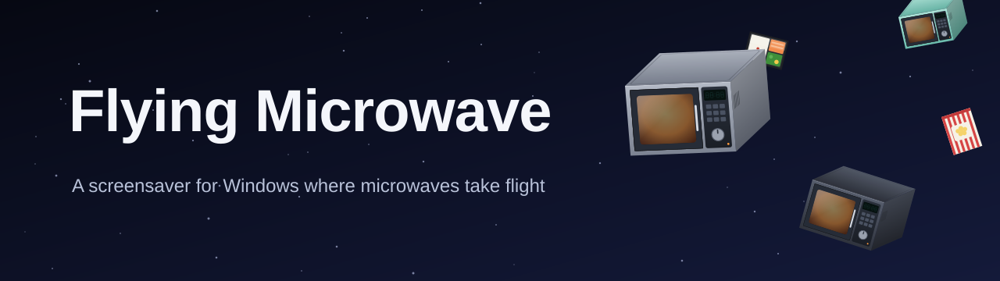

# Flying Microwave

電子レンジが画面を飛び回る、Windows用のスクリーンセーバー。昔の、家電が空を飛ぶスクリーンセーバーに着想を得た独自の作品で、それらの再現や移植ではない。

- 対象: Windows 11(x64)
- 入手: [GitHubのReleases](https://github.com/suchi/flying-microwave/releases)。インストールの手順と既知の制限は、zipに同梱する[利用者向けREADME](packaging/windows/README.md)とリリースノートにある。
- 脆弱性の報告: [セキュリティポリシー](SECURITY.md)

## 開発

- [開発参加者向けオンボーディング](docs/development/onboarding.md)
- [AGENTS.md](AGENTS.md): 開発の規則
- [docs/](docs/README.md): 計画、設計、判断の記録(ADR)

## ライセンス

[MIT](LICENSE)

## 免責

このプロダクトは、AIコーディングエージェントが実装の多くを担うAgentic Codingで開発している。コードはレビューと自動テストを経ているが、すべてのコードの細部まで人が把握しているわけではない。本ソフトウェアは現状のまま提供するもので、利用によって生じたいかなる損害についても、作者および著作権者は責任を負わない。法的な条件は[MITライセンス](LICENSE)が定める。
