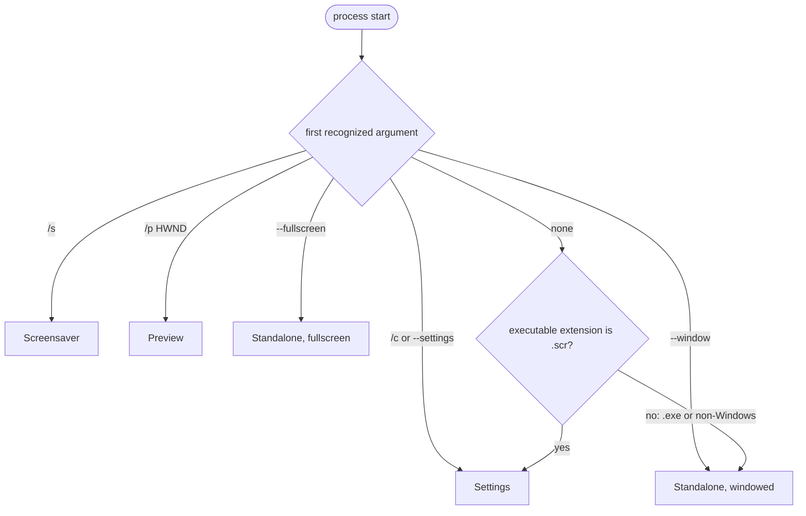

# ADR-0012: 単独アプリとしてウィンドウ・全画面でも実行できる設計にする

- ステータス: 採用
- 日付: 2026-10-31

## 背景

本アプリはスクリーンセーバーとして動くだけでなく、単独のアプリケーションとして、ウィンドウまたは全画面でも実行できるようにしたい。実装は後のフェーズでもよいが、設計は最初からそれを見込んでおく必要がある。

- 開発での利点: 開発中の動作確認に役立つ。
- 移植での利点: 将来のLinux版・macOS版では、OSのスクリーンセーバーとの統合が不要な単独アプリとして動かすのが、自然な最初の一歩になる([アーキテクチャのクロスプラットフォームの方針](../design/architecture.md#クロスプラットフォームの方針))。
- Windowsの規約: スクリーンセーバーを単体のアプリとして実行するには`.exe`拡張子が必要で、コントロールパネルから実行されるには`.scr`拡張子が必要である([Microsoft Learn「Handling Screen Savers」][MS-2])。引数なしでは設定ダイアログを表示することになっている([Microsoft Learn「Command-line arguments for Screen Savers」][MS-1])。

それまでの設計は、引数なしを常に設定画面としていた。メンテナーが2026-10-31にこの設計を拡張すると決定した。

## 決定

### 起動モード

起動モードは、Screensaver(`/s`)、Preview(`/p`)、Settings(`/c`または引数なし)、Standalone(ウィンドウまたは全画面)の4つとする。

- 長いオプション: `--window`、`--fullscreen`、`--settings`を用意する。実行ファイルの名前によらず動作する。
- 判定の順序: 最初に認識できた引数がモードを決める。引数解析の詳細な規則(認識できない引数の扱いなど)は[アーキテクチャの起動モードの判定](../design/architecture.md#起動モードの判定)に従う。
- 引数なしの場合: 実行ファイルの拡張子が`.scr`ならSettingsを表示する(Microsoftのスクリーンセーバーの規約に従う)。それ以外(`.exe`、またはWindows以外のプラットフォーム)ならStandaloneのウィンドウ表示で起動する。

### Standaloneの動作

- 終了: 入力では終了しない。ウィンドウを閉じると終了する。
- 全画面: F11で全画面を切り替え、Escで全画面を終了する。全画面は現在のモニタだけを覆う。
- カーソル: ウィンドウ表示では表示したままにする。
- 多重起動: 制限しない(Screensaverの単一起動とは異なる)。

### 構造

モードごとの「表示方針」(どのウィンドウを作るか、全モニタを黒で覆うか、カーソルの扱い、終了方針)を、共通のシミュレーションと描画から分離する。これにより、Standaloneを後から追加しても構造を作り直さずに済む。シミュレーションと終了判定は[ADR-0009](0009-cargo-workspace-core-and-app.md)の`core`に置き、表示方針は`app`に置く。

### 実装時期と配布形態

- 実装時期: Phase 1では実装しない。実装の時期は後で計画する(開発の補助として前倒しすることもある)。
- 配布形態: 同じバイナリを`.scr`と`.exe`の両方で配布するか、`.exe`のみとして手順を案内するかは、実装時に決める。

### 検討した選択肢と採用しなかった理由

- 従来の設計(引数なしは常に設定画面): 規約どおりで単純だが、`.exe`をそのまま実行しても設定画面しか出ず、単独のアプリとして実行できない。
- Standaloneを設計の対象外にする: 実装の手間はないが、開発での確認や他OSへの展開の際に、表示方針をシミュレーション・描画から分離し直す構造変更が必要になる。

## 結果

- メリット:
  - 開発中に、スクリーンセーバーの起動条件に頼らずに動作を確認できる。
  - 将来のLinux版・macOS版を、OSのスクリーンセーバー統合の前に、単独アプリとして提供できる。
  - 表示方針を分離することで、各モードの責務が明確になる。
- デメリット・受け入れたトレードオフ:
  - 引数なしの動作が、拡張子(`.scr`か`.exe`か)によって変わり、利用者には分かりにくい。
  - 引数なしを常に設定画面とする前提で書かれていた文書(実装計画のF-04、仕様調査のW-2、アーキテクチャの起動モードの判定)は、この決定に合わせて更新した。
  - Phase 1から表示方針を分離した構造にするため、初期の実装がやや増える。
  - 配布形態が未決である。単体アプリとして実行するには`.exe`拡張子が必要とMicrosoftが記載しているため、`.exe`も用意するか、手順を案内する必要がある。
- 将来の見直し条件:
  - 実装時に、`.scr`と`.exe`の配布形態を決めるとき。
  - 引数なしの拡張子による分岐が、利用者の混乱を招くと分かったとき。
  - Standaloneの追加で、表示方針の分離が不十分と分かったとき。

[MS-1]: https://learn.microsoft.com/en-us/previous-versions/troubleshoot/windows/win32/screen-saver-command-line
[MS-2]: https://learn.microsoft.com/en-us/windows/win32/lwef/screen-saver-library
