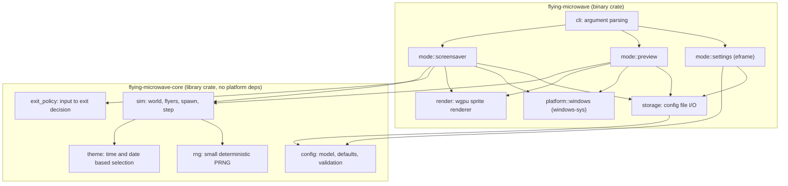
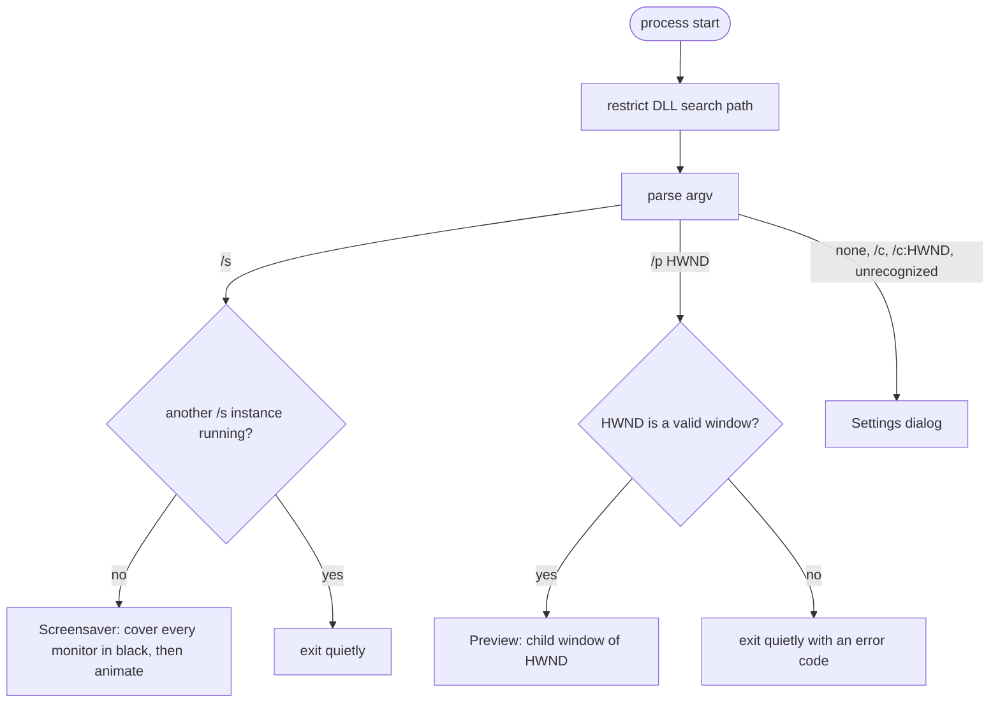
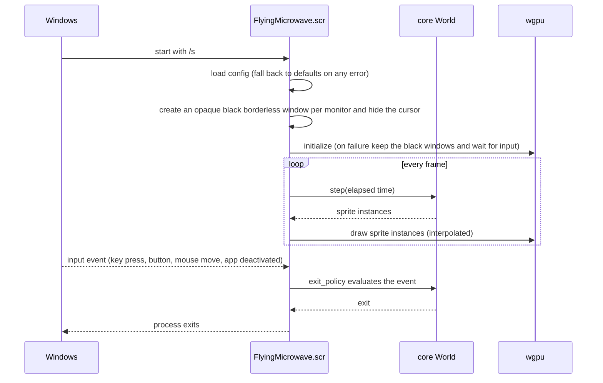

# アーキテクチャ(提案)

- 作成日: 2026-10-31
- ステータス: 提案。[言語・エコシステムの比較検討](../research/tech-stack.md)の推奨案(Rust + winit + wgpu + eframe)を前提とする。技術選定の承認後に確定し、主要な判断はADRに記録する。
- 関連: [実装計画](../plans/0001-initial-implementation-plan.md)、[設定項目仕様](settings.md)、[ビジュアルデザイン方針](visual-design.md)

## 設計原則

| ID | 原則 | 理由 |
| --- | --- | --- |
| A-1 | プラットフォームに依存しないロジック(シミュレーション・設定モデル・テーマ選択・終了判定)を`core`に分離する | 将来のLinux版・macOS版で再利用し、Linux上でも単体テストできるようにする |
| A-2 | プラットフォーム固有コードは`platform`モジュールに閉じ込める。ただし2つ目のOSに着手するまで抽象化(trait)は作らない | 移植性の確保とYAGNIの両立 |
| A-3 | シミュレーションは決定的にする(固定タイムステップ、自前の乱数生成器とシード、時刻の注入) | TDDで再現性のあるテストを書くため |
| A-4 | ネットワーク通信を一切行わない | プライバシーと安全性。スクリーンセーバーに通信は不要 |
| A-5 | `/s`・`/p`の実行中は設定ファイルに書き込まない | 放置中に動くプロセスの副作用を最小にする |
| A-6 | 外部入力(引数・設定ファイル)は検証し、不正でもクラッシュせず既定値で動く | AGENTS.mdのセキュリティ方針、仕様調査のW-6・W-7 |
| A-7 | `app`クレートもLinuxでビルドできる状態を保つ(Windows固有部分は`cfg`で分岐する) | エージェントのLinux環境でもコミット前にビルド・リントを実行できるようにするため。将来の移植の準備にもなる |

## 構成要素

## crate・ディレクトリ構成

Cargoワークスペースで2つのcrateに分ける。描画モジュールも将来は独立crateにできるが、必要になるまで分けない。

| パス | 内容 |
| --- | --- |
| `Cargo.toml` | ワークスペース定義、共通のlint設定 |
| `rust-toolchain.toml` | Rustツールチェーンのバージョン固定 |
| `.cargo/config.toml` | Windowsターゲットの`+crt-static`などビルド設定 |
| `crates/core/` | `flying-microwave-core`。OS・GPUに依存しない純粋なロジック |
| `crates/app/` | `flying-microwave`。実行ファイル(起動モード、描画、設定画面、設定ファイル入出力、プラットフォーム固有処理) |
| `crates/app/build.rs` | Windowsリソース(アイコン、バージョン情報、String Tableの序数1)の埋め込み |
| `assets/sprites/` | SVG素材と、作者・ライセンスを記録する`README.md`(Phase 3から) |
| `spikes/` | Phase 0の技術スパイク。ワークスペースには含めず、製品コードから参照しない(Phase 0の終了時に削除するか残すかを決める) |

crate名はPhase 0で作るため、製品名(実装計画のD-5)をPhase 0の開始前に決める。

## 起動モードの判定

winit 0.30.13は1プロセスにつきイベントループを1つしか作れない([言語・エコシステムの比較検討](../research/tech-stack.md))。そのため、起動モードの判定はイベントループを作る前に行い、モードごとに1つのループだけを使う。設定画面の中にプレビューや開発者表示を出す場合も、eframeのループの中で描く。

引数解析の規則(Phase 1でテストから先に書く):

| 入力例 | 結果 | 備考 |
| --- | --- | --- |
| (なし) | Settings(オーナーなし) | [MS-1] |
| `/c` | Settings(前面のウィンドウをオーナーにする) | [MS-1]。前面のウィンドウは取得後に有効なウィンドウか検証する |
| `/c:1234`、`/c 1234` | Settings(オーナーHWND 1234) | 形式はスパイクS3で確認 |
| `/p 1234`、`/p:1234` | Preview(親HWND 1234) | [MS-1]。HWNDは符号なし10進数 |
| `/p`(HWNDなし)、`/p abc` | Settings(オーナーなし) | 誤って全画面にしない |
| `/s`、`/S`、`-s` | Screensaver | 大文字小文字・ハイフンを許容 |
| 認識した引数の後に続く余分な引数(`/s extra`、`/p 1234 extra`など) | 余分な引数を無視する | 隠しの起動オプション(アイデアE-12)を採用する場合は、この表に追加する |
| 上記以外 | Settings(オーナーなし) | 仕様調査のW-8 |

多重起動: `/s`は名前付きミューテックスで単一起動にし、既に動いている場合は静かに終了する(「プレビュー」ボタンと待ち時間による起動が重なる場合など)。`/p`はプレビュー枠ごとに独立して動かす。

## スクリーンセーバー実行時(`/s`)の流れ

## シミュレーション(core)

- 座標系: 画面の高さを1.0とする論理座標を使う。幅は縦横比に応じて変わる。大きさと速度を高さ基準で表すため、小さなプレビュー枠でも4K全画面でも同じ見た目になる。
- 時間の進め方: 固定タイムステップ(例: 1/120秒)で状態を更新し、実時間の経過分を積算して必要な回数だけ進める。スリープ復帰などで大きな経過時間が来た場合は上限で切り詰める。
- 補間: 描画時は直前と現在の状態を経過時間の端数で補間する。固定タイムステップとモニタのリフレッシュレート(144Hz、165Hzなど)が合わないときのカクつきを防ぐため。
- 飛行物体(flyer): 電子レンジと食べ物を同じ構造で表す(種類、位置、速度、奥行き、アニメーションの位相)。画面の上辺・右辺の外側から出現し、左下方向へ飛び、画面外に完全に出たら再出現させて数を保つ。
- 乱数: `core`内の小さな乱数生成器(SplitMix64など)を使う。外部crateの出力列の変化でテストが壊れないようにするため。テストでは固定シード、実行時は起動時刻などから生成する。
- 時刻: 現在時刻はインターフェースとして注入し、テストでは任意の日時を与える(時計表示・季節テーマのテストのため)。
- 出力: 描画に必要な情報だけを持つスプライトインスタンス(素材ID、アニメーションフレーム、位置、拡大率、奥行き)の列を返す。coreは画素やGPUを知らない。

## 描画

- Phase 1・2は仮素材(単純な図形)をwgpuで直接描く。Phase 3からSVG素材を起動時に表示サイズとDPIに合った解像度でラスタライズし、1枚のテクスチャアトラスにまとめる。
- スプライトはインスタンス描画で一括して描く(四角形1種類 + インスタンスごとの位置・拡大率・UV)。
- 奥行き(depth)の順に並べて描き、奥のものほど小さく遅くすることで立体感を出す(Phase 3)。
- フレームレートは垂直同期を基本とし、設定の上限値で間引く。
- GPUアダプタは省電力を優先して選ぶ(ハイブリッドGPU環境で外部GPUを起こさないため)。GPUが使えない場合の扱い(DX12のWARPへのフォールバックなど)はスパイクS6の結果で決める。
- ディスプレイの電源が切れている間は描画を止める(電源設定の通知でディスプレイの状態を受け取る。Phase 3まで)。

## 入力と終了判定

| モード | 終了する条件 | 無視する入力 |
| --- | --- | --- |
| Screensaver | キーの押下、マウスボタン、ホイール、タッチ・ペン、起動時の位置から閾値以上のカーソル移動、アプリ全体の非アクティブ化、ウィンドウを閉じる要求 | キーの解放、合成されたキーイベント、閾値未満のカーソル移動、自アプリのウィンドウ間のフォーカス移動、起動直後の猶予時間内の移動とフォーカス変化 |
| Preview | 親ウィンドウが無効になった(定期的に確認する)、自ウィンドウが破棄された | すべての入力 |
| Settings | 通常のウィンドウとして閉じたとき | - |

複数モニタでの注意点(レビュー指摘を受けてwinit 0.30.13のソースで確認):

- winitのウィンドウは既定で作成時にアクティブになる(`WindowAttributes`の`active`の既定値がtrue)。モニタごとにウィンドウを作ると、作るたびに直前のウィンドウがフォーカスを失う。ウィンドウ単位の「フォーカス喪失で終了」にすると起動直後に終了してしまうため、終了条件は「自アプリのどのウィンドウにもフォーカスがない状態」とする。
- フォーカスの移動に伴ってwinitは押下中のキーの合成イベント(`is_synthetic`)を生成するため、合成イベントは無視する。
- 「プレビュー」ボタンをEnterキーで押した場合、キーの解放イベントが起動直後に届きうるため、キーは押下だけを終了条件にする。
- カーソル位置はウィンドウ相対の座標ではなく、スクリーン座標(物理ピクセル)で判定する。モニタをまたいだ移動でも同じ基準で比べるため。閾値は[設定項目仕様](settings.md)の`input.exit_sensitivity`で決める。

終了判定は`core::exit_policy`に純粋関数として実装し、イベントの列に対する判定結果をテストする。上の表と注意点の各項目をテストケースにする。

## マルチモニタ

- Phase 1では、モニタごとに全画面ウィンドウを作り、それぞれ独立したシミュレーションを動かす。どのウィンドウで終了条件を満たしても全体を終了する。
- 実行中にモニタが追加・変更された場合も、すべてのモニタを覆う(仕様調査のW-10。Phase 2)。
- DPIの異なるモニタが混在しても論理座標で同じ見た目になる。winit 0.30.13はWindowsでイベントループの生成時にモニタごとのDPI対応(`DPI_AWARENESS_CONTEXT_PER_MONITOR_AWARE_V2`)を設定する(ソースで確認)。実機での見え方はスパイクS4で確認する。
- モニタをまたいで電子レンジが飛ぶ演出は将来のアイデアとする([将来のオプションのアイデア](../ideas/future-options.md))。

## 設定の保存

- 設定はTOMLファイルとしてユーザーごとの設定ディレクトリに保存する(推奨案。保存形式・場所はPhase 2の着手前にADRで決定する)。
- 書き込みは一時ファイルに書いてから置き換える。`/s`が書きかけのファイルを読まないようにするため。
- 項目・範囲・既定値・検証規則は[設定項目仕様](settings.md)に定める。

## セキュリティ

| ID | 対策 | 理由 |
| --- | --- | --- |
| SEC-1 | 起動直後にDLLの検索パスをシステムディレクトリに制限する(`SetDefaultDllDirectories`)。読み込み時の依存DLLにも同じ制限をかけるリンカ設定(`/DEPENDENTLOADFLAG`)を使う | `.scr`は任意のフォルダに置かれて自動実行される。wgpu-halは`d3d12.dll`などをパスなしの名前で読み込む(仕様調査のW-11)。APIとリンカ設定の詳細はPhase 1で公式ドキュメントを確認してから適用する |
| SEC-2 | wgpuのDX12シェーダーコンパイラを`Fxc`に明示し、使うバックエンドも明示する | 既定値の`Auto`は`dxcompiler.dll`の読み込みを先に試すため |
| SEC-3 | 引数のHWNDと前面のウィンドウは、有効なウィンドウかを確認してから使う | 仕様調査のW-6 |
| SEC-4 | 設定ファイルはサイズの上限を設け、すべての値を検証する | A-6 |
| SEC-5 | ネットワーク通信を行わない | A-4 |

セキュリティに影響する変更(上記の対策の追加・変更)は、AGENTS.mdに従いPR本文で明示する。

## エラー処理とログ

- 実行ファイルはコンソールウィンドウを出さない設定(Windowsのサブシステム指定)でビルドする。
- `/s`・`/p`ではエラーダイアログを表示しない。
- `/s`で描画の初期化に失敗した場合は、黒い全画面を表示したまま入力を待つ(W-9)。すぐに終了すると、画面を隠す目的を果たせず、再開時にロックする設定の環境では直後にロック画面になるため。
- `/p`で初期化に失敗した場合は静かに終了する。
- ログは既定で出力しない。調査用に有効化する手段(環境変数または設定キー)をPhase 1で決める。

## クロスプラットフォームの方針

Windows版の実装中は、以下を「将来の移植を妨げない」ための確認材料として扱い、実装はしない。

| OS | スクリーンセーバーの仕組み | 想定する対応 |
| --- | --- | --- |
| Windows | `.scr`実行ファイルと引数`/s`・`/p`・`/c` [MS-1] | 本計画の対象 |
| Linux(X11) | XScreenSaverは描画先のウィンドウIDを環境変数`XSCREENSAVER_WINDOW`でサブプログラムに渡す [XSS-1] | winitの`with_parent_window`はX11の子ウィンドウにも対応している(ソースで確認)。XScreenSaverの「hack」として動かす方式を要調査 |
| Linux(Wayland) | 要調査 | 要調査 |
| macOS | `ScreenSaverView`のサブクラスを含む`.saver`バンドル [APL-1] | `core`と描画をライブラリとしてビルドし、Swift等の薄いラッパーから呼ぶ方式を要調査 |

## 参考資料

- [MS-1] Microsoft Learn「Command-line arguments for Screen Savers」(KB182383)
- [XSS-1] XScreenSaver Manual(検索結果の要約で確認。本文の該当箇所は未取得)
- [APL-1] Apple Developer Documentation「ScreenSaverView」(検索結果の要約で確認)

[MS-1]: https://learn.microsoft.com/en-us/previous-versions/troubleshoot/windows/win32/screen-saver-command-line
[XSS-1]: https://www.jwz.org/xscreensaver/man1.html
[APL-1]: https://developer.apple.com/documentation/screensaver/screensaverview
