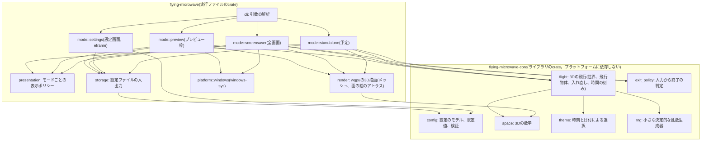
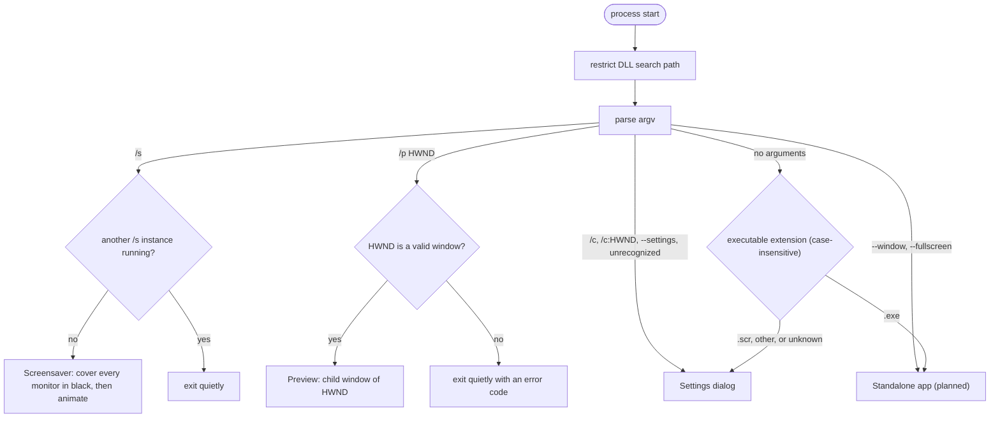
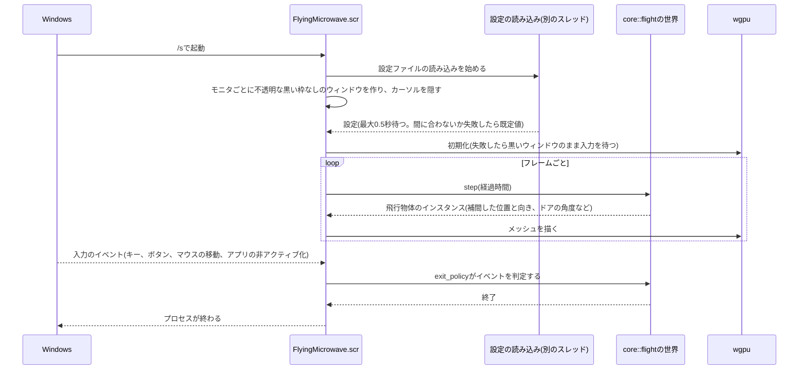

# アーキテクチャ

- 作成日: 2026-10-31
- ステータス: 採用(2026-10-31)。主要な判断は[ADR](../adr/README.md)に記録した(ADR-0001〜0004、0009、0010、0012)。技術スパイクの結果によって更新することがある。
- 関連: [実装計画](../plans/0001-initial-implementation-plan.md)、[設定項目仕様](settings.md)、[ビジュアルデザイン方針](visual-design.md)

## 設計原則

| ID | 原則 | 理由 |
| --- | --- | --- |
| A-1 | プラットフォームに依存しないロジック(シミュレーション・設定モデル・テーマ選択・終了判定)を`core`に分離する | 将来のLinux版・macOS版で再利用し、Linux上でも単体テストできるようにする |
| A-2 | プラットフォーム固有コードは`platform`モジュールに閉じ込める。ただし2つ目のOSに着手するまで抽象化(trait)は作らない。Phase 1の時点では、Windowsの処理は`win.rs`にまとめ、`platform`モジュールへの整理は2つ目のOSに着手するときに行う(計画のD-27) | 移植性の確保とYAGNIの両立 |
| A-3 | シミュレーションは決定的にする(固定タイムステップ、自前の乱数生成器とシード、時刻の注入) | TDDで再現性のあるテストを書くため |
| A-4 | ネットワーク通信を一切行わない | プライバシーと安全性。スクリーンセーバーに通信は不要 |
| A-5 | `/s`・`/p`の実行中は設定ファイルに書き込まない | 放置中に動くプロセスの副作用を最小にする |
| A-6 | 外部入力(引数・設定ファイル)は検証し、不正でもクラッシュせず既定値で動く | AGENTS.mdのセキュリティ方針、仕様調査のW-6・W-7 |
| A-7 | `app`クレートもLinuxでビルドできる状態を保つ(Windows固有部分は`cfg`で分岐する) | エージェントのLinux環境でもコミット前にビルド・リントを実行できるようにするため。将来の移植の準備にもなる |
| A-8 | 実行モードごとの振る舞い(作るウィンドウ、全モニタを黒で覆うか、カーソル、終了判定)を「表示ポリシー」として分け、シミュレーションと描画は全モードで共有する。Phase 1の時点では、終了判定だけを`core::exit_policy`のモードで分け、ウィンドウの作り方は`saver.rs`と`preview.rs`にある。表示ポリシーへの整理は、単独アプリ(F-12)に着手するときに行う(計画のD-27) | スクリーンセーバー以外に、単独アプリ(ウィンドウ・全画面)としても実行できるようにするため([ADR-0012](../adr/0012-standalone-app-mode.md)) |

## 構成要素

次の図は、目標とする構成である。いまの実際の構成(`cli.rs`、`saver.rs`、`preview.rs`、`render.rs`、`model.rs`、`atlas.rs`、`settings.rs`、`storage.rs`、`licenses.rs`、`win.rs`、`log.rs`、`diag.rs`、`gpu_limit.rs`、`display_power.rs`と、coreの`config.rs`、`exit_policy.rs`、`frame_loop.rs`、`pacing.rs`、`monitors.rs`、`rng.rs`、`sim.rs`、`space.rs`、`flight.rs`、`clock.rs`)との違いは、上のA-2とA-8と、計画のD-27を参照。

## crate・ディレクトリ構成

製品は、Cargoワークスペースの2つのcrate(`core`と`app`)に分ける([ADR-0009](../adr/0009-cargo-workspace-core-and-app.md))。ほかに、製品に含めないテスト用のcrate(`smoke`)がある([計画0003](../plans/0003-v0.1.1-smoke-test.md)のD-1)。描画モジュールも将来は独立crateにできるが、必要になるまで分けない。

| パス | 内容 |
| --- | --- |
| `Cargo.toml` | ワークスペース定義、共通のlint設定 |
| `rust-toolchain.toml` | Rustツールチェーンのバージョン固定 |
| `.cargo/config.toml` | Windowsターゲットの`+crt-static`などビルド設定 |
| `crates/core/` | `flying-microwave-core`。OS・GPUに依存しない純粋なロジック |
| `crates/app/` | `flying-microwave`。実行ファイル(起動モード、描画、設定画面、設定ファイル入出力、プラットフォーム固有処理) |
| `crates/app/src/diag.rs` | 診断用のログで、ウィンドウごとの毎フレームの出来事(描こうとしたこと、描画のスキップ)を最初の数回だけ書くための判定と、終了のときに書く回数のまとめ(Issue #50の切り分け)。Windowsに依存しない |
| `crates/app/src/licenses.rs` | 設定画面のAboutに表示する、依存ライブラリのライセンス表記(`THIRD-PARTY-LICENSES.txt`)の読み込み。Windowsに依存しない |
| `crates/core/src/monitors.rs` | `/s`の実行中のモニタの一覧の比較(増えた・位置や大きさが変わった・なくなったを求める)と、それに基づくウィンドウの決め方(既知のモニタとウィンドウの対応、描くウィンドウ、閉じるウィンドウ、前面にするウィンドウ)。Windowsに依存しない純粋な関数 |
| `crates/core/src/frame_loop.rs` | `/s`のイベントループが1回の処理のあとどう待つか(待たない・時刻まで待つ・イベントまで待つ)を決める。終了が決まっていれば待たない(winitがWindowsで、終了を確かめる前にこの待ち方で待つため)。Windowsに依存しない純粋な関数([ADR-0025](../adr/0025-draw-every-window-from-one-place.md)) |
| `crates/core/src/space.rs` | 3Dの数学(ベクトル、四元数、4x4行列、透視投影)。数学のcrateは使わない([ADR-0026](../adr/0026-render-microwaves-as-3d-meshes.md)) |
| `crates/core/src/flight.rs` | 3Dの飛行の計算(奥行きのある位置、回転して飛ぶ表現と同じ向きで飛ぶ表現、ドアの角度、ターンテーブルの位相、入れ直し、固定の時間刻みと補間) |
| `crates/core/src/clock.rs` | LEDの時計: ローカル時刻と設定(24時間・12時間、オン・オフ)から、光らせる画のビット列を求める。時刻は注入する(計画0005のF-06、D-16) |
| `crates/core/src/sim.rs` | 飛行の計算とほかの部分が共有する定数と型(時間の刻み、1回に進める時間の上限、設定の倍率`SimParams`、本体の色の数)。v0.2.0の2Dのシミュレーションは、計画0005の作業6で3Dに移したときに削除した |
| `crates/app/src/model.rs` | 3Dの電子レンジ: 面の絵のシートの中の位置、手で書いたメッシュ(本体の箱、ドア、ターンテーブル)、機体ごとの行列、光、ドアのガラスを描く順番。Windowsに依存しない([ADR-0026](../adr/0026-render-microwaves-as-3d-meshes.md)) |
| `crates/app/src/atlas.rs` | 面の絵のテクスチャアトラス(詰め方、縁の繰り返し、ミップマップ)。ラスタライズ(resvg)のほかはWindowsに依存しない |
| `crates/app/src/gpu_limit.rs` | GPUの初期化の上限の状態(発火か解除のどちらかへ一度だけ移る)と、設定画面で上限に達したときの処理の順番。Windowsに依存しない部分([計画0005](../plans/0005-v0.3.0-visuals-and-clock.md)のD-1) |
| `crates/app/src/display_power.rs` | ディスプレイの電源の状態の受け渡し(通知の値の読み取り)。Windowsに依存しない部分。登録は`win.rs`(計画0005のD-8) |
| `crates/app/build.rs` | Windowsリソース(アイコン、バージョン情報、String Tableの序数1)の埋め込み。バージョン情報は`Cargo.toml`のバージョンから生成する |
| `crates/smoke/` | `flying-microwave-smoke`。ビルドした実行ファイルを各モードで起動し、起動と終了を確かめるスモークテスト(Windows専用。[計画0003](../plans/0003-v0.1.1-smoke-test.md))。製品には含めない |
| `crates/app/res/` | リソース定義ファイル(`app.rc`)と、アイコン(`icon.svg`と、そこから作る`flying-microwave.ico`) |
| `assets/sprites/` | SVG素材(面の絵のシート)と、作者・ライセンスを記録する`README.md`(v0.2.0の試作版から。v0.3.0から3Dの面の絵。[ADR-0026](../adr/0026-render-microwaves-as-3d-meshes.md)) |

crate名は製品名(実装計画のD-5)に合わせて`flying-microwave-core`・`flying-microwave`とする。

## 起動モードの判定

winit 0.30.13は1プロセスにつきイベントループを1つしか作れない([言語・エコシステムの比較検討](../research/tech-stack.md))。そのため、起動モードの判定はイベントループを作る前に行い、モードごとに1つのループだけを使う。設定画面の中にプレビューや開発者表示を出す場合も、eframeのループの中で描く。

引数解析の規則(Phase 1でテストから先に書く):

| 入力例 | 結果 | 備考 |
| --- | --- | --- |
| (なし)、実行ファイルの拡張子が`.scr` | Settings(オーナーなし) | [MS-1] |
| (なし)、実行ファイルの拡張子が`.exe` | Standalone(ウィンドウ) | 単独アプリとして実行するには`.exe`拡張子が必要とされる[MS-2]。拡張子は実行中のファイルのパス(`std::env::current_exe()`)から取得し、大文字小文字を区別せずに比べる。実装は後のフェーズ([ADR-0012](../adr/0012-standalone-app-mode.md)) |
| (なし)、拡張子を取得できない、またはそれ以外の拡張子 | Settings(オーナーなし) | 安全側に倒す。Windows以外での扱いは移植時に決める |
| `--window`、`--fullscreen` | Standalone(ウィンドウ、全画面) | 実行ファイルの名前によらず有効。実装は後のフェーズ |
| `--settings` | Settings(オーナーなし) | 実行ファイルの名前によらず有効。長いオプションは完全一致で判定し、`/s`・`-s`と取り違えない(テストケースにする) |
| `/c` | Settings(前面のウィンドウをオーナーにする) | [MS-1]。前面のウィンドウは取得後に有効なウィンドウか検証する |
| `/c:1234`、`/c 1234` | Settings(オーナーHWND 1234) | 形式はスパイクS3で確認 |
| `/p 1234`、`/p:1234` | Preview(親HWND 1234) | [MS-1]。HWNDは符号なし10進数 |
| `/p`(HWNDなし)、`/p abc` | Settings(オーナーなし) | 誤って全画面にしない |
| `/s`、`/S`、`-s` | Screensaver | 大文字小文字・ハイフンを許容 |
| 2番目以降の余分な引数(`/s extra`、`/p 1234 extra`など) | 余分な引数を無視する。最初の引数がモードを決める | 隠しの起動オプション(アイデアE-12)を採用する場合は、この表に追加する |
| 最初の引数を認識できない(`foo /s`、`.exe`に`foo`を付けた場合など) | Settings(オーナーなし) | 2番目以降に`/s`があっても全画面にしない(W-8) |
| 上記以外 | Settings(オーナーなし) | 仕様調査のW-8 |

多重起動: `/s`は名前付きミューテックスで単一起動にし、既に実行中の場合は静かに終了する(「プレビュー」ボタンと待ち時間による起動が重なる場合など)。`/p`はプレビュー枠ごとに独立して実行する。

## スクリーンセーバー実行時(`/s`)の流れ

## シミュレーション(core)

3Dの飛行の計算は`core::flight`にある([ADR-0026](../adr/0026-render-microwaves-as-3d-meshes.md)、[計画0005](../plans/0005-v0.3.0-visuals-and-clock.md)のD-12)。v0.2.0の2Dのシミュレーション([ADR-0023](../adr/0023-svg-sprites-from-v0.2.0.md))は、計画0005の作業6で描画を3Dに移したときに削除した。

- 座標系: カメラの空間(カメラが原点にあり、-zの向きを見る。yが上)を使う。単位は本体の高さで、本体は幅1.5、高さ1.0、奥行き1.3125である。画面の大きさによらず、縦の視野角で見え方が決まるため、小さなプレビュー枠でも4K全画面でも同じ見た目になる。
- 時間の進め方: 固定タイムステップ(1/120秒)で状態を更新し、実時間の経過分を積算して必要な回数だけ進める。スリープ復帰などで大きな経過時間が来た場合は、0.25秒で切り詰める。
- 補間: 描画時は直前と現在の状態を経過時間の端数で補間する(位置は線形に、回転、ドアの羽ばたき、ターンテーブルは位相を補間する)。固定タイムステップとモニタのリフレッシュレート(144Hz、165Hzなど)が合わないときに、動きがぎこちなく見えるのを防ぐため。
- 飛行物体(flyer): 電子レンジと、食べ物(弁当、ポップコーンの袋、マグカップ、肉まん。計画0005のD-17)がある。食べ物は、電子レンジのあとに`flight.food_count`の数だけ並び、電子レンジと同じ飛び方(奥行き、速さ、回転、入れ直し)をする。種類は、出現と再出現のときに乱数で選ぶ。奥行き(カメラからの距離)を保ったまま、右上から左下へ(左に2、下に1の割合で)飛ぶ。速さは奥行きによらず同じなので、遠いものほど小さく遅く見える(F-08)。回転して飛ぶ表現では、機体ごとに違う軸と速さで回る。同じ向きで飛ぶ表現では、全機を同じ向きにし、カメラから機体への向きに合わせて補正する(計画0005のD-10)。機体を囲む球(半径1.75×大きさの倍率。食べ物も同じ半径を使う)が視野の外に出たら、上辺か右辺から入れ直して数を保つ。描画のメッシュは、この球の中に収める(`crates/app/src/model.rs`のテストで確かめる)。
- 乱数: `core`内の小さな乱数生成器(SplitMix64)を使う。外部crateの出力列の変化でテストが壊れないようにするため。テストでは固定シード、実行時は起動時刻などから生成する。
- 時刻: 現在時刻はインターフェースとして注入し、テストでは任意の日時を与える(時計表示・季節テーマのテストのため)。
- 出力: 描画に必要な情報だけを持つ飛行物体のインスタンス(位置、向き、大きさの倍率、ドアの角度、ターンテーブルの位相、本体の色の番号、種類)の列を返す。coreは画素やGPUを知らない。

見た目の値(視野角、奥行きの範囲、回転と飛ぶ速さ)は、スパイクで置いた出発点の値で、`v0.3.0-alpha.2`で動きを見てメンテナーが決める(計画0005のE-1。値は`crates/core/src/flight.rs`と[ADR-0026](../adr/0026-render-microwaves-as-3d-meshes.md)の「見た目の値」)。ドアの羽ばたきの位相(1秒に1.2〜1.8回)、本体の色、回転は、出現と再出現のときに乱数で決め、シミュレーションは決定的のままにする。再出現した飛行物体は、補間の始点も再出現の位置にする(画面を横切る残像を出さないため)。

## 描画

- v0.3.0から、電子レンジを箱のメッシュで3Dに描く([ADR-0026](../adr/0026-render-microwaves-as-3d-meshes.md)。`crates/app/src/model.rs`、`render.rs`、WGSLのシェーダー`mesh.wgsl`)。食べ物も、手で書いたメッシュ(弁当と袋は箱、マグカップは円柱と取っ手、肉まんはつぶれた半球)で描く(計画0005のD-17)。面の絵は、`assets/sprites/`のSVGのシートから、最初のサーフェスを用意するときに決まった大きさでラスタライズし、ミップマップ付きの1枚のテクスチャアトラス(4096×2080、5段、約45MB。高い面から行に詰める)にまとめる(`atlas.rs`)。アトラスとメッシュは全ウィンドウで共有し、毎フレームのラスタライズはしない(計画0005のD-13)。v0.2.0は、2Dのスプライトを、表示の大きさに合った解像度でラスタライズして描いていた([ADR-0023](../adr/0023-svg-sprites-from-v0.2.0.md))。Phase 1と`v0.1.x`は、仮素材の四角を、バッファからテクスチャへのコピーで描いていた(計画のD-27)。
- 1フレームの描き方: 背景の色と深度バッファ(Depth32Float)を消し、全機の不透明な部分を、深度を書いて描く。本体(庫内とLEDを含む)、ターンテーブル、食べ物は、絵が端まで不透明なので、テクセルのアルファで捨てずに描く。ドアは、不透明なテクセルだけを描く。次に、ドアの窓のガラスを、奥のものから順に、深度を書かずに乗算済みのアルファで重ねる。機体ごとに本体、ドア、ターンテーブルの3つの行列をインスタンスのデータとして渡す。食べ物は、本体の行列でその種類のメッシュを描き、ドア、ターンテーブル、ガラスは描かない。光は、カメラの空間の平行光源とアンビエントで、明るさを0.55〜1.00に収める(ガイドラインG-3)。庫内、ターンテーブル、LEDは光の影響を受けない。ドアは、正面の左の縦の辺(ヒンジ)の軸の回りに0°〜70°回して開閉させる。LEDの時計は、すべての画が消えた絵の上で、LEDの板の画素ごとに、どの画の上にあるかをシェーダーで計算し、光っている画を光らせる。画の縁は画素の大きさに合わせてなめらかにする(遠くの小さなLEDでも、画が途切れずに薄くなる)。どの画を光らせるかは、ローカル時刻(`GetLocalTime`)から`core::clock`が求めるビット列で、共通のデータ(uniform)で全機に渡し、変わったときだけ書く。画の位置の表(`model.rs`の`led_segments`)も、共通のデータで渡す。LEDの絵を描き直さずに、分の変化とコロンの点滅(1秒ごと)を表せる(計画0005のD-16)。
- 縁: MSAAは使わない。縁の見た目は`v0.3.0-alpha.2`でメンテナーが判断する。異方性フィルタは、アダプターが対応していれば8倍で使う(計画0005のD-13)。
- 描画の準備(アトラス、メッシュ、パイプライン、深度バッファ)に失敗したときは、ログに書いて背景だけを描き続ける。
- フレームレートは垂直同期を基本とし、設定の上限値で間引く。
- GPUアダプタは省電力を優先して選ぶ(ハイブリッドGPU環境で外部GPUを省電力の状態から復帰させないため)。GPUが使えない場合は、wgpuがDX12のWARP(ソフトウェアの描画)を選ぶ想定である。CIのGPUのないランナーでは、製品がWARPを自動で選んで描画できた(スパイクS6の結果は[spike-results.md](../research/spike-results.md)。実機のWindows Sandboxでの確認は、v0.2.0では行わず、Issue #59で追う。計画0004のD-16)。
- ディスプレイの電源が切れている間は描画を止める(電源設定の通知でディスプレイの状態を受け取る。Phase 3まで)。v0.3.0の`/s`では、`PowerSettingRegisterNotification`(powrprof.dll。System32にあるためSEC-1を満たす)で、セッションのディスプレイの状態(`GUID_SESSION_DISPLAY_STATUS`)をコールバックで受け取る。ウィンドウを使わず、登録の直後に今の状態も届く。オフ(0)の間だけ描画を止め、減光(2)では描く。登録に失敗したときは描き続ける。再開は、モニターの確認と同じ1秒ごとの起床で判定する([計画0005](../plans/0005-v0.3.0-visuals-and-clock.md)のD-8)。`/p`は対象にしていない。

## 入力と終了判定

| モード | 終了する条件 | 無視する入力 |
| --- | --- | --- |
| Screensaver | キーの押下、マウスボタン、ホイール、タッチ・ペン、起動時の位置から閾値以上のカーソル移動、アプリ全体の非アクティブ化、ウィンドウを閉じる要求 | キーの解放、合成されたキーイベント、閾値未満のカーソル移動、自アプリのウィンドウ間のフォーカス移動、起動直後の猶予時間内の移動とフォーカス変化 |
| Preview | 親ウィンドウが無効になった(定期的に確認する)、自ウィンドウが破棄された | すべての入力 |
| Settings | 通常のウィンドウとして閉じたとき | - |
| Standalone(計画) | ウィンドウを閉じたとき | キー・マウスの入力(F11で全画面の切り替え、Escで全画面の解除のみ行う) |

複数モニタでの注意点(レビュー指摘を受けてwinit 0.30.13のソースで確認):

- winitのウィンドウは既定で作成時にアクティブになる(`WindowAttributes`の`active`の既定値がtrue)。モニタごとにウィンドウを作ると、作るたびに直前のウィンドウがフォーカスを失う。ウィンドウ単位の「フォーカス喪失で終了」にすると起動直後に終了してしまうため、終了条件は「自アプリのどのウィンドウにもフォーカスがない状態」とする。
- フォーカスの移動に伴ってwinitは押下中のキーの合成イベント(`is_synthetic`)を生成するため、合成イベントは無視する。
- 「プレビュー」ボタンをEnterキーで押した場合、キーの解放イベントが起動直後に届きうるため、キーは押下だけを終了条件にする。
- カーソル位置はウィンドウ相対の座標ではなく、スクリーン座標(物理ピクセル)で判定する。モニタをまたいだ移動でも同じ基準で比べるため。閾値は[設定項目仕様](settings.md)の`input.exit_sensitivity`で決める。

終了判定は`core::exit_policy`に純粋関数として実装し、イベントの列に対する判定結果をテストする。上の表と注意点の各項目をテストケースにする。

移動量の閾値は`input.exit_sensitivity`で決まる(lowが48、mediumが16、highが4物理ピクセル。既定値はmedium。[設定項目仕様](settings.md))。基準位置からの直線距離で判定する。v0.2.0の候補で、実機で確かめた(計画0004のD-16)。

Phase 1の暫定の扱い(スパイクS4と実機の結果で見直す):

- 起動直後の猶予時間: 500ミリ秒(スパイクの値)。猶予時間内のカーソル移動は、終了の判定には使わず、移動量の基準位置を移すだけにする。猶予時間内でも、キーの押下・マウスボタン・ホイール・タッチは終了の条件にする。
- フォーカス: 自アプリのウィンドウごとのフォーカスの状態を記録し、イベントのまとまりを処理し終えた時点(winitの`about_to_wait`)で判定する。ウィンドウ間でフォーカスが移るときの「どのウィンドウにもフォーカスがない」途中の状態で終了しないため。一度もフォーカスを得ていない間は終了しない。
- 時刻: 猶予時間の開始からの経過時間を、呼び出し側から渡す(テストで任意の時刻を与えるため)。猶予時間は、すべてのウィンドウの作成とGPUの初期化(失敗した場合を含む)が終わった時点から数える。その間にたまったカーソル移動やフォーカスの変化は、そのあとに届くため、猶予時間の中で扱う必要がある(スパイクと同じ起点)。
- 猶予時間の終わり: 呼び出し側は、猶予時間が終わる時刻にイベントループを起こす(winitの`ControlFlow::WaitUntil`)。GPUの初期化に失敗して黒い画面のまま待つ場合も、猶予時間内に失ったフォーカスを、次のイベントを待たずに判定するため。
- 合成されたキーイベント: winitの`is_synthetic`(フォーカスが移ったときに、押されたままのキーについてwinitが生成するイベント)だけを指す。キーリピートや、SendInputで注入された入力は、利用者の入力として扱う。

## 単独アプリとしての実行(Standalone、計画)

[ADR-0012](../adr/0012-standalone-app-mode.md)に基づく。実装は後のフェーズで行い、Phase 1からはこの形を前提に構造を作る(A-8)。

| 項目 | スクリーンセーバー(`/s`) | 単独アプリ(Standalone) |
| --- | --- | --- |
| 起動 | Windowsが`/s`を付けて起動する | `--window`・`--fullscreen`、または拡張子が`.exe`の実行ファイルを引数なしで起動する |
| ウィンドウ | 全モニタに全画面ウィンドウ | ウィンドウ1つ。全画面は現在のモニタだけを覆う |
| 黒での即時被覆(W-9) | 行う | 行わない |
| カーソル | 非表示 | ウィンドウでは表示する |
| 終了 | 入力で終了する | ウィンドウを閉じたときだけ終了する |
| 単一起動 | 行う | 行わない |
| 設定の読み込み | 行う | 行う |

- 配布の形(同じバイナリを`.scr`と`.exe`の両方の名前で同梱する、`.exe`だけを配布して手順を示すなど)は実装時に決める。
- そのほか実装時に決めること([ADR-0012](../adr/0012-standalone-app-mode.md)): 全画面での実行中にディスプレイのスリープやスクリーンセーバーの起動を抑止するか、全画面でのカーソルの扱い、全画面にするモニタの選び方、GPUの初期化に失敗したときの動作。設定ファイルへの書き込みは、[ADR-0004](../adr/0004-store-settings-as-toml.md)により設定画面でのOK操作に限る(単独アプリで別の書き込みが必要になった場合は新しいADRで決める)。
- Linux版・macOS版では、OSのスクリーンセーバーとの連携より先に、単独アプリとして実行することを最初の段階にできる。
- 開発中の動作確認にも役立つため、必要になれば実装を前倒ししてよい。

## マルチモニタ

- Phase 1では、モニタごとに全画面ウィンドウを作り、それぞれ独立したシミュレーションを実行する。ウィンドウは、winitの全画面の指定を使わず、枠のない最前面のウィンドウをモニタの位置と大きさで作る([ADR-0019](../adr/0019-screensaver-windows-without-winit-fullscreen.md))。どのウィンドウで終了条件を満たしても全体を終了する。
- 実行中にモニタが追加・変更された場合も、すべてのモニタを覆う(仕様調査のW-10、計画0004のF-07。v0.2.0で実装)。winit 0.30.13は`WM_DISPLAYCHANGE`をアプリに渡さない(`WM_DPICHANGED`だけをイベントにする。ソースで確認)ため、1秒ごとにモニタの一覧を取り直し、ウィンドウが覆っているモニタと比べる(計画0004のD-12)。比較はcoreの`monitors.rs`が行う。ハンドルが同じモニタ、またはハンドルが替わっても位置と大きさが同じモニタを、同じモニタとみなす。一覧が空のときは、取得の失敗とみなして何も変えない。
  - 増えたモニタ: 黒い枠なしのウィンドウを、アクティブにしない(`with_active(false)`)で作り、描画の準備をする。アクティブにすると前面のウィンドウからキーボードのフォーカスを奪うため。
  - 位置や大きさが変わったモニタ: ウィンドウを新しい位置と大きさに合わせ、描画先と世界を作り直す。
  - なくなったモニタ: ウィンドウを閉じる。ただし、すべてのウィンドウが閉じることになるときは、閉じない。前面のウィンドウを閉じる場合は、先に残るウィンドウを前面にする(そうしないと、別のアプリが前面になってフォーカスを失い、終了してしまうため)。閉じたウィンドウは、終了判定にフォーカスを失ったことを伝える。
  - `display.monitors = "primary"`のとき: 変更のたびに、主モニタのウィンドウで描くように決め直す。主モニタにウィンドウがなければ、最初のウィンドウで描く(どこかで必ず描くため)。描かなくなったウィンドウは描画先を捨てて黒にする。
  - モニタの領域は、winitの`MonitorHandle::size()`(内部で`unwrap`するため、なくなった直後のモニタでpanicしうる)を使わず、Win32の`GetMonitorInfoW`で求める(`win.rs`の`monitor_area`)。求められなかったモニタは、その回の一覧から外す。
  - 描き方: `/s`の描画は、ウィンドウごとの`request_redraw`と`RedrawRequested`ではなく、`about_to_wait`の1か所で、描く時期が来たすべてのウィンドウを順に描く([ADR-0025](../adr/0025-draw-every-window-from-one-place.md))。winit 0.30.13のWindowsは`RedrawRequested`を`WM_PAINT`で送り、1回ごとに処理を打ち切るため、1台目だけに届き続けて2台目に描かれなかった(Issue #50)。描けたウィンドウが1つでもあれば`ControlFlow::Poll`、なければ猶予の終わり・モニタの確認・各ウィンドウの再試行や間引きの時刻の最小まで`WaitUntil`で待つ。`RedrawRequested`は、描画先のないウィンドウを黒く塗り直すことにだけ使う。プレビュー(`/p`)はウィンドウが1つなので、`RedrawRequested`で描く。
  - 実機での確認(モニタの抜き差し)は、まだしていない。2画面で2台目に描かれない不具合(Issue #50)は、この対応とは別の問題で、上の描き方に変えて直した。2026-11-09に、`v0.2.0-alpha.4`で、2画面の実機で両方のモニタに描かれることを確かめた([incidents 0014](../incidents/0014-second-monitor-not-drawn.md))。リフレッシュレートの違うモニタの組み合わせは、環境がなく、まだ確かめていない。
- DPIの異なるモニタが混在しても論理座標で同じ見た目になる。winit 0.30.13はWindowsでイベントループの生成時にモニタごとのDPI対応(`DPI_AWARENESS_CONTEXT_PER_MONITOR_AWARE_V2`)を設定する(ソースで確認)。スパイクS4では、拡大率の違うモニタの組み合わせを試していない([spike-results.md](../research/spike-results.md))。製品での見え方は、計画の8.2の手動テスト(項目20)で確かめる(未確認)。
- モニタをまたいで電子レンジが飛ぶ演出は将来のアイデアとする([将来のオプションのアイデア](../ideas/future-options.md))。

## 設定の保存

- 設定はTOMLファイルとして利用者ごとの設定ディレクトリに保存する([ADR-0004](../adr/0004-store-settings-as-toml.md))。場所は`%APPDATA%\FlyingMicrowave\config.toml`で、`SHGetKnownFolderPath(FOLDERID_RoamingAppData)`で求める([計画0004](../plans/0004-v0.2.0-settings.md)のD-1、[ADR-0027](../adr/0027-settings-file-handling-from-v0.3.0.md))。環境変数`FLYING_MICROWAVE_CONFIG_DIR`(ドライブ文字で始まる絶対パス。それ以外の値はエラーにし、本当の設定ファイルを使わない)でフォルダを上書きできる(テスト用。ADR-0027のE-1)。
- 読み込み: `/s`は、黒いウィンドウで画面を覆うのを設定の読み込みで遅らせないよう、別のスレッドで読み始め、覆ったあとで最大0.5秒待つ。間に合わないか失敗したときは既定値で動く(計画0004のD-9)。`/p`は、起動時に読んでから始める。読み込みの結果とかかった時間をログに書く。ファイルのパスと、ファイルに書かれた値は書かず、検証したあとの設定(数と選択肢)は書く。モデル・既定値・検証は`core::config`、ファイルの読み書きは`crates/app/src/storage.rs`、設定画面は`crates/app/src/settings.rs`(eframe)にある。
- 設定画面のAbout: 依存ライブラリのライセンス表記は、実行ファイルの隣の`THIRD-PARTY-LICENSES.txt`(リリースのzipに入る。[ADR-0011](../adr/0011-license-notices-with-cargo-about.md))を、設定画面を開くときに1回だけ読み、スクロールできる領域に表示する(計画0004のD-12)。読むのは`licenses.rs`で、パスは`current_exe`のフォルダとファイル名だけから作る(環境変数や引数は使わない)。`current_exe`が絶対パスでないとき、2MiBより大きいとき、UTF-8でないときは読まず、見つからないときなどとあわせて、そのファイル名を示す文を表示する。
- 書き込みは一時ファイル(`config.toml.<pid>.tmp`)に書いてから置き換える。`/s`が書きかけのファイルを読まないようにするため。
- 項目・範囲・既定値・検証規則は[設定項目仕様](settings.md)に定める。

## セキュリティ

| ID | 対策 | 理由 |
| --- | --- | --- |
| SEC-1 | 起動直後にDLLの検索パスをシステムディレクトリに制限する(`SetDefaultDllDirectories`)。読み込み時の依存DLLにも同じ制限をかけるリンカ設定(`/DEPENDENTLOADFLAG`)を使う | `.scr`は任意のフォルダに置かれて自動実行される。wgpu-halは`d3d12.dll`などをパスなしの名前で読み込む(仕様調査のW-11)。GPUのない環境で使うソフトウェアの描画(WARP)も、[Microsoftのドキュメント](https://learn.microsoft.com/en-us/windows/win32/direct3darticles/directx-warp)によると、アプリの`.exe`の隣に置いた`D3d10warp.dll`を使う。この制限で防げる想定だが、ランタイムがフルパスで読み込む場合は防げないため、実機で確かめる(計画の8.2の手動テスト)。実装: `SetDefaultDllDirectories(LOAD_LIBRARY_SEARCH_SYSTEM32)`(`crates/app/src/win.rs`)と、実行ファイルのリンカ設定`/DEPENDENTLOADFLAG:0x800`(`crates/app/build.rs`。値は`LOAD_LIBRARY_SEARCH_SYSTEM32`で、MicrosoftのMSVCのリンカのリファレンスで確かめた。Windows 10 RS1以降で効く)。CIとリリースのワークフローで、`dumpbin /loadconfig`により設定が入ったことを確かめる |
| SEC-2 | wgpuのDX12シェーダーコンパイラを`Fxc`に明示し、使うバックエンドも明示する | 既定値の`Auto`は`dxcompiler.dll`の読み込みを先に試すため |
| SEC-3 | 引数のHWNDと前面のウィンドウは、有効なウィンドウかを確認してから使う | 仕様調査のW-6 |
| SEC-4 | 設定ファイルはサイズの上限を設け、すべての値を検証する | A-6 |
| SEC-5 | ネットワーク通信を行わない | A-4 |

セキュリティに影響する変更(上記の対策の追加・変更)は、AGENTS.mdに従いPR本文で明示する。

## エラー処理とログ

- 実行ファイルはコンソールウィンドウを出さない設定(Windowsのサブシステム指定)でビルドする。
- `/s`・`/p`ではエラーダイアログを表示しない。
- `/s`で描画の初期化に失敗した場合は、黒い全画面を表示したまま入力を待つ(W-9)。すぐに終了すると、画面を隠す目的を果たせず、再開時にロックする設定の環境では直後にロック画面になるため。ただし、GPUの初期化が15秒で終わらない場合(ドライバの呼び出しが戻らない場合)は、ログに書いてプロセスを終了する(終了コード6。`/p`も同じ)。プロセスと覆った画面が残り続けないようにするため(計画のD-27)。設定画面にも同じ15秒の上限を設け、上限に達したら、オーナーを有効に戻し、メッセージボックスで開けなかったことを示して、終了コード7で終わる(計画0004のD-17、計画0005のD-1)。
- `/p`で初期化に失敗した場合は静かに終了する。
- ログ: v0.x系の間は、診断用のログを一時フォルダの`flying-microwave.log`に、いつも書く(1MBまで。起動の情報、モニタとウィンドウの位置・大きさ・拡大率、GPUの名前とドライバ、描画の警告とエラー(wgpuの警告とエラーを含む)、終了の理由、ウィンドウごとの描こうとした回数・描画・間引き・黒のまま・スキップの回数を記録し(描こうとした回数は、描画・間引き・黒のまま・スキップの和と一致する。`/p`は記録しない)、利用者のデータは含まない。`crates/app/src/log.rs`)。v1.0.0までに、既定では出力せず、調査のときだけ有効にする形(環境変数または設定キー)にする(計画のD-25。当初は「既定で出力しない。有効化する手段をPhase 1で決める」としていたが、実装がこれを満たしていなかった。[incidents 0011](../incidents/0011-log-written-against-requirement.md))。

## クロスプラットフォームの方針

Windows版の実装中は、以下を「将来の移植を妨げない」ための確認材料として扱い、実装はしない。どのOSでも、単独アプリとしての実行(Standalone)を最初の段階にできる。

| OS | スクリーンセーバーの仕組み | 想定する対応 |
| --- | --- | --- |
| Windows | `.scr`実行ファイルと引数`/s`・`/p`・`/c` [MS-1] | 本計画の対象 |
| Linux(X11) | XScreenSaverは描画先のウィンドウIDを環境変数`XSCREENSAVER_WINDOW`でサブプログラムに渡す [XSS-1] | winitの`with_parent_window`はX11の子ウィンドウにも対応している(ソースで確認)。XScreenSaverの「hack」として実行する方式を要調査 |
| Linux(Wayland) | 要調査 | 要調査 |
| macOS | `ScreenSaverView`のサブクラスを含む`.saver`バンドル [APL-1] | `core`と描画をライブラリとしてビルドし、Swift等の薄いラッパーから呼ぶ方式を要調査 |

## 参考資料

- [MS-1] Microsoft Learn「Command-line arguments for Screen Savers」(KB182383)
- [MS-2] Microsoft Learn「Handling Screen Savers」
- [XSS-1] XScreenSaver Manual(検索結果の要約で確認。本文の該当箇所は未取得)
- [APL-1] Apple Developer Documentation「ScreenSaverView」(検索結果の要約で確認)

[MS-1]: https://learn.microsoft.com/en-us/previous-versions/troubleshoot/windows/win32/screen-saver-command-line
[MS-2]: https://learn.microsoft.com/en-us/windows/win32/lwef/screen-saver-library
[XSS-1]: https://www.jwz.org/xscreensaver/man1.html
[APL-1]: https://developer.apple.com/documentation/screensaver/screensaverview
