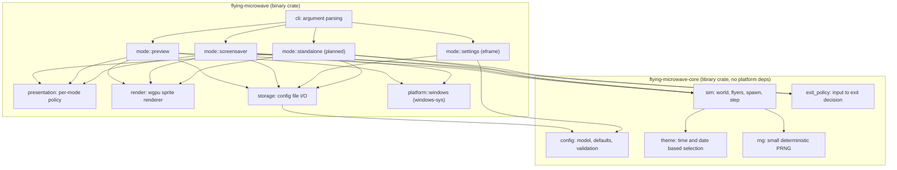
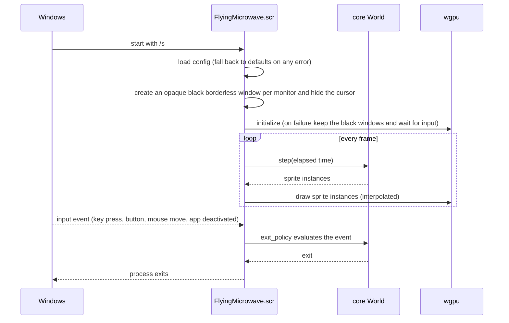

# アーキテクチャ

- 作成日: 2026-10-31
- ステータス: 採用(2026-10-31)。主要な判断は[ADR](../adr/README.md)に記録した(ADR-0001〜0004、0009、0010、0012)。技術スパイクの結果によって更新することがある。
- 関連: [実装計画](../plans/0001-initial-implementation-plan.md)、[設定項目仕様](settings.md)、[ビジュアルデザイン方針](visual-design.md)

## 設計原則

| ID | 原則 | 理由 |
| --- | --- | --- |
| A-1 | プラットフォームに依存しないロジック(シミュレーション・設定モデル・テーマ選択・終了判定)を`core`に分離する | 将来のLinux版・macOS版で再利用し、Linux上でも単体テストできるようにする |
| A-2 | プラットフォーム固有コードは`platform`モジュールに閉じ込める。ただし2つ目のOSに着手するまで抽象化(trait)は作らない。Phase 1の時点では、Windowsの処理は`win.rs`にまとめ、`platform`モジュールへの整理は2つ目のOSに着手するときに行う(計画のD-27) | 移植性の確保とYAGNIの両立 |
| A-3 | シミュレーションは決定的にする(固定タイムステップ、自前の乱数生成器とシード、時刻の注入) | TDDで再現性のあるテストを書くため |
| A-4 | ネットワーク通信を一切行わない | プライバシーと安全性。スクリーンセーバーに通信は不要 |
| A-5 | `/s`・`/p`の実行中は設定ファイルに書き込まない | 放置中に動くプロセスの副作用を最小にする |
| A-6 | 外部入力(引数・設定ファイル)は検証し、不正でもクラッシュせず既定値で動く | AGENTS.mdのセキュリティ方針、仕様調査のW-6・W-7 |
| A-7 | `app`クレートもLinuxでビルドできる状態を保つ(Windows固有部分は`cfg`で分岐する) | エージェントのLinux環境でもコミット前にビルド・リントを実行できるようにするため。将来の移植の準備にもなる |
| A-8 | 実行モードごとの振る舞い(作るウィンドウ、全モニタを黒で覆うか、カーソル、終了判定)を「表示ポリシー」として分け、シミュレーションと描画は全モードで共有する。Phase 1の時点では、終了判定だけを`core::exit_policy`のモードで分け、ウィンドウの作り方は`saver.rs`と`preview.rs`にある。表示ポリシーへの整理は、単独アプリ(F-12)に着手するときに行う(計画のD-27) | スクリーンセーバー以外に、単独アプリ(ウィンドウ・全画面)としても実行できるようにするため([ADR-0012](../adr/0012-standalone-app-mode.md)) |

## 構成要素

次の図は、目標とする構成である。Phase 1の時点の実際の構成(`cli.rs`、`saver.rs`、`preview.rs`、`render.rs`、`win.rs`、`log.rs`、`layout.rs`)との違いは、上のA-2とA-8と、計画のD-27を参照。

## crate・ディレクトリ構成

Cargoワークスペースで2つのcrateに分ける。描画モジュールも将来は独立crateにできるが、必要になるまで分けない。

| パス | 内容 |
| --- | --- |
| `Cargo.toml` | ワークスペース定義、共通のlint設定 |
| `rust-toolchain.toml` | Rustツールチェーンのバージョン固定 |
| `.cargo/config.toml` | Windowsターゲットの`+crt-static`などビルド設定 |
| `crates/core/` | `flying-microwave-core`。OS・GPUに依存しない純粋なロジック |
| `crates/app/` | `flying-microwave`。実行ファイル(起動モード、描画、設定画面、設定ファイル入出力、プラットフォーム固有処理) |
| `crates/app/build.rs` | Windowsリソース(アイコン、バージョン情報、String Tableの序数1)の埋め込み。バージョン情報は`Cargo.toml`のバージョンから生成する |
| `crates/smoke/` | `flying-microwave-smoke`。ビルドした実行ファイルを各モードで起動し、起動と終了を確かめるスモークテスト(Windows専用。[計画0003](../plans/0003-v0.1.1-smoke-test.md))。製品には含めない |
| `crates/app/res/` | リソース定義ファイル(`app.rc`)と、アイコン(`icon.svg`と、そこから作る`flying-microwave.ico`) |
| `assets/sprites/` | SVG素材と、作者・ライセンスを記録する`README.md`(Phase 3から) |
| `spikes/` | Phase 0の技術スパイク。ワークスペースには含めず、製品コードから参照しない。Phase 2の終わりに削除する(計画のD-28) |

crate名は製品名(実装計画のD-5)に合わせて`flying-microwave-core`・`flying-microwave`とする。

## 起動モードの判定

winit 0.30.13は1プロセスにつきイベントループを1つしか作れない([言語・エコシステムの比較検討](../research/tech-stack.md))。そのため、起動モードの判定はイベントループを作る前に行い、モードごとに1つのループだけを使う。設定画面の中にプレビューや開発者表示を出す場合も、eframeのループの中で描く。

引数解析の規則(Phase 1でテストから先に書く):

| 入力例 | 結果 | 備考 |
| --- | --- | --- |
| (なし)、実行ファイルの拡張子が`.scr` | Settings(オーナーなし) | [MS-1] |
| (なし)、実行ファイルの拡張子が`.exe` | Standalone(ウィンドウ) | 単体アプリとして実行するには`.exe`拡張子が必要とされる[MS-2]。拡張子は実行中のファイルのパス(`std::env::current_exe()`)から取得し、大文字小文字を区別せずに比べる。実装は後のフェーズ([ADR-0012](../adr/0012-standalone-app-mode.md)) |
| (なし)、拡張子を取得できない、またはそれ以外の拡張子 | Settings(オーナーなし) | 安全側に倒す。Windows以外での扱いは移植時に決める |
| `--window`、`--fullscreen` | Standalone(ウィンドウ、全画面) | 実行ファイルの名前によらず有効。実装は後のフェーズ |
| `--settings` | Settings(オーナーなし) | 実行ファイルの名前によらず有効。長いオプションは完全一致で判定し、`/s`・`-s`と取り違えない(テストケースにする) |
| `/c` | Settings(前面のウィンドウをオーナーにする) | [MS-1]。前面のウィンドウは取得後に有効なウィンドウか検証する |
| `/c:1234`、`/c 1234` | Settings(オーナーHWND 1234) | 形式はスパイクS3で確認 |
| `/p 1234`、`/p:1234` | Preview(親HWND 1234) | [MS-1]。HWNDは符号なし10進数 |
| `/p`(HWNDなし)、`/p abc` | Settings(オーナーなし) | 誤って全画面にしない |
| `/s`、`/S`、`-s` | Screensaver | 大文字小文字・ハイフンを許容 |
| 2番目以降の余分な引数(`/s extra`、`/p 1234 extra`など) | 余分な引数を無視する。最初の引数がモードを決める | 隠しの起動オプション(アイデアE-12)を採用する場合は、この表に追加する |
| 最初の引数を認識できない(`foo /s`、`.exe`に`foo`を付けた場合など) | Settings(オーナーなし) | 2番目以降に`/s`があっても全画面にしない(W-8) |
| 上記以外 | Settings(オーナーなし) | 仕様調査のW-8 |

多重起動: `/s`は名前付きミューテックスで単一起動にし、既に動いている場合は静かに終了する(「プレビュー」ボタンと待ち時間による起動が重なる場合など)。`/p`はプレビュー枠ごとに独立して動かす。

## スクリーンセーバー実行時(`/s`)の流れ

## シミュレーション(core)

- 座標系: 画面の高さを1.0とする論理座標を使う。幅は縦横比に応じて変わる。大きさと速度を高さ基準で表すため、小さなプレビュー枠でも4K全画面でも同じ見た目になる。
- 時間の進め方: 固定タイムステップ(例: 1/120秒)で状態を更新し、実時間の経過分を積算して必要な回数だけ進める。スリープ復帰などで大きな経過時間が来た場合は上限で切り詰める。
- 補間: 描画時は直前と現在の状態を経過時間の端数で補間する。固定タイムステップとモニタのリフレッシュレート(144Hz、165Hzなど)が合わないときのカクつきを防ぐため。
- 飛行物体(flyer): 電子レンジと食べ物を同じ構造で表す(種類、位置、速度、奥行き、アニメーションの位相)。画面の上辺・右辺の外側から出現し、左下方向へ飛び、画面外に完全に出たら再出現させて数を保つ。
- 乱数: `core`内の小さな乱数生成器(SplitMix64など)を使う。外部crateの出力列の変化でテストが壊れないようにするため。テストでは固定シード、実行時は起動時刻などから生成する。
- 時刻: 現在時刻はインターフェースとして注入し、テストでは任意の日時を与える(時計表示・季節テーマのテストのため)。
- 出力: 描画に必要な情報だけを持つスプライトインスタンス(素材ID、アニメーションフレーム、位置、拡大率、奥行き)の列を返す。coreは画素やGPUを知らない。

Phase 1の暫定値(設定画面がまだないため既定値で動かす。実機で見た目を確かめて調整する):

| 項目 | 値 | 理由 |
| --- | --- | --- |
| 固定タイムステップ | 1/120秒 | 120Hz以下のモニタでは1フレームに1回以上進み、補間で高いリフレッシュレートにも合わせられる |
| 1回の更新で進める経過時間の上限 | 0.25秒 | スリープ復帰などで大きな経過時間が来ても、数十回の更新で済ませるため |
| 座標の向き | 原点は画面の左上、xは右、yは下が正 | ウィンドウの座標と同じ向きにして、描画側での変換を減らす |
| 数 | 12 | 設定項目`flight.count`の既定値 |
| 大きさ | 画面の高さの0.12倍の正方形(位置は中心) | 1080pで約130ピクセル |
| 速さ | 画面の高さの0.15倍/秒を基準に、1つずつ0.8〜1.2倍のばらつき | 横方向の成分は約0.134倍/秒で、16:9の画面を左右に横切るのに約13秒かかる |
| 向き | 左に2、下に1の割合 | 左下へ流れる見た目にする。向きのばらつきは付けない |
| 出現 | 画面の上辺と右辺のすぐ外側に出現させる。出現位置の線は、上辺の外側をx=-大きさの半分から右上の角の外側(幅+大きさの半分、-大きさの半分)まで進み、そこから右辺の外側をy=1+大きさの半分まで下る。2つの部分を角でつなぎ、両端も画面の角まで延ばして、スプライトが画面にかかりうるどの軌跡にも飛行物体が来るようにする。どちらの部分に出すかは、部分の長さと、それに垂直な速度の成分の積に比例した確率で決める(上の部分は長さ×1、右の部分は長さ×2) | 辺を通り抜ける流れの量に合わせ、画面の中の密度を均一にする。角でつながないと、右上の角から斜めに、飛行物体の通らない帯ができる |
| 起動時の配置 | 画面の内側と出現位置の範囲に一様に置く | 起動直後に画面が空にならないようにする |

Phase 1のスプライトインスタンスは、位置と大きさだけを持つ(素材ID、アニメーションフレーム、奥行きは、使うフェーズで加える)。再出現した飛行物体は、補間の始点も再出現の位置にする(画面を横切る残像を出さないため)。

## 描画

- Phase 1・2は仮素材(単純な図形)をwgpuで直接描く。Phase 3からSVG素材を起動時に表示サイズとDPIに合った解像度でラスタライズし、1枚のテクスチャアトラスにまとめる。
- スプライトはインスタンス描画で一括して描く(四角形1種類 + インスタンスごとの位置・拡大率・UV)。Phase 1・2の仮素材の四角は、シェーダーを使わず、バッファからテクスチャへのコピーで描いている。インスタンス描画は、Phase 3の素材(テクスチャアトラス)で導入する(計画のD-27)。
- 奥行き(depth)の順に並べて描き、奥のものほど小さく遅くすることで立体感を出す(Phase 3)。
- フレームレートは垂直同期を基本とし、設定の上限値で間引く。
- GPUアダプタは省電力を優先して選ぶ(ハイブリッドGPU環境で外部GPUを起こさないため)。GPUが使えない場合は、wgpuがDX12のWARP(ソフトウェアの描画)を選ぶ想定である。実機での確認はスパイクS6(Phase 1の段階3。計画のD-22)で行う。
- ディスプレイの電源が切れている間は描画を止める(電源設定の通知でディスプレイの状態を受け取る。Phase 3まで)。

## 入力と終了判定

| モード | 終了する条件 | 無視する入力 |
| --- | --- | --- |
| Screensaver | キーの押下、マウスボタン、ホイール、タッチ・ペン、起動時の位置から閾値以上のカーソル移動、アプリ全体の非アクティブ化、ウィンドウを閉じる要求 | キーの解放、合成されたキーイベント、閾値未満のカーソル移動、自アプリのウィンドウ間のフォーカス移動、起動直後の猶予時間内の移動とフォーカス変化 |
| Preview | 親ウィンドウが無効になった(定期的に確認する)、自ウィンドウが破棄された | すべての入力 |
| Settings | 通常のウィンドウとして閉じたとき | - |
| Standalone(計画) | ウィンドウを閉じたとき | キー・マウスの入力(F11で全画面の切り替え、Escで全画面の解除のみ行う) |

複数モニタでの注意点(レビュー指摘を受けてwinit 0.30.13のソースで確認):

- winitのウィンドウは既定で作成時にアクティブになる(`WindowAttributes`の`active`の既定値がtrue)。モニタごとにウィンドウを作ると、作るたびに直前のウィンドウがフォーカスを失う。ウィンドウ単位の「フォーカス喪失で終了」にすると起動直後に終了してしまうため、終了条件は「自アプリのどのウィンドウにもフォーカスがない状態」とする。
- フォーカスの移動に伴ってwinitは押下中のキーの合成イベント(`is_synthetic`)を生成するため、合成イベントは無視する。
- 「プレビュー」ボタンをEnterキーで押した場合、キーの解放イベントが起動直後に届きうるため、キーは押下だけを終了条件にする。
- カーソル位置はウィンドウ相対の座標ではなく、スクリーン座標(物理ピクセル)で判定する。モニタをまたいだ移動でも同じ基準で比べるため。閾値は[設定項目仕様](settings.md)の`input.exit_sensitivity`で決める。

終了判定は`core::exit_policy`に純粋関数として実装し、イベントの列に対する判定結果をテストする。上の表と注意点の各項目をテストケースにする。

Phase 1の暫定の扱い(スパイクS4と実機の結果で見直す):

- 起動直後の猶予時間: 500ミリ秒(スパイクの値)。猶予時間内のカーソル移動は、終了の判定には使わず、移動量の基準位置を移すだけにする。猶予時間内でも、キーの押下・マウスボタン・ホイール・タッチは終了の条件にする。
- 移動量の閾値: 16物理ピクセル(`input.exit_sensitivity`の既定値mediumの値)。基準位置からの直線距離で判定する。
- フォーカス: 自アプリのウィンドウごとのフォーカスの状態を記録し、イベントのまとまりを処理し終えた時点(winitの`about_to_wait`)で判定する。ウィンドウ間でフォーカスが移るときの「どのウィンドウにもフォーカスがない」途中の状態で終了しないため。一度もフォーカスを得ていない間は終了しない。
- 時刻: 猶予時間の開始からの経過時間を、呼び出し側から渡す(テストで任意の時刻を与えるため)。猶予時間は、すべてのウィンドウの作成とGPUの初期化(失敗した場合を含む)が終わった時点から数える。その間にたまったカーソル移動やフォーカスの変化は、そのあとに届くため、猶予時間の中で扱う必要がある(スパイクと同じ起点)。
- 猶予時間の終わり: 呼び出し側は、猶予時間が終わる時刻にイベントループを起こす(winitの`ControlFlow::WaitUntil`)。GPUの初期化に失敗して黒い画面のまま待つ場合も、猶予時間内に失ったフォーカスを、次のイベントを待たずに判定するため。
- 合成されたキーイベント: winitの`is_synthetic`(フォーカスが移ったときに、押されたままのキーについてwinitが生成するイベント)だけを指す。キーリピートや、SendInputで注入された入力は、利用者の入力として扱う。

## 単独アプリとしての実行(Standalone、計画)

[ADR-0012](../adr/0012-standalone-app-mode.md)に基づく。実装は後のフェーズで行い、Phase 1からはこの形を前提に構造を作る(A-8)。

| 項目 | スクリーンセーバー(`/s`) | 単独アプリ(Standalone) |
| --- | --- | --- |
| 起動 | Windowsが`/s`を付けて起動する | `--window`・`--fullscreen`、または拡張子が`.exe`の実行ファイルを引数なしで起動する |
| ウィンドウ | 全モニタに全画面ウィンドウ | ウィンドウ1つ。全画面は現在のモニタだけを覆う |
| 黒での即時被覆(W-9) | 行う | 行わない |
| カーソル | 非表示 | ウィンドウでは表示する |
| 終了 | 入力で終了する | ウィンドウを閉じたときだけ終了する |
| 単一起動 | 行う | 行わない |
| 設定の読み込み | 行う | 行う |

- 配布の形(同じバイナリを`.scr`と`.exe`の両方の名前で同梱する、`.exe`だけを配布して手順を示すなど)は実装時に決める。
- そのほか実装時に決めること([ADR-0012](../adr/0012-standalone-app-mode.md)): 全画面での実行中にディスプレイのスリープやスクリーンセーバーの起動を抑止するか、全画面でのカーソルの扱い、全画面にするモニタの選び方、GPUの初期化に失敗したときの動作。設定ファイルへの書き込みは、[ADR-0004](../adr/0004-store-settings-as-toml.md)により設定画面でのOK操作に限る(単独アプリで別の書き込みが必要になった場合は新しいADRで決める)。
- Linux版・macOS版では、OSのスクリーンセーバーとの連携より先に、単独アプリとして動かすことを最初の段階にできる。
- 開発中の動作確認にも役立つため、必要になれば実装を前倒ししてよい。

## マルチモニタ

- Phase 1では、モニタごとに全画面ウィンドウを作り、それぞれ独立したシミュレーションを動かす。ウィンドウは、winitの全画面の指定を使わず、枠のない最前面のウィンドウをモニタの位置と大きさで作る([ADR-0019](../adr/0019-screensaver-windows-without-winit-fullscreen.md))。どのウィンドウで終了条件を満たしても全体を終了する。
- 実行中にモニタが追加・変更された場合も、すべてのモニタを覆う(仕様調査のW-10。Phase 2)。
- DPIの異なるモニタが混在しても論理座標で同じ見た目になる。winit 0.30.13はWindowsでイベントループの生成時にモニタごとのDPI対応(`DPI_AWARENESS_CONTEXT_PER_MONITOR_AWARE_V2`)を設定する(ソースで確認)。実機での見え方はスパイクS4で確認する。
- モニタをまたいで電子レンジが飛ぶ演出は将来のアイデアとする([将来のオプションのアイデア](../ideas/future-options.md))。

## 設定の保存

- 設定はTOMLファイルとして利用者ごとの設定ディレクトリに保存する([ADR-0004](../adr/0004-store-settings-as-toml.md))。具体的な保存場所はPhase 2の着手前に別のADRで決める。
- 書き込みは一時ファイルに書いてから置き換える。`/s`が書きかけのファイルを読まないようにするため。
- 項目・範囲・既定値・検証規則は[設定項目仕様](settings.md)に定める。

## セキュリティ

| ID | 対策 | 理由 |
| --- | --- | --- |
| SEC-1 | 起動直後にDLLの検索パスをシステムディレクトリに制限する(`SetDefaultDllDirectories`)。読み込み時の依存DLLにも同じ制限をかけるリンカ設定(`/DEPENDENTLOADFLAG`)を使う | `.scr`は任意のフォルダに置かれて自動実行される。wgpu-halは`d3d12.dll`などをパスなしの名前で読み込む(仕様調査のW-11)。GPUのない環境で使うソフトウェアの描画(WARP)も、[Microsoftのドキュメント](https://learn.microsoft.com/en-us/windows/win32/direct3darticles/directx-warp)によると、アプリの`.exe`の隣に置いた`D3d10warp.dll`を使う。この制限で塞げる想定だが、ランタイムがフルパスで読み込む場合は塞げないため、実機で確かめる(計画の8.2の手動テスト)。実装: `SetDefaultDllDirectories(LOAD_LIBRARY_SEARCH_SYSTEM32)`(`crates/app/src/win.rs`)と、実行ファイルのリンカ設定`/DEPENDENTLOADFLAG:0x800`(`crates/app/build.rs`。値は`LOAD_LIBRARY_SEARCH_SYSTEM32`で、MicrosoftのMSVCのリンカのリファレンスで確かめた。Windows 10 RS1以降で効く)。CIとリリースのワークフローで、`dumpbin /loadconfig`により設定が入ったことを確かめる |
| SEC-2 | wgpuのDX12シェーダーコンパイラを`Fxc`に明示し、使うバックエンドも明示する | 既定値の`Auto`は`dxcompiler.dll`の読み込みを先に試すため |
| SEC-3 | 引数のHWNDと前面のウィンドウは、有効なウィンドウかを確認してから使う | 仕様調査のW-6 |
| SEC-4 | 設定ファイルはサイズの上限を設け、すべての値を検証する | A-6 |
| SEC-5 | ネットワーク通信を行わない | A-4 |

セキュリティに影響する変更(上記の対策の追加・変更)は、AGENTS.mdに従いPR本文で明示する。

## エラー処理とログ

- 実行ファイルはコンソールウィンドウを出さない設定(Windowsのサブシステム指定)でビルドする。
- `/s`・`/p`ではエラーダイアログを表示しない。
- `/s`で描画の初期化に失敗した場合は、黒い全画面を表示したまま入力を待つ(W-9)。すぐに終了すると、画面を隠す目的を果たせず、再開時にロックする設定の環境では直後にロック画面になるため。ただし、GPUの初期化が15秒で終わらない場合(ドライバの呼び出しが戻らない場合)は、ログに書いてプロセスを終了する(終了コード6。`/p`も同じ)。プロセスと覆った画面が残り続けないようにするため(計画のD-27)。
- `/p`で初期化に失敗した場合は静かに終了する。
- ログ: v0.x系の間は、診断用のログを一時フォルダの`flying-microwave.log`に、いつも書く(1MBまで。起動の情報、モニタとウィンドウの位置・大きさ・拡大率、GPUの名前とドライバ、描画の警告とエラー(wgpuの警告とエラーを含む)、終了の理由を記録し、利用者のデータは含まない。`crates/app/src/log.rs`)。v1.0.0までに、既定では出力せず、調査のときだけ有効にする形(環境変数または設定キー)にする(計画のD-25。当初は「既定で出力しない。有効化する手段をPhase 1で決める」としていたが、実装がこれを満たしていなかった。[incidents 0011](../incidents/0011-log-written-against-requirement.md))。

## クロスプラットフォームの方針

Windows版の実装中は、以下を「将来の移植を妨げない」ための確認材料として扱い、実装はしない。どのOSでも、単独アプリとしての実行(Standalone)を最初の段階にできる。

| OS | スクリーンセーバーの仕組み | 想定する対応 |
| --- | --- | --- |
| Windows | `.scr`実行ファイルと引数`/s`・`/p`・`/c` [MS-1] | 本計画の対象 |
| Linux(X11) | XScreenSaverは描画先のウィンドウIDを環境変数`XSCREENSAVER_WINDOW`でサブプログラムに渡す [XSS-1] | winitの`with_parent_window`はX11の子ウィンドウにも対応している(ソースで確認)。XScreenSaverの「hack」として動かす方式を要調査 |
| Linux(Wayland) | 要調査 | 要調査 |
| macOS | `ScreenSaverView`のサブクラスを含む`.saver`バンドル [APL-1] | `core`と描画をライブラリとしてビルドし、Swift等の薄いラッパーから呼ぶ方式を要調査 |

## 参考資料

- [MS-1] Microsoft Learn「Command-line arguments for Screen Savers」(KB182383)
- [MS-2] Microsoft Learn「Handling Screen Savers」
- [XSS-1] XScreenSaver Manual(検索結果の要約で確認。本文の該当箇所は未取得)
- [APL-1] Apple Developer Documentation「ScreenSaverView」(検索結果の要約で確認)

[MS-1]: https://learn.microsoft.com/en-us/previous-versions/troubleshoot/windows/win32/screen-saver-command-line
[MS-2]: https://learn.microsoft.com/en-us/windows/win32/lwef/screen-saver-library
[XSS-1]: https://www.jwz.org/xscreensaver/man1.html
[APL-1]: https://developer.apple.com/documentation/screensaver/screensaverview
