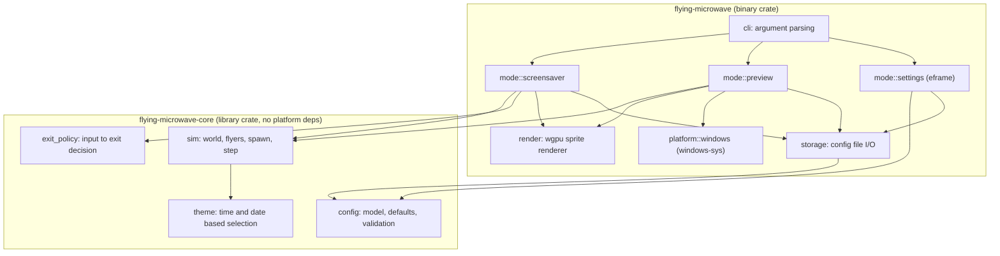
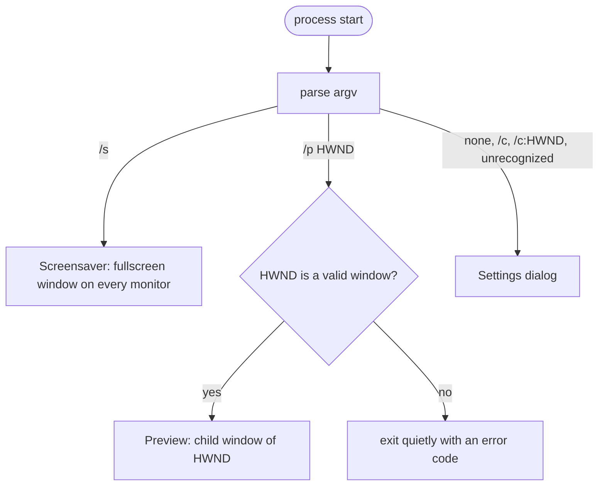
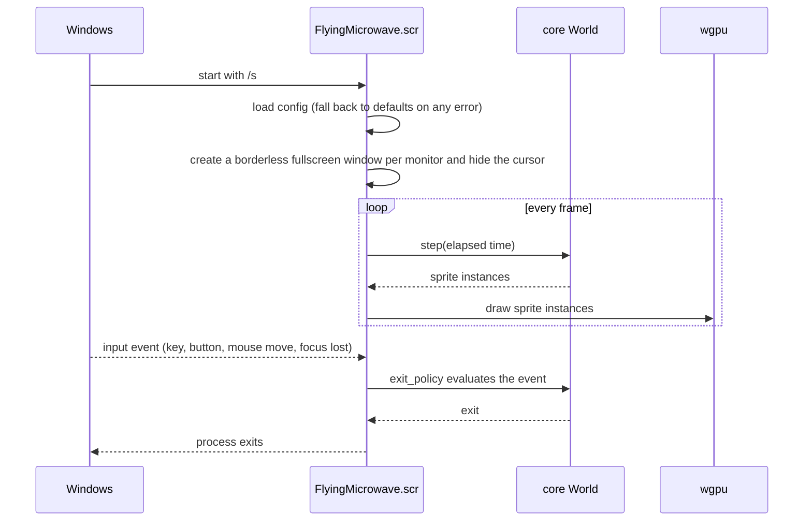

# アーキテクチャ(提案)

- 作成日: 2026-10-31
- ステータス: 提案。[言語・エコシステムの比較検討](../research/tech-stack.md)の推奨案(Rust + winit + wgpu + eframe)を前提とする。技術選定の承認後に確定し、主要な判断はADRに記録する。
- 関連: [実装計画](../plans/0001-initial-implementation-plan.md)、[設定項目仕様](settings.md)、[ビジュアルデザイン方針](visual-design.md)

## 設計原則

| ID | 原則 | 理由 |
| --- | --- | --- |
| A-1 | プラットフォームに依存しないロジック(シミュレーション・設定モデル・テーマ選択・終了判定)を`core`に分離する | 将来のLinux版・macOS版で再利用し、Linux上でも単体テストできるようにする |
| A-2 | プラットフォーム固有コードは`platform`モジュールに閉じ込める。ただし2つ目のOSに着手するまで抽象化(trait)は作らない | 移植性の確保とYAGNIの両立 |
| A-3 | シミュレーションは決定的にする(固定タイムステップ、シード指定可能な乱数、時刻の注入) | TDDで再現性のあるテストを書くため |
| A-4 | ネットワーク通信を一切行わない | プライバシーと安全性。スクリーンセーバーに通信は不要 |
| A-5 | `/s`・`/p`の実行中は設定ファイルに書き込まない | 放置中に動くプロセスの副作用を最小にする |
| A-6 | 外部入力(引数・設定ファイル)は検証し、不正でもクラッシュせず既定値で動く | AGENTS.mdのセキュリティ方針、仕様調査のW-6・W-7 |

## 構成要素

## crate・ディレクトリ構成

Cargoワークスペースで2つのcrateに分ける。描画モジュールも将来は独立crateにできるが、必要になるまで分けない。

| パス | 内容 |
| --- | --- |
| `Cargo.toml` | ワークスペース定義、共通のlint設定 |
| `rust-toolchain.toml` | Rustツールチェーンのバージョン固定 |
| `crates/core/` | `flying-microwave-core`。OS・GPUに依存しない純粋なロジック |
| `crates/app/` | `flying-microwave`。実行ファイル(起動モード、描画、設定画面、設定ファイル入出力、プラットフォーム固有処理) |
| `crates/app/build.rs` | Windowsリソース(アイコン、バージョン情報、String Tableの序数1)の埋め込み |
| `assets/sprites/` | SVG素材と、作者・ライセンスを記録する`README.md` |

## 起動モードの判定

引数解析の規則(Phase 1でテストから先に書く):

| 入力例 | 結果 | 備考 |
| --- | --- | --- |
| (なし) | Settings(親なし) | [MS-1] |
| `/c` | Settings(親なし) | [MS-1] |
| `/c:1234`、`/c 1234` | Settings(親HWND 1234) | 形式はスパイクS3で確認 |
| `/p 1234`、`/p:1234` | Preview(親HWND 1234) | [MS-1]。HWNDは符号なし10進数 |
| `/p`(HWNDなし)、`/p abc` | Settings(親なし) | 誤って全画面にしない |
| `/s`、`/S`、`-s` | Screensaver | 大文字小文字・ハイフンを許容 |
| 上記以外 | Settings(親なし) | 仕様調査のW-8 |

## スクリーンセーバー実行時(`/s`)の流れ

## シミュレーション(core)

- 座標系: 画面の高さを1.0とする論理座標を使う。幅は縦横比に応じて変わる。大きさと速度を高さ基準で表すため、小さなプレビュー枠でも4K全画面でも同じ見た目になる。
- 時間の進め方: 固定タイムステップ(例: 1/120秒)で状態を更新し、実時間の経過分を積算して必要な回数だけ進める。スリープ復帰などで大きな経過時間が来た場合は上限で切り詰める。
- 飛行物体(flyer): 電子レンジと食べ物を同じ構造で表す(種類、位置、速度、奥行き、アニメーションの位相)。画面の上辺・右辺の外側から出現し、左下方向へ飛び、画面外に完全に出たら再出現させて数を保つ。
- 乱数: シードを指定できる乱数を使う。テストでは固定シード、実行時は起動時刻などから生成する。
- 時刻: 現在時刻はインターフェースとして注入し、テストでは任意の日時を与える(時計表示・季節テーマのテストのため)。
- 出力: 描画に必要な情報だけを持つスプライトインスタンス(素材ID、アニメーションフレーム、位置、拡大率、奥行き)の列を返す。coreは画素やGPUを知らない。

## 描画

- SVG素材を起動時に表示サイズとDPIに合った解像度でラスタライズし、1枚のテクスチャアトラスにまとめる。
- スプライトはインスタンス描画で一括して描く(四角形1種類 + インスタンスごとの位置・拡大率・UV)。
- 奥行き(depth)の順に並べて描き、奥のものほど小さく遅くすることで立体感を出す(Phase 3)。
- フレームレートは垂直同期を基本とし、設定の上限値で間引く。

## 入力と終了判定

| モード | 終了する条件 | 無視する入力 |
| --- | --- | --- |
| Screensaver | キー入力、マウスボタン、ホイール、最初に観測した位置から閾値以上のカーソル移動、フォーカス喪失 | 閾値未満のカーソル移動 |
| Preview | 親ウィンドウが無効になった(定期的に確認する)、自ウィンドウが破棄された | すべての入力 |
| Settings | 通常のウィンドウとして閉じたとき | - |

終了判定は`core::exit_policy`に純粋関数として実装し、イベントの列に対する判定結果をテストする。

## マルチモニタ

- Phase 1では、モニタごとに全画面ウィンドウを作り、それぞれ独立したシミュレーションを動かす。どのウィンドウで入力があっても全体を終了する。
- DPIの異なるモニタが混在しても論理座標で同じ見た目になる。winitのDPI対応の既定動作を確認し、必要ならアプリケーションマニフェストで宣言する(Phase 1、スパイクS4)。
- モニタをまたいで電子レンジが飛ぶ演出は将来のアイデアとする([将来のオプションのアイデア](../ideas/future-options.md))。

## 設定の保存

- 設定はTOMLファイルとしてユーザーごとの設定ディレクトリに保存する(推奨案。保存形式・場所はPhase 2の着手前にADRで決定する)。
- 項目・範囲・既定値・検証規則は[設定項目仕様](settings.md)に定める。

## エラー処理とログ

- 実行ファイルはコンソールウィンドウを出さない設定(Windowsのサブシステム指定)でビルドする。
- `/s`・`/p`ではエラーダイアログを表示しない。初期化に失敗した場合は静かに終了する。描画の初期化に失敗したときに黒い全画面だけを表示し続けるかは、スパイクS6の結果を見て決める。
- ログは既定で出力しない。調査用に有効化する手段(環境変数または設定キー)をPhase 1で決める。

## クロスプラットフォームの方針

Windows版の実装中は、以下を「将来の移植を妨げない」ための確認材料として扱い、実装はしない。

| OS | スクリーンセーバーの仕組み | 想定する対応 |
| --- | --- | --- |
| Windows | `.scr`実行ファイルと引数`/s`・`/p`・`/c` [MS-1] | 本計画の対象 |
| Linux(X11) | XScreenSaverは描画先のウィンドウIDを環境変数`XSCREENSAVER_WINDOW`でサブプログラムに渡す [X-1] | winitの`with_parent_window`はX11の子ウィンドウにも対応している(ソースで確認)。XScreenSaverの「hack」として動かす方式を要調査 |
| Linux(Wayland) | 要調査 | 要調査 |
| macOS | `ScreenSaverView`のサブクラスを含む`.saver`バンドル [A-1] | `core`と描画をライブラリとしてビルドし、Swift等の薄いラッパーから呼ぶ方式を要調査 |

## 参考資料

- [MS-1] Microsoft Learn「Command-line arguments for Screen Savers」(KB182383)
- [X-1] XScreenSaver Manual(検索結果の要約で確認。本文の該当箇所は未取得)
- [A-1] Apple Developer Documentation「ScreenSaverView」(検索結果の要約で確認)

[MS-1]: https://learn.microsoft.com/en-us/previous-versions/troubleshoot/windows/win32/screen-saver-command-line
[X-1]: https://www.jwz.org/xscreensaver/man1.html
[A-1]: https://developer.apple.com/documentation/screensaver/screensaverview
