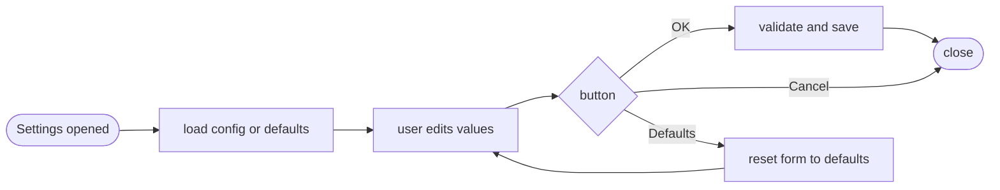

# 設定項目仕様(案)

- 作成日: 2026-10-31
- ステータス: 提案。項目は導入フェーズの着手時に見直す(先回りで実装しない)。
- 関連: [アーキテクチャ](architecture.md)、[実装計画](../plans/0001-initial-implementation-plan.md)

## 設定項目

UIラベルはAGENTS.mdの言語ルールに従い英語とする。範囲外の値は範囲内に丸める。

| キー | UIラベル | 型 | 範囲・選択肢 | 既定値 | 導入 | 説明 |
| --- | --- | --- | --- | --- | --- | --- |
| `flight.count` | Number of microwaves | 整数 | 1〜50 | 12 | v0.2.0 | 同時に飛ぶ物体の数(食べ物を含む) |
| `flight.speed` | Speed | 小数 | 0.25〜3.0 | 1.0 | v0.2.0 | 飛行速度の倍率 |
| `flight.scale` | Size | 小数 | 0.5〜2.0 | 1.0 | v0.2.0 | 大きさの倍率 |
| `display.max_fps` | Frame rate limit | 選択 | 30 / 60 / 120 / vsync | 60 | v0.2.0 | 描画フレームレートの上限 |
| `display.monitors` | Monitors | 選択 | all / primary | all | v0.2.0 | 表示するモニタ。primaryでは他のモニタを黒で覆う |
| `input.exit_sensitivity` | Mouse sensitivity | 選択 | low / medium / high | medium | v0.2.0 | 終了と判定するマウス移動の閾値 |
| `flight.food_ratio` | Food | 整数(%) | 0〜100 | 30 | v0.3.0 | 飛ぶ物体のうち食べ物の割合 |
| `clock.enabled` | Show clock on display | 真偽 | - | true | v0.3.0 | 電子レンジのLED表示に現在時刻を出す |
| `clock.format` | Clock format | 選択 | 24h / 12h | 24h | v0.3.0 | 時刻の表示形式 |
| `theme.background` | Background | 選択 | black / night_sky / time_of_day | black | v0.4.0 | 背景(time_of_dayは時刻で変化) |
| `theme.seasonal` | Seasonal themes | 真偽 | - | true | v0.4.0 | 季節・記念日のテーマを有効にする |
| `extras.surprises` | Surprises | 真偽 | - | true | v0.5.0 | まれに起こる隠し要素を有効にする |

候補として保留する項目(必要性を確認してから追加する):

- 飛行方向(左下へ・右下へ・ランダム)
- バッテリー駆動時のフレームレート低減
- 効果音のオン・オフ(既定はオフ)

## 設定ファイル

推奨案はTOML形式(保存形式・場所はPhase 2の着手前にADRで決定する)。

```toml
schema_version = 1

[flight]
count = 12
speed = 1.0
scale = 1.0

[display]
max_fps = 60
monitors = "all"

[input]
exit_sensitivity = "medium"
```

## 検証規則

| 状況 | 動作 |
| --- | --- |
| ファイルが存在しない | すべて既定値 |
| ファイルが大きすぎる(上限は64KiBを想定) | 読まずにすべて既定値 |
| TOMLとして解析できない | すべて既定値 |
| 範囲外の数値 | 範囲内に丸める |
| 型が違う・選択肢にない値 | その項目だけ既定値 |
| 未知のキー | 無視する(新しいバージョンの設定を古いバージョンで読んでも動く) |
| `schema_version`が新しい | 読める項目だけ使い、書き込み時にユーザーへ確認する |

検証は`core::config`の純粋関数として実装し、上の各行をテストケースにする。

## 設定画面



- タブ構成の案: Flight / Display / Extras / About。
- Aboutにはバージョン、ライセンス、着想元への言及、プロジェクトのURLを表示する。
- 保存に失敗した場合は、設定画面内にエラーメッセージを表示する(設定画面はユーザー操作中なので表示してよい)。
