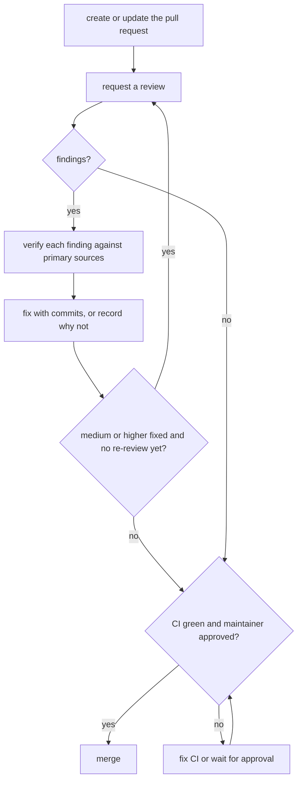

# PRのレビュー手順

- ステータス: 採用([ADR-0014](../adr/0014-risk-based-review-depth.md))
- 対象: すべてのPR(製品コード・ドキュメント・設定)
- 関連: [AGENTS.md](../../AGENTS.md)の「PR・レビュー・マージ」、`.claude/commands/babysit-pr.md`、`.claude/commands/merge-pr.md`

本リポジトリでは、作成者とは別のコンテキストを持つエージェントによる敵対的レビューを既定とし、GitHub Copilotは利用しない。レビューの深さは変更の種類で決める。Copilotでレビューする場合の手順も参考として残す。

## レビューの深さ

| 区分 | 対象 | レビュー |
| --- | --- | --- |
| 本格的なレビュー | 製品コード、設計の判断(ADR・計画の決定事項)、セキュリティ設定(`.github/workflows/`・`.claude/hooks/`など)、リリース | 最も高性能なモデルで行う |
| 軽いレビュー | ドキュメントだけの変更、手順の文書、使い捨てのスパイク | 1回だけ行い、再レビューはしない。安価なモデルでもよい。スパイクは安全性(画面を覆ったまま抜けられない、`unsafe`の誤用、危険な外部コマンドの実行など)だけを見る |

- 報告させる指摘: high・mediumと、動作や判断を誤らせるlowに限る。文書の言い回しや、動作に影響しない文書間の食い違いは報告させない。
- 再レビュー: medium以上の指摘を修正したときだけ行い、1つのPRで最大1回とする。それ以外の指摘は、修正して記録したうえでレビュー完了とする。
- 文書の整合性: PRごとには追わず、フェーズの区切りで`/consistency-check`をまとめて実行する。

## 共通ループ

| 段階 | 内容 |
| --- | --- |
| レビュー依頼 | 差分の範囲と、関係する要件・計画・ADR・AGENTS.mdのルールを渡す。作成者の結論や仮説は渡さない(結論に引きずられないようにするため)。再レビューでは、例外として前回の指摘と対応の一覧も渡す |
| 指摘の検証 | 指摘は検証すべき主張として扱い、一次情報(公式ドキュメント、ソース、レジストリ)で確かめる。確かめた結果を「確認済み」「未確認・妥当」「不採用」に分ける |
| 対応 | 採用した指摘は修正コミットで直す。修正は論理変更ごとにコミットし、検証を終えてからまとめて1回でプッシュする(重いCIの再実行を減らすため)。採用しない指摘は理由を記録する。セキュリティに関わる指摘は、メンテナーが判断するまで未解決のままにする |
| 返信と解決 | 人間が付けたレビュースレッドには、対応内容または対応しない理由を返信してから解決する |
| 再レビュー | 「レビューの深さ」の条件を満たすときだけ、1回行う |
| マージ | レビュー完了・CIの全ジョブがグリーン・メンテナーの承認の3つがそろってからマージする(「レビュー完了の判定」) |

## 敵対的レビューの手順(既定)

1. 依頼内容を準備する。
   - 範囲: 対象のPRの差分(ベースブランチとの差分、または前回のレビュー以降の差分)。
   - 根拠: 関係する計画(`docs/plans/`)、設計(`docs/design/`)、ADR(`docs/adr/`)、AGENTS.md。
   - 観点: 本格的なレビューでは、正しさ、セキュリティ、テストの不足、先回りの実装(YAGNI)、個人情報や会話の記録が含まれていないこと。軽いレビューでは「レビューの深さ」の範囲。
   - 出力形式: 重大な順に、重要度・箇所・問題・根拠・修正案を並べる。報告させる指摘の範囲(「レビューの深さ」)を依頼文に書く。
2. レビュー用のエージェントを起動する。
   - Claude Codeでは、読み取り専用を指示したサブエージェント、または`/code-review`スキルを使う。
   - 作成者と同じ会話の結論を引き継がないよう、新しいコンテキストで起動する。
3. 結果を検証して対応する(共通ループの「指摘の検証」「対応」)。
4. 記録する。
   - PRでは、指摘の一覧と各指摘への対応を1件のコメントにまとめて投稿する(エージェントの指摘はGitHubのレビュースレッドにならないため)。冒頭に、レビューの対象(ベースのコミットとレビューしたhead SHA)と指摘の件数を書く。例: 「レビュー対象: `abc1234..def5678`、指摘: 3件(すべて修正済み)」。
   - 計画・設計の本格的なレビューは、`docs/reviews/NNNN-<対象>.md`にも記録する(例: [0001-plan-adversarial-review.md](../reviews/0001-plan-adversarial-review.md))。

## レビュー完了の判定

次をすべて満たしたら、レビュー完了とする。

1. 最後のレビュー(再レビューを行った場合はその回)の結果を、PRのまとめコメントに記録した(対象のhead SHA、指摘の件数、各指摘への対応、修正のコミット)。
2. medium以上の指摘を修正した場合は、再レビュー(1回)でその修正を確かめた。
3. 最後にレビューしたSHAより後のコミットが、まとめコメントに挙げた修正と、レビュー記録(`docs/reviews/`)の更新だけである。

マージの前の確認: `git fetch origin`を実行し、PRのhead SHAを取得する(ghでは`gh pr view <番号> --json headRefOid -q .headRefOid`、GitHub MCPではPRの情報の`head.sha`。ローカルの`HEAD`は古い場合があるため使わない)。`git log --oneline <最後にレビューしたSHA>..<PRのhead SHA>`で、条件3を確かめる。

## GitHub Copilotを使う場合の手順(参考。本リポジトリでは使わない)

以下はテンプレートから引き継いだ手順で、本プロジェクトでは実際に検証していない。将来Copilotのレビューを使う場合は、公式ドキュメントで現状を確認してから採用する。

1. レビューを依頼する。
   - ghがある環境: `gh pr edit <番号> --add-reviewer @copilot`(gh 2.88.0以上が必要とされる)。
   - claude.ai/code(ghなし): GitHub MCPの`request_copilot_review`ツール。
   - REST APIの`.../requested_reviewers`は、レビュー済みのPRの再レビューを起動しないとされるため使わない。
2. 完了を判定する。次の両方を満たすまで完了としない。
   - `requested_reviewers`の`users`からCopilotが消えている。
   - 依頼した時刻より後に、本文が空でないCopilotのレビュー(総評)が提出されている。判定は本文の長さだけで行い、見出しの文字列には頼らない。
   - 本文が空のCOMMENTEDのレビューは、インラインコメントの入れ物(途中の記録)であり、完了の合図として扱わない。
3. 指摘に対応する(共通ループ)。スレッドには返信してから解決する。
4. 再レビューの扱いは「レビューの深さ」に従う。
5. 禁止事項: `DELETE .../requested_reviewers`を使わない(レビュアーの状態が壊れるとされる)。再レビューのためにPRを閉じて開き直したり作り直したりしない。

Copilot向けの設定として、`.github/copilot-instructions.md`(Copilot全般向けの薄いポインタで、レビューを日本語で書く指示を含む)と`.github/copilot-code-review.yml`(レビューの言語設定。公式ドキュメントに記載がないとされる)を残している。Copilotを使わない間は影響しない。

## 共通の禁止事項

- レビュー未完了・CI失敗のままのマージ。時間がかかっているなどの理由で省略しない。
- 再レビューのためにPRを閉じて開き直すこと、作り直すこと。
- CIの通過とマージの状態を確認する前に「完了」と報告すること。
