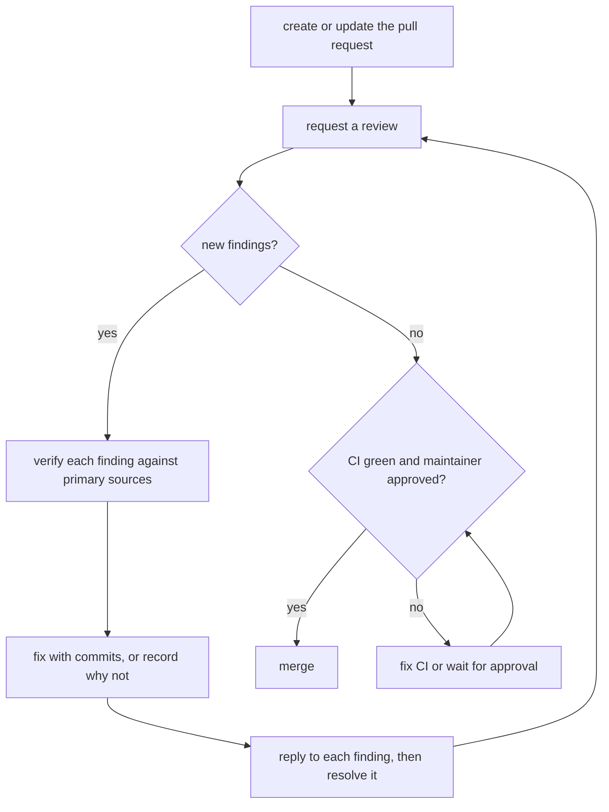

# PRのレビュー手順

- ステータス: 採用([ADR-0007](../adr/0007-adversarial-review-without-copilot.md))
- 対象: すべてのPR(製品コード・ドキュメント・設定)
- 関連: [AGENTS.md](../../AGENTS.md)の「PR・レビュー・マージ」、`.claude/commands/babysit-pr.md`、`.claude/commands/merge-pr.md`

本リポジトリでは、作成者とは別のコンテキストを持つエージェントによる敵対的レビューを既定とし、GitHub Copilotのレビューは使わない。Copilotを使う場合の手順も参考として残す。どちらのレビュアーでも、次の共通ループで進める。

## 共通ループ

| 段階 | 内容 |
| --- | --- |
| レビュー依頼 | 差分の範囲と、関係する要件・計画・ADR・AGENTS.mdのルールを渡す。作成者の結論や仮説は渡さない(結論に引きずられないようにするため)。再レビューでは、例外として前回の指摘と対応の一覧も渡す |
| 指摘の検証 | 指摘は検証すべき主張として扱い、一次情報(公式ドキュメント、ソース、レジストリ)で確かめる。確かめた結果を「確認済み」「未確認・妥当」「不採用」に分ける |
| 対応 | 採用した指摘は修正コミットで直す。採用しない指摘は理由を記録する。セキュリティに関わる指摘は、メンテナーが判断するまで未解決のままにする |
| 返信と解決 | 各指摘に対応内容または対応しない理由を返信してから解決する(同じ指摘の繰り返しを防ぐため) |
| 再レビュー | 修正を含めて再びレビューを依頼し、新規指摘がなくなるまで繰り返す |
| マージ | レビュー完了・CIの全ジョブがグリーン・メンテナーの承認の3つがそろってからマージする。レビュー完了は、PRのheadをレビューして新規指摘が0件だった記録があることで判定する(例外は「最終回の記録」の節) |

## レビュアーの種類

| 種類 | 本リポジトリでの扱い | 依頼の方法 | 完了の判定 |
| --- | --- | --- | --- |
| 敵対的レビューのエージェント | 既定 | 下記「敵対的レビューの手順」 | レビューしたhead SHAと「新規指摘: 0件」を記したまとめコメントがPRにあり、そのSHAが現在のPRのheadと一致している(例外は「最終回の記録」の節) |
| 別系統のモデル(OpenAI Codexなど) | 任意。アーキテクチャ・セキュリティ・リリースに関わる重要な変更で2回目のレビューとして使う | 各ツールの方法で、敵対的レビューと同じ依頼内容を渡す | 報告が届いた時点 |
| GitHub Copilot | 使わない(参考として手順を残す) | 下記「GitHub Copilotを使う場合の手順」 | 下記の判定条件 |

## 敵対的レビューの手順(既定)

1. 依頼内容を準備する。
   - 範囲: 対象のPRの差分(ベースブランチとの差分、または前回のレビュー以降の差分)。
   - 根拠: 関係する計画(`docs/plans/`)、設計(`docs/design/`)、ADR(`docs/adr/`)、AGENTS.md。
   - 観点: 正しさ、セキュリティ、ドキュメントとコードの整合性、テストの不足、先回りの実装(YAGNI)、AGENTS.mdの言語・書式のルール、個人情報や会話の記録が含まれていないこと。
   - 出力形式: 重大な順に、重要度・箇所・問題・根拠・修正案を並べる。問題がなかった確認項目も短く挙げる。
2. レビュー用のエージェントを起動する。
   - Claude Codeでは、読み取り専用を指示したサブエージェント、または`/code-review`スキルを使う。
   - レビューは深い検討が必要なため、最も高性能なモデルで行う(AGENTS.mdのモデルの使い分け)。
   - 作成者と同じ会話の結論を引き継がないよう、新しいコンテキストで起動する。
3. 結果を検証して対応する(共通ループの「指摘の検証」「対応」)。
4. 記録する。
   - PRでは、指摘の一覧と各指摘への対応を1件のコメントにまとめて投稿する(エージェントの指摘はGitHubのレビュースレッドにならないため)。コメントの冒頭に、レビューの対象(ベースのコミットとレビューしたhead SHA)と新規指摘の件数を書く。例: 「レビュー対象: `abc1234..def5678`、新規指摘: 0件」。
   - レビュー中にPRへコミットが追加された場合は、追加分を含めて再レビューするまで完了としない。
   - 計画・設計のレビューは、`docs/reviews/NNNN-<対象>.md`に記録する(例: [0001-plan-adversarial-review.md](../reviews/0001-plan-adversarial-review.md))。新規指摘が0件になった最終回の結果も記録する(下記「最終回の記録」)。ループの途中で記録を更新するコミットは、ほかの修正と同じく次の再レビューの対象にする。
5. 再レビューでは、前回以降の差分と、前回の指摘とその対応の一覧を渡し、対応が妥当かと新しい欠陥がないかを確認させる。前回の指摘と対応は作成者の結論の一部だが、対応の妥当性を確かめるために例外として渡す(AGENTS.mdの「PR・レビュー・マージ」)。

## 最終回の記録

新規指摘が0件になった最終回のまとめコメントをPRに投稿したあと、その結果をレビュー記録に追記する。AGENTS.mdのとおり、検討の経緯はすべてリポジトリに残すため。

次の条件をすべて満たすコミットは、再レビューを省略でき、レビュー完了の判定(head SHAとの照合)にも影響しない。

1. 最終回のまとめコメントを投稿した後のコミットである。
2. 変更するファイルが、`docs/reviews/`配下と`docs/README.md`(レビュー記録の一覧の表への行の追加だけ)に限られる。
3. 内容が、最終回の結果の追記、レビュー記録のステータスの更新、最終回の記録ファイルの新規作成と一覧への登録に限られる。新しく作るファイルの中身も最終回の結果だけに限り、途中の回の記録を含めない(途中の回の記録は、次の再レビューの前にコミットする)。それ以外の訂正は、通常の修正として再レビューの対象にする。

確認の方法(マージの前):

1. `git fetch origin`を実行し、PRのhead SHAを取得する(ghでは`gh pr view <番号> --json headRefOid -q .headRefOid`、GitHub MCPではPRの情報の`head.sha`)。ローカルの`HEAD`は古い場合があるため使わない。
2. `git diff --no-renames --name-only <レビューしたSHA> <PRのhead SHA>`の出力のすべての行が、`docs/reviews/`で始まるか`docs/README.md`であることを確かめる。
3. `docs/README.md`を含む場合は、差分がレビュー記録の表への行の追加だけであることを確かめる。
4. `git diff <レビューしたSHA> <PRのhead SHA> -- docs/reviews/`を読み、条件3の内容(最終回の結果の追記とステータスの更新、または最終回だけの新しい記録)に限られることを確かめる。

## 軽微な指摘だけが残った場合

再レビューで残った指摘が、すべて次の条件を満たす場合は、修正して記録したうえで、再レビューを繰り返さずにレビュー完了としてよい(メンテナーが2026-10-31に決めた方針)。

- 条件: 重要度がlowで、文書の表現・記述の整合性・記録の不備だけに関わり、セキュリティ・製品の動作・決定内容(ADRや計画の決定事項)に影響しない。1件でも当てはまらない指摘があれば、通常どおり再レビューを繰り返す。
- 記録: PRのまとめコメントに「レビュー対象: `<base>..<head SHA>`、新規指摘: N件(すべて軽微。修正済み)」と、修正したコミットの一覧を書く。計画・設計のレビューでは`docs/reviews/`にも記録する。
- 完了の判定: `git fetch origin`のあと`git log --oneline <レビューしたSHA>..<PRのhead SHA>`を実行し、レビューしたSHAより後のコミットが、まとめコメントに挙げた修正のコミットと、その後の最終回の記録(上の節)だけであることを確かめる。

## GitHub Copilotを使う場合の手順(参考。本リポジトリでは使わない)

以下はテンプレートから引き継いだ手順で、本プロジェクトでは実際に検証していない。将来Copilotのレビューを使う場合は、公式ドキュメントで現状を確認してから採用する。

1. レビューを依頼する。
   - ghがある環境: `gh pr edit <番号> --add-reviewer @copilot`(gh 2.88.0以上が必要とされる)。
   - claude.ai/code(ghなし): GitHub MCPの`request_copilot_review`ツール。
   - REST APIの`.../requested_reviewers`は、レビュー済みのPRの再レビューを起動しないとされるため使わない。
2. 完了を判定する。次の両方を満たすまで完了としない。
   - `requested_reviewers`の`users`からCopilotが消えている。
   - 依頼した時刻より後に、本文が空でないCopilotのレビュー(総評)が提出されている。判定は本文の長さだけで行い、見出しの文字列には頼らない。
   - 本文が空のCOMMENTEDのレビューは、インラインコメントの入れ物(途中の記録)であり、完了の合図として扱わない。
3. 指摘に対応する(共通ループ)。スレッドには返信してから解決する。
4. 再レビューを依頼し、新規指摘がなくなるまで繰り返す。
5. 禁止事項: `DELETE .../requested_reviewers`を使わない(レビュアーの状態が壊れるとされる)。再レビューのためにPRを閉じて開き直したり作り直したりしない。

Copilot向けの設定として、`.github/copilot-instructions.md`(Copilot全般向けの薄いポインタで、レビューを日本語で書く指示を含む)と`.github/copilot-code-review.yml`(レビューの言語設定。公式ドキュメントに記載がないとされる)を残している。Copilotを使わない間は影響しない。

## 共通の禁止事項

- レビュー未完了・CI失敗のままのマージ。時間がかかっているなどの理由で省略しない。
- 再レビューのためにPRを閉じて開き直すこと、作り直すこと。
- CIの通過とマージの状態を確認する前に「完了」と報告すること。
