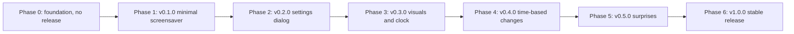
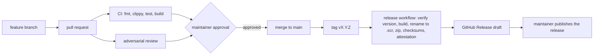

# 0001: 空飛ぶ電子レンジ スクリーンセーバー 初期実装計画(SOW)

- 作成日: 2026-10-31
- ステータス: 合意済み(2026-10-31)。決定事項は[12. 決定事項](#12-決定事項)と[ADR](../adr/README.md)に記録した。
- 対象: AGENTS.mdの「プロジェクト概要」に記載されたWindowsスクリーンセーバー
- 改訂: 2026-10-31 敵対的レビューの指摘を反映([レビュー記録](../reviews/0001-plan-adversarial-review.md))。同日、決定事項を反映し、単独アプリとしての実行を想定した設計を追加した。2026-11-01 Phase 0をスパイクS1〜S4の確認で終え、Phase 1を「最初に動く版」から進める順番に改めた(D-20。[incidents 0006](../incidents/0006-plan-delayed-first-runnable-version.md))。

## 1. 目的

昔のMacintoshにあったFlying Toastersに着想を得た、電子レンジが空を飛ぶWindowsスクリーンセーバーを作る。基本機能から段階的に実装し、実行できる段階ごとにセマンティックバージョニングでGitHub Releaseを公開する。将来のLinux版・macOS版を妨げない設計にする。スクリーンセーバーとしてだけでなく、単独のアプリとしてウィンドウ・全画面でも実行できる設計にする(実装の時期は後で決める)。

本計画は次のドキュメントを根拠・詳細として参照する。

| ドキュメント | 内容 |
| --- | --- |
| [Windowsスクリーンセーバーの仕様調査](../research/windows-screensaver.md) | 一次情報に基づく`.scr`の仕様と要件W-1〜W-11、技術スパイクS1〜S6 |
| [言語・エコシステムの比較検討](../research/tech-stack.md) | 候補の比較と決定(Rust)、ビルド上の注意、依存crateの候補 |
| [先行作品と知的財産上の配慮](../research/prior-art-and-ip.md) | 着想元との関係と方針IP-1〜IP-5、名称の確認 |
| [アーキテクチャ](../design/architecture.md) | 構成要素、起動モード(単独アプリを含む)、シミュレーション、描画、終了判定、セキュリティSEC-1〜SEC-5 |
| [設定項目仕様](../design/settings.md) | 設定項目・既定値・検証規則 |
| [ビジュアルデザイン方針](../design/visual-design.md) | 飛行表現の案、素材の作り方、表現上のガイドラインG-1〜G-6 |
| [将来のオプションのアイデア](../ideas/future-options.md) | 時間的に変化する項目・隠し要素などのアイデア |
| [ADR一覧](../adr/README.md) | 本計画の合意時に起票したADR-0001〜0013 |
| [PRのレビュー手順](../development/review-process.md) | 敵対的レビューの共通ループ |
| [開発参加者向けオンボーディング](../development/onboarding.md) | 後から参加する人の入口 |
| [敵対的レビュー記録](../reviews/0001-plan-adversarial-review.md) | 本計画に対するレビューの指摘と対応 |

## 2. 計画作成時のリポジトリの状態と対応

計画を作成した時点(2026-10-31)では、エージェント設定テンプレートから作成した直後の状態で、製品コードはなかった。AGENTS.mdの検証コマンド表とCIワークフロー(`.github/workflows/`)は未設定で、Phase 0で整える。

確認された不整合・制約と、その対応:

| ID | 内容 | 対応 |
| --- | --- | --- |
| I-1 | AGENTS.mdのプロジェクト概要は「GitHub Copilotは利用しない」とする一方、PR手順や`.claude/commands/babysit-pr.md`はCopilotのレビューを前提にしていた | 解決: Copilotは利用せず(レビューを含む)、敵対的レビューを既定とした([ADR-0007](../adr/0007-adversarial-review-without-copilot.md))。AGENTS.mdとコマンドを更新し、Copilotを使う場合の手順は[PRのレビュー手順](../development/review-process.md)に参考として残した |
| I-2 | `.github/dependabot.yml`の`assignees`がテンプレート由来の値で、本リポジトリの所有者と異なっていた | 解決: 本リポジトリの所有者に変更した |
| I-3 | テンプレートの個人設定用フォルダ(`personal/`)が残っていた | 解決: 削除した |
| I-4 | AGENTS.mdのブランチ名の規則と、Claude Code on the Webが指定するブランチ名(`claude/`で始まる)が異なっていた | 解決: ツールが指定するブランチ名を使ってよいことをAGENTS.mdに明記した |
| I-5 | ライセンスファイルがなかった | 解決: MITを採用し、`LICENSE`を追加した([ADR-0005](../adr/0005-license-mit.md)) |
| I-6 | リポジトリは非公開である。非公開リポジトリのGitHub Releaseはアクセス権のある人しか取得できず、無償のコード署名やアーティファクト証明などにも制約がありうる | 当面は非公開で進め、将来公開する(D-13)。公開に備え、ドキュメントに個人を特定できる情報や会話のやり取りを残さない(AGENTS.md)。公開前の確認はIssue #3で追跡する |

## 3. スコープ

対象(v1.0.0まで):

- Windows 11向けスクリーンセーバー本体(`/s`全画面、`/p`プレビュー、`/c`設定画面)
- 電子レンジと食べ物が飛ぶアニメーション、LED表示の時計
- 設定画面からのパラメーター設定と保存
- 時間的に変化する演出と隠し要素(アイデアから採用したもの)
- GitHub Releaseでの配布(zip、チェックサム、利用者向けREADME)
- 単独アプリとしての実行(ウィンドウ・全画面)を想定した設計([ADR-0012](../adr/0012-standalone-app-mode.md))

時期を後で決めるもの:

- 単独アプリとしての実行の実装。v1.0.0より後でもよい。開発中の確認に役立つ場合は前倒ししてよい

対象外:

- Linux版・macOS版の実装(設計上の考慮のみ。v1.0.0以降に別の計画を立てる)
- ネットワーク通信を伴う機能(天気、テレメトリ、自動アップデート)
- Windows 95向けのパスワード機能(`/a`)
- インストーラとwinget対応(v1.0.0の前に要否を判断する)

## 4. 要件

### 4.1 機能要件

| ID | 要件 | 根拠 | フェーズ |
| --- | --- | --- | --- |
| F-01 | `/s`で起動直後から全モニタを不透明な黒で覆い、カーソルを隠す。その後アニメーションを表示する | W-4、W-9 | 1 |
| F-02 | `/s`ではキーの押下・マウスボタン・タッチ・閾値以上のマウス移動・アプリ全体の非アクティブ化で終了する。複数ウィンドウ間のフォーカス移動や合成イベントでは終了しない | W-4、アーキテクチャ | 1 |
| F-03 | `/p <HWND>`で設定画面のプレビュー枠に描画し、親ウィンドウがなくなったら終了する | W-3 | 1 |
| F-04 | 引数なし(拡張子が`.scr`のとき)・`/c`・認識できない引数で設定画面を表示する。`/c`では前面のウィンドウをオーナーにする | W-2、W-8 | 1(メッセージボックス)、2 |
| F-05 | 電子レンジが画面を斜めに横切って飛び続ける | プロジェクト概要 | 1(仮素材)、3 |
| F-06 | 設定項目を設定画面から変更・保存し、`/s`・`/p`に反映する | プロジェクト概要 | 2 |
| F-07 | `/s`の実行中にモニタが追加・変更されても、すべてのモニタを覆う | W-10 | 2 |
| F-08 | 電子レンジ固有の要素で飛行を表現し、食べ物も飛ぶ | IP-2、IP-5 | 3 |
| F-09 | LED表示に現在時刻を出す | アイデアT-01 | 3 |
| F-10 | 時間的に変化する演出を行う | プロジェクト概要 | 4 |
| F-11 | 隠し要素を実装する | プロジェクト概要 | 5 |
| F-12 | 単独アプリとして、ウィンドウまたは全画面で実行できる(`--window`・`--fullscreen`、または拡張子が`.exe`の実行ファイルを引数なしで起動) | ADR-0012 | 未定(設計はPhase 1から考慮する) |

### 4.2 非機能要件

数値は暫定の目標値で、Phase 1で計測して見直す。

| ID | 要件 | 目標・基準 |
| --- | --- | --- |
| N-01 | 起動の速さ | 起動から全モニタが黒で覆われるまで0.5秒以内、最初のアニメーションのフレームまで1秒以内。計測の起点は、ログの最初の行(`started`)とする。プロセスの起動からその行までの時間(ローダーが依存を解決する時間)は含まない(2026-11-02に決定。D-24のとおりエージェントがログから読むため。測り方は[オンボーディング](../development/onboarding.md)の5.4) |
| N-02 | 終了の速さ | 入力から画面が消えるまで0.2秒以内 |
| N-03 | CPU負荷 | 4Kモニタ1台・60fpsで論理1コアの10%以下 |
| N-04 | メモリ使用量 | 200MB以下。長時間動かしても増え続けない |
| N-05 | 配布サイズ | zip 1つあたり20MB以下 |
| N-06 | 通信 | ネットワーク通信を一切行わない |
| N-07 | 副作用 | `/s`・`/p`の実行中はファイルに書き込まない(ログを有効にした場合を除く)。2026-11-02に変更(D-25): v0.x系の間は、診断用のログ(一時フォルダの`flying-microwave.log`。1MBまで、利用者のデータを含まない)だけは、いつも書く。v1.0.0までに、既定では書かない形にする |
| N-08 | 堅牢性 | 不正な引数・設定ファイルでクラッシュせず、既定値で動作する |
| N-09 | 対応環境 | Windows 11のx64。arm64版は、動作を保証せずに配布する。追加のランタイムを必要としない(VC++ランタイムを静的リンクする)。Windows 10は動作保証外(2025-10-14にサポート終了 [MS-5])。[ADR-0006](../adr/0006-target-windows-11-x64-arm64.md)、[ADR-0016](../adr/0016-arm64-without-guarantee.md) |
| N-10 | 表示品質 | モニタごとのDPIに対応し、どのモニタでも同じ見た目になる。高リフレッシュレートのモニタでもカクつかない(描画時の補間) |
| N-11 | 表現 | ガイドラインG-1〜G-6を満たす(閃光なし、静止要素なし等) |
| N-12 | ライセンス | 依存はすべてOSSライセンス。配布物に依存crateのライセンス表記(フォントなどcrateのメタデータ外のものを含む)を同梱する |
| N-13 | セキュリティ | アーキテクチャのSEC-1〜SEC-5を満たす(DLL検索パスの制限など) |
| N-14 | 省電力 | 省電力のGPUを優先して使う。ディスプレイの電源が切れている間は描画を止める(Phase 3まで) |
| N-15 | 多重起動 | `/s`は単一起動にする |

## 5. 技術選定(決定)

詳細と根拠は[言語・エコシステムの比較検討](../research/tech-stack.md)と各ADRを参照。

| 項目 | 決定 | 記録 |
| --- | --- | --- |
| 言語 | Rust(stable。2026-10-31時点の最新は1.99.1。`rust-toolchain.toml`で固定し、VC++ランタイムを静的リンクする) | [ADR-0001](../adr/0001-use-rust.md) |
| ウィンドウ・入力 | winit 0.30系(eframeの対応に合わせて更新する) | [ADR-0001](../adr/0001-use-rust.md) |
| 描画 | wgpu 30系 | [ADR-0002](../adr/0002-render-with-wgpu.md) |
| 設定画面 | eframe/egui 0.37系(既定機能を無効にし、フォントを差し替える) | [ADR-0003](../adr/0003-settings-ui-with-eframe.md) |
| 設定の保存 | 利用者ごとの設定ディレクトリにTOMLファイル | [ADR-0004](../adr/0004-store-settings-as-toml.md) |
| 素材 | SVG(Phase 3からresvgでラスタライズ) | [ADR-0008](../adr/0008-svg-assets-with-resvg.md) |
| ワークスペース | `core`と`app`の2crate | [ADR-0009](../adr/0009-cargo-workspace-core-and-app.md) |
| シミュレーション | 固定タイムステップ・自前の乱数生成器・時刻の注入による決定的な設計 | [ADR-0010](../adr/0010-deterministic-core-simulation.md) |
| ライセンス表記 | cargo-aboutで生成 | [ADR-0011](../adr/0011-license-notices-with-cargo-about.md) |

## 6. アーキテクチャ概要

詳細は[アーキテクチャ](../design/architecture.md)を参照。

- Cargoワークスペースで、OSに依存しない`flying-microwave-core`(シミュレーション、設定モデル、テーマ選択、終了判定、乱数生成器)と、実行ファイルの`flying-microwave`(起動モード、描画、設定画面、プラットフォーム固有処理)に分ける。どちらもLinuxでビルドできる状態を保つ。
- `core`は決定的に作り(固定タイムステップ、自前の乱数生成器、時刻の注入)、Linux上でも単体テストできるようにする。
- 起動モードの判定はイベントループの生成前に行う(winitは1プロセスにつきイベントループを1つしか作れないため)。
- 実行モードごとの振る舞い(作るウィンドウ、黒での被覆、カーソル、終了判定)を表示ポリシーとして分け、シミュレーションと描画は全モードで共有する。これにより単独アプリとしての実行を後から追加できる。
- プラットフォーム固有コードは`platform`モジュールに閉じ込めるが、2つ目のOSに着手するまで抽象化は作らない。
- Phase 1の時点の構成(`win.rs`、`saver.rs`、`preview.rs`など)と、上の2つの方針との違いはD-27に記録した。

## 7. 段階的実装計画

各フェーズは1つ以上のPRで進め、フェーズの完了時にリリースする。リリース後の不具合修正はパッチバージョン(例: v0.1.1)で出す。依存crateは、最初に使う時点(スパイクを含む)の前にメンテナーの承認を得る。コミットは1つの論理変更ごとに分け、行き詰まったときに戻しやすくする。

### 7.1 全フェーズ共通のリリース条件

各フェーズのリリースは、次をすべて満たしてから行う。

1. 自動テストとCIの全ジョブがグリーン。
2. 敵対的レビューが完了している(各指摘に対応したか、対応しない理由を記録した)。
3. Windows 11実機で[手動テストのチェックリスト](#82-手動テストwindows実機)に合格している。確認できなかった項目はリリースノートに明記する。
4. 非機能要件の計測値を記録している。目標に届かない場合は、対応方針をメンテナーが決めている。
5. ルートのREADME・利用者向けREADME・CHANGELOG・設定項目仕様などのドキュメントが実態と一致している。開発参加者向けのオンボーディングの「この文書で扱う作業」の一覧が、そのリリースの実態で満たされている(未整備の項目は、理由と時期が書かれている。[incidents 0010](../incidents/0010-onboarding-missed-build-steps.md))。
6. メンテナーが承認している。

### 7.2 リリース手順

1. バージョンを上げるPRを作る(`Cargo.toml`のバージョンとCHANGELOGの`## vX.Y.Z (日付)`の節。実行ファイルのバージョン情報は`build.rs`で`Cargo.toml`から生成し、二重管理しない)。利用者向けREADMEを確定し、冒頭の下書きの印と注記を消す(作業13)。
2. 共通のリリース条件を満たし、メンテナーの承認を得てからマージする。
3. メンテナーが、`main`のそのコミットに`vX.Y.Z`のタグを付ける(タグはルールセットで保護されている)。
4. タグのプッシュで、リリースのワークフロー(`release.yml`)が動く。検査のジョブは、タグと`Cargo.toml`のバージョン、CHANGELOGの節、利用者向けREADMEに下書きの印がないことを確かめる。ビルドのジョブがx64とarm64の実行ファイルを作り、それと並行してライセンスのジョブが`THIRD-PARTY-LICENSES.txt`を作る。zipのジョブが、x64とarm64のzip(実行ファイル、`README.md`、`LICENSE.txt`、`THIRD-PARTY-LICENSES.txt`、SBOMの`.spdx.json`)を作り(D-31)、下書きを作るジョブが`SHA256SUMS.txt`とGitHub Releaseの下書きを作る。リリースノートの最後には、arm64版についての決まった節が付く。失敗したときは、7.3の手順3と同じく、エージェントが`main`から手動実行する(D-23)。
5. メンテナーが下書きの内容を確かめて公開する。arm64のzipは、実機では確かめない(ADR-0016)。

### 7.3 プレリリースの手順

2026-11-01に加えた(D-20)。正式なリリースの前に、動く版ができるたびに、プレリリース`vX.Y.Z-alpha.N`として公開する。動作を保証しない試作版である。段階1・2のプレリリースは、x64だけを配布した。段階3でリリースのワークフローがarm64もビルドするようにしたため、それ以降のプレリリースにも、arm64版が含まれる([ADR-0016](../adr/0016-arm64-without-guarantee.md)、D-23)。

1. バージョンを`X.Y.Z-alpha.N`に上げるPRを作る(`Cargo.toml`のバージョンと、CHANGELOGのプレリリースの項目)。7.1の条件のうち、1(CIの全ジョブがグリーン)・2(レビューの完了)・6(メンテナーの承認)と、その段階で作った機能の手動テストを満たしてからマージする。あわせて、開発参加者向けのオンボーディングの「この文書で扱う作業」の一覧が、その段階の実態で満たされていることを確かめる([incidents 0010](../incidents/0010-onboarding-missed-build-steps.md))。非機能要件の計測と、利用者向けのドキュメントの確定は、正式なリリースのときに行う。
2. メンテナーが、`main`のそのコミットに`vX.Y.Z-alpha.N`のタグを付ける(タグはルールセットで保護されている)。
3. タグのプッシュで、リリースのワークフロー(`release.yml`。作業12)が動き、GitHub Releaseの下書き(プレリリース)を作る。ワークフローは、キャッシュを使わずにビルドし(9章)、`FlyingMicrowave-<version>-windows-x64.zip`と`FlyingMicrowave-<version>-windows-arm64.zip`(それぞれ、実行ファイル、`README.md`(下書き)、`LICENSE.txt`、`THIRD-PARTY-LICENSES.txt`)と`SHA256SUMS.txt`を添付する(段階1・2のプレリリースは、x64のzipだけだった)。リリースノートは、CHANGELOGのその版の節から作り、最後にarm64版についての決まった節が付く。ワークフローが動かなかったときや失敗したときは、エージェントが、実行中のものがないことを確かめてから、`main`から、タグを指定して手動実行する。失敗して不完全な下書きが残ったときは、手動実行の前に、メンテナーがその下書きを削除する(削除は破壊的な操作のため。同じタグの下書きがあると、ワークフローは止まる)。
4. メンテナーが、下書きの中身を確かめ、x64のzipで実機での確認を行ってから、公開する。arm64のzipは、実機では確かめない。添付されていることと、リリースノートの末尾のarm64版の節を確かめる(ADR-0016)。リリースノートは、必要なら画面で直す(インストールの手順など、CHANGELOGにない内容)。エージェントは、下書きができたことと、確かめる点を伝える。

2026-11-01の変更(D-21): 当初は、エージェントがCIの手動実行で成果物を作り、メンテナーがGitHub Releaseの画面でプレリリースを作る手順だった(`v0.1.0-alpha.2`の成果物は、この手順で作り、メンテナーが実機で確かめた)。メンテナーの依頼で、作業12を段階3から前倒しし、下書きまでをワークフローで作るようにした。`v0.1.0-alpha.2`は、ワークフローの手動実行で下書きを作り直し、添付のzipで実機の確認をし直してから公開する(前の手順の成果物とは別のビルドになるため)。

### Phase 0: 基盤整備(リリースなし)

目的: 決定した技術で実装を始められる状態にし、Windows実機でしか確かめられない技術的な不確実性を先に潰す。

計画の合意時に済ませたもの: ADR-0001〜0013の起票、`LICENSE`の追加、Dependabotの担当者の修正、`personal/`の削除、AGENTS.mdとPRコマンドのレビュー手順の更新、オンボーディング文書と利用者向けREADMEの下書き。

作業:

1. 製品名「Flying Microwave」の商標の確認(D-5)。米国(USPTO)は2026-10-31に同じ文字列のフレーズ検索を行い、同じ文字列の登録・出願は見当たらず、着想元に関係する第9類の登録は失効していた([先行作品と知的財産上の配慮](../research/prior-art-and-ip.md#名称の確認))。米国の結果の再確認(自動化したブラウザで得た結果のため)、空白なしの表記や類似の商標、日本(J-PlatPat。自動化したブラウザからの接続を拒否される)は、メンテナーが通常のブラウザで確認し、結果を同じ文書に追記する。
2. Cargoワークスペースの雛形(`crates/core`・`crates/app`)、`rust-toolchain.toml`、`.cargo/config.toml`(Windowsターゲットの`+crt-static`)、lint設定を作る。crate名は`flying-microwave-core`・`flying-microwave`とする。
3. AGENTS.mdの検証コマンド表を確定する(下表の案)。
4. CIワークフローを追加する(`.github/workflows/`の変更はセキュリティ設定のため要承認)。Windowsランナーでfmt・clippy・テスト・x64ビルド(2026-11-01に変更: arm64はLinuxランナーでの型チェックだけ。[ADR-0016](../adr/0016-arm64-without-guarantee.md))・依存DLLの確認(システムDLLだけか)・依存crateの重複検出(`cargo tree -d`)を行う。Linuxランナーでワークスペース全体のビルド・clippy・テストを行う(アーキテクチャのA-7)。ActionsはコミットSHAで固定し、ジョブごとの権限を最小にする。非公開リポジトリではWindowsランナーが無料枠を消費することに留意する。
5. Dependabotにcargoを追加する(`.github/dependabot.yml`の変更は要承認。`cooldown`は維持する)。0.x系のcrateはマイナー更新でも破壊的変更になりうるため、egui系・winit・wgpuは一緒に更新されるようにグループを分ける。
6. `CHANGELOG.md`を追加する。
7. 技術スパイクS1〜S6を行う。スパイク用の依存(winit・wgpu・pollster・windows-sys・eframe。2026-11-01にsaver-spikeへlogを追加)について事前に承認を得る。スパイクは`spikes/`に置き、ワークスペースに含めず製品コードから参照しない。CIまたはメンテナーのWindows環境でビルドし、メンテナーがWindows 11実機で実行して結果を`docs/research/spike-results.md`に記録する。
8. GitHubのWindowsランナーでGUIを伴うスモークテスト([8.1 自動テスト](#81-自動テスト))が実行できるかを確認する。

検証コマンド表(Phase 0でAGENTS.mdに確定した):

| 用途 | コマンド |
| --- | --- |
| セットアップ | `rustup toolchain install`(`rust-toolchain.toml`のツールチェーンを導入) |
| テスト | `cargo test --workspace --locked` |
| リント・フォーマット | `cargo fmt --all --check`、`cargo clippy --workspace --all-targets --locked -- -D warnings` |
| 型チェック | `cargo check --workspace --all-targets --locked` |
| ビルド | `cargo build --release --locked`(Windows向けの成果物はCIのWindowsランナーで作る) |

エージェントのLinux環境でもこれらを実行できるよう、`app`クレートはLinuxでビルドできる状態を保つ(Windows固有のコードはLinuxではコンパイルされないため、その部分の確認はWindowsのCIで行う)。ドキュメントだけの変更(Rustのコード・Cargoの設定・ワークフローを変えないもの)では、テスト・リントは不要とする(AGENTS.md)。

完了条件:

- 雛形の状態でCIの全ジョブがグリーン
- スパイクS1〜S6の結果が記録され、結果に応じて本計画・アーキテクチャ・ADRを更新済み(例: S1が不成立ならプレビューの代替案を決め、S2が不成立なら設定画面の方式を新しいADRで見直す)

2026-11-01の変更(D-20): Phase 0は、スパイクの4回目の実機での確認を最後に終える。4回目の結果は、[スパイクの結果](../research/spike-results.md)に記録する。S1〜S4の判定は、3回目までの確認で、いずれも「一部成立」である。方式は使えるが、確かめていない項目が残っている。残りの項目は、Phase 1の製品で確かめる。

- S1: 親のウィンドウの消失による終了、表示の拡大率を変えた場合、プロセスが残らないこと。
- S2: オーナーのウィンドウを前面に戻すこと(`SetForegroundWindow(owner)`が失敗した)。設定ウィンドウはPhase 2で作るため、Phase 2で確かめる。
- S4: 2台目のモニタで描画できるか(4回目の確認ではモニタごとに確かめていない)、拡大率の違うモニタの組み合わせ、ウィンドウの大きさが一時的に変わる現象の原因。`/s`のウィンドウの作り方(winitの`with_fullscreen`を使わない)は、[ADR-0019](../adr/0019-screensaver-windows-without-winit-fullscreen.md)とアーキテクチャに反映した。
- S5(インストールの方法)とS6(GPUのない環境)は、まだ確かめていない。

完了条件のうち、S1・S4の残りの項目とS5・S6の記録、その反映は、Phase 1の完了条件に移す。S2の残りの項目は、Phase 2の完了条件に移す。作業1の商標の確認も、Phase 1の完了条件に移す(v0.1.0のリリースの前に済ませる。D-30でv0.1.1の完了条件に移した)。

### Phase 1: v0.1.0 最小のスクリーンセーバー

目的: Windowsのスクリーンセーバーとして選択・プレビュー・実行・終了ができる最小のものを出す。

進め方(2026-11-01に変更。D-20): AGENTS.mdの「基本機能から段階的に実装していく」に従い、最初に動く版を最優先で作り、実機で動かしてから残りの作業を足す。下の作業を、次の3段階で進める。

1. 最初に動く版: `/s`で、全モニタに仮の図形の電子レンジが飛び、入力で終了する。作業1〜6と9。作業1〜4は、テストとともにすでにある。CIで製品の実行ファイルを成果物として作る(ワークフローの変更は、PRでメンテナーの承認を得る)。メンテナーが実機で動かし、S4の残りの項目も確かめる。作業11(ライセンス表記の生成)も、配布物に含めるためにこの段階で行う。動いたら、[7.3の手順](#73-プレリリースの手順)でプレリリース`v0.1.0-alpha.1`として公開する。
2. 残りのモード: 作業7(`/p`)と作業8(Settingsのメッセージ)。スパイクS1で方式は確かめてある。実機での確認で、S1の残りの項目も確かめる。S6は段階3に回した(D-22)。動いたら、7.3の手順でプレリリース`v0.1.0-alpha.3`として公開する(`v0.1.0-alpha.1`を公開しなかったため、段階1は`alpha.2`、段階2は`alpha.3`になった)。
3. 配布の準備: 作業10・12の残り(arm64のビルドと自動の確認。D-21)・13。S5(インストールの方法)を確かめ、作業13に反映する。S6(GPUのない環境。仮想マシンなどで、WARPへのフォールバック)も、この段階で確かめる(D-22)。ここでv0.1.0をリリースする。2026-11-02の変更(D-30): S5・S6と実機での確認は、v0.1.1に移した。作業14(スモークテスト)は、v0.1.0に間に合わなければ、その後のパッチバージョンで加える。

PRは、段階ごとのまとまりで作る。実機での確認も、段階ごとにまとめて依頼する(往復を減らすため)。

作業(テストを先に書く順):

1. 引数解析(`cli`): [アーキテクチャの引数解析の規則](../design/architecture.md#起動モードの判定)の各行(`/c`のオーナー、余分な引数、単独アプリ用の長いオプションと拡張子による判定を含む)をテストにしてから実装する。単独アプリのモード自体は実装しない。Standaloneと判定された場合(開発中に`.exe`を引数なしで起動した場合や、`--window`・`--fullscreen`を付けた場合)は、まだ使えない旨のメッセージボックスを表示して終了する。
2. 終了判定(`core::exit_policy`): [アーキテクチャの入力と終了判定](../design/architecture.md#入力と終了判定)の各項目(閾値、キーの押下と解放、合成イベント、自アプリのウィンドウ間のフォーカス移動、起動直後の猶予時間、タッチ、閉じる要求、プレビューでの入力無視)をテストにする。モードごとのポリシーとして実装する(A-8)。
3. 乱数生成器(`core::rng`): 既知の出力列と一致することをテストにする。
4. シミュレーション(`core::sim`): 指定数の出現、左下方向への移動、画面外での再出現、同じシードで同じ結果になること、経過時間の上限処理、描画用の補間をテストにする。
5. 描画(`render`): wgpuによるスプライト描画。仮素材(単純な図形)を使う。省電力のGPUを優先し、DX12のシェーダーコンパイラを`Fxc`に明示する(SEC-2)。
6. `/s`: 単一起動、全モニタを黒で覆ってからの描画開始、カーソル非表示、入力での終了。描画の初期化に失敗したら黒い画面のまま入力を待つ。ただし、GPUの初期化が15秒で終わらない場合は終了する(D-27)。
7. `/p`: プレビュー枠の子ウィンドウへの描画、親ウィンドウの消失での終了。
8. Settingsと判定されたすべての場合([アーキテクチャの引数解析の規則](../design/architecture.md#起動モードの判定)でSettingsになる行。引数なしで拡張子が`.scr`、`/c`、`--settings`、認識できない最初の引数、HWNDのない`/p`など): 「設定は今後のバージョンで追加する」旨のメッセージボックス(UIラベルは英語)。
9. セキュリティ: SEC-1(DLL検索パスの制限とリンカ設定)、SEC-3(HWNDの検証)。
10. Windowsリソースの埋め込み(アイコン、バージョン情報、String Tableの序数1)、`.scr`へのリネーム、VC++ランタイムを静的リンクしていることのCIでの確認。
11. 依存crateのライセンス表記ファイル(`THIRD-PARTY-LICENSES.txt`)の生成(ADR-0011)。Windowsで開きやすいよう、拡張子を付けたテキスト形式にする。フォントなどcrateのメタデータ外のライセンスも確認する。
12. リリースワークフロー(要承認): タグのプッシュでビルドし、zip・チェックサム・(利用できれば)アーティファクト証明を作り、GitHub Releaseの下書きを作る。
13. 利用者向けREADME(`packaging/windows/README.md`。2026-11-02にテキスト形式からMarkdownに変えた)を確定する。確定したら、冒頭の下書きの印(`<!-- draft -->`)と下書きの注記を消す。印が残っていると、正式なリリースのタグの検査が失敗する。インストール手順はスパイクS5の結果に合わせ(D-30で、S5はv0.1.1に移した。v0.1.0の説明書の手順は実機で確かめていない)、既知の制限(SmartScreenの警告、Smart App Controlによるブロック、グループポリシーで固定された環境)を書く。ルートのREADMEの「状況」と「利用者の方へ」を更新する。
14. Phase 0で実行可能と分かった場合は、Windowsランナーでのスモークテストを追加する。

完了条件: [全フェーズ共通のリリース条件](#71-全フェーズ共通のリリース条件)に加えて、Phase 0から移した次の項目(D-20)。

- スパイクS1・S4の残りの項目、S5、S6を製品で確かめ、記録し、結果を本計画・アーキテクチャ・ADRに反映している。
- 商標の確認(Phase 0の作業1)が済んでいる。

2026-11-02の変更(D-30): v0.1.0は、実機での確認をしないまま出す。上の2つの完了条件と、共通のリリース条件のうち実機での確認(手動テスト、N-01〜N-04の記録)は、v0.1.1の完了条件に移す。v0.1.1は、スモークテスト(作業14)を加える版で、Phase 2の前に出す(D-24)。v0.1.1の完了条件は次のとおり。

- スモークテスト(作業14)をx64とarm64のリリースのジョブで実行している(D-24)。
- v0.1.1の候補の成果物(x64)で、メンテナーが実機での確認を行い、結果を記録している。確認の項目は、手動テスト(7.1)、スパイクS1・S4の残りの項目、S5、S6(Windows Sandbox)、N-01〜N-04である。見つかった問題は、v0.1.1で直すか、既知の制限として書く。
- 結果を本計画・アーキテクチャ・ADR・スパイクの結果に反映し、利用者向けREADMEの手順を確かめた結果に合わせている。説明書の既知の制限から、実機で確かめていない旨の行を消している。
- 商標の確認(Phase 0の作業1)が済んでいる。
- リリースのワークフローの所要時間を短くしている(D-31)。v0.1.1のタグの実行の所要時間を記録する。

リリース: 段階1・2でプレリリース(`v0.1.0-alpha.N`。x64だけ)、段階3でv0.1.0(x64。arm64版は動作を保証せずに配布する)

### Phase 2: v0.2.0 設定画面

目的: 設定画面から主要なパラメーターを変えられるようにする。

見た目の要件(2026-11-01に加えた): スパイクの設定画面は、配置の釣り合いが悪く、見た目が整っていなかった(スパイクの結果の4回目)。製品の設定画面は、配置と余白を整えた、洗練された見た目にする。同じ技術(Rust)で作られた別のスクリーンセーバーの設定画面を、参考にしてよい。設計のときに見た目の案を作り、メンテナーの確認を得る。

作業:

1. 設定ファイルの具体的な保存場所をADRで決める(形式はADR-0004で決定済み)。
2. `core::config`: [設定項目仕様](../design/settings.md)のv0.2.0の項目と検証規則をテストにしてから実装する。
3. `storage`: 設定ファイルの読み書き(サイズ上限、壊れたファイルの扱い、一時ファイルを使った置き換え)。
4. 設定画面(eframe): Flight / Display / About タブ、OK・Cancel・Defaults。eframeは既定機能を無効にして必要な機能だけを使い、フォントはライセンスを確認したものにする。`/c`のオーナーに対するモーダル化はスパイクS2の結果に従う(Phase 1のメッセージボックスはオーナーを付けずに表示しており、オーナーへの対応はこの作業で行う。F-04)。
5. `/s`・`/p`で設定を読み込んで反映する。
6. `/s`の実行中のモニタの追加・変更への対応(F-07)。
7. 利用者向けREADMEに、設定の使い方と設定ファイルの場所を追記する。
8. フェーズの最初に、文書全体の用語の点検(Issue #28)を行う。設定画面の設計を始めるときに、参考にする別のリポジトリを、読み取りだけの権限でセッションに加える(D-24)。
9. 公開の前の点検(Issue #3)を行い、リポジトリを公開する時期を決める(D-24)。

完了条件: 共通のリリース条件に加え、設定の保存と反映、壊れた設定ファイルでもクラッシュしないことをテストと実機で確認する。スパイクS2の残りの項目(オーナーのウィンドウを前面に戻すこと)を製品で確かめ、記録する(D-20)。`spikes/`とスパイクのワークフローを削除する(D-28)。

リリース: v0.2.0

### Phase 3: v0.3.0 見た目と時計

目的: 仮素材を本番の見た目に置き換え、電子レンジらしい表現にする。

作業:

1. 飛行表現は[ビジュアルデザイン方針](../design/visual-design.md)の案A(ドアの羽ばたき)で進め、素材の作成時に見え方を確認する(D-9)。
2. SVG素材の作成と取り込み(resvg)、素材のライセンス記録。
3. ドアの開閉、ターンテーブルの回転、LED表示の時計(T-01)、飛ぶ食べ物、奥行きによる大きさと速度の違い。
4. 設定項目の追加(食べ物の数、時計の表示形式など)。
5. ディスプレイの電源が切れている間の描画停止(N-14)。
6. 本番の素材に合わせて、READMEのバナー(`docs/assets/banner.svg`)と実行ファイルのアイコン(`crates/app/res/icon.svg`)を作り直す。

完了条件: 共通のリリース条件に加え、ガイドラインG-1〜G-6のセルフチェックを記録する。

リリース: v0.3.0

### Phase 4: v0.4.0 時間的に変化する演出

目的: 時刻や日付によって変化する楽しさを加える。

作業: フェーズの着手時に[将来のオプションのアイデア](../ideas/future-options.md)から採用する項目を選ぶ。推奨の候補は、背景の時間帯変化(T-02)、季節・行事のテーマ(T-04)、タイマーのカウントダウン(T-06)。日付・時刻を注入したテストで境界条件(日付の切り替わり、年末年始など)を確かめる。設定画面にExtrasタブを追加する。

完了条件: 共通のリリース条件に加え、採用した各演出の発動条件をテストで確認する。

リリース: v0.4.0

### Phase 5: v0.5.0 隠し要素

目的: まれに起こる驚きを加える。

作業: フェーズの着手時にアイデアから採用する項目を選ぶ。推奨の候補は、金色の電子レンジ(E-01)、開発者表示(E-07)、デモ用の起動オプション(E-12)。確率で起こる要素は、乱数のシードを固定したテストで発生条件を確かめる。

フェーズの終わりに、コード署名の方針を判断する(Issue #2、D-24)。判断の材料(SignPath Foundation、有償の署名サービス、署名しないことの条件と費用)は、それまでに一次情報で調べる。

完了条件: 共通のリリース条件に加え、隠し要素をすべて設定でオフにできることを確認する。

隠し要素の内容は、`CHANGELOG.md`とリリースノートに書かない(AGENTS.mdの「ドキュメント」の規則)。記録は開発者向けの文書(`docs/`)に残す。

リリース: v0.5.0

### Phase 6: v1.0.0 安定版

目的: 機能を固め、安心して配布できる状態にする。

作業:

1. 機能の凍結と不具合修正、長時間動作の確認(メモリ使用量が増え続けないこと)。
2. 配布の改善の判断: コード署名の再判断(Issue #2「Decide code signing policy before v1.0.0」、[ADR-0013](../adr/0013-no-code-signing-for-v0.md))、インストーラ、wingetへの登録の要否。署名の判断は、Phase 5の終わりに行う(D-24)。
3. 診断用のログを、既定では書かない形にする(D-25)。
4. 単独アプリとしての実行の実装時期の判断(F-12)。
5. ドキュメントの整備(ルートのREADME、利用者向けREADME、設定の説明)。

完了条件: 共通のリリース条件に加え、8時間以上の連続動作で異常がないことを確認する。

リリース: v1.0.0

## 8. テスト戦略

### 8.1 自動テスト

- TDD(Red → Green → Refactor)で、`core`のロジックと引数解析を単体テストする。WindowsとLinuxの両方のCIで実行する。
- シミュレーションは自前の乱数生成器・固定シード・固定タイムステップで、位置や個数などの結果を決定的に比較する。
- スモークテスト(Phase 0で実行可能性を確認し、可能ならPhase 1で導入): Windowsランナーで、GPUの代わりにWARP(ソフトウェア描画)を使い、次を確かめる。`/s`が送信したキー入力で0.2秒以内に終了すること、`/p`がテスト用の親ウィンドウの破棄で終了すること、不正な引数で全画面にならないこと、終了後にプロセスが残らないこと。
- 描画結果の画像比較は当面行わない。GPUを使う描画をCIで安定して比較するには環境の準備が必要で、初期の費用対効果が低いため。必要になったらwgpuのオフスクリーン描画で導入を検討する。

### 8.2 手動テスト(Windows実機)

各リリースの前に、メンテナーがWindows 11実機で次を確認する(エージェントの開発環境はLinuxで、Windowsの画面を伴う動作は確認できないため)。

1. 設定の「スクリーンセーバー」一覧に、想定した名前で表示される。
2. プレビュー枠にアニメーションが表示される。別のスクリーンセーバーに切り替えると、プレビューのプロセスが終了する(タスクマネージャーで確認)。
3. 「設定」ボタンで設定画面(Phase 1はメッセージボックス)が前面に表示される。
4. 「プレビュー」ボタン(マウスでの押下とEnterキーでの押下の両方)で全画面になり、直後に勝手に終了しない。マウス移動・キー・クリック・タッチ(環境がある場合)のそれぞれで終了し、わずかなマウスの揺れでは終了しない。
5. 待ち時間の経過で自動的に起動する。
6. 複数モニタ(DPIが異なる組み合わせを含む)のすべてが覆われ、起動直後に終了しない(環境がある場合)。
7. 「再開時にログオン画面に戻る」を有効にしたとき、終了後にロック画面が表示される。
8. `.scr`のダブルクリック、右クリックメニューの「テスト」「構成」「インストール」が期待どおり動く。
9. ダウンロードしたzip(インターネットから取得した印が付いたもの)から展開した`.scr`で動く。
10. VC++ランタイムが入っていないクリーンな環境(Windows Sandboxなど)で動く。
11. 空白や日本語を含むパス・ユーザー名の環境で動く。
12. DLLの差し替えが効かない(SEC-1): `.scr`と同じフォルダに、中身のない`D3d10warp.dll`・`d3d12.dll`・`dxgi.dll`を置いて`/s`で起動し、Process Monitorで、そのフォルダのこの3つのファイルのパスへの操作(ファイルを開く`CreateFile`を含むすべての操作)が1件もないことを確かめる。読み込み(Load Image)がないことだけでは判定しない(中身のないファイルは、探しに来て開いても読み込みに失敗するだけで、Load Imageのイベントにならないため)。保護が効いていれば、そのフォルダを探しに来ないので、ファイルを開く操作も出ない。前の2つは実行中の読み込み(`SetDefaultDllDirectories`で守る)、`dxgi.dll`は起動時の静的な依存(リンカ設定`/DEPENDENTLOADFLAG`で守る)を確かめるためのものである。正常に動くことだけでは判定しない(GPUのある実機では、`D3d10warp.dll`の読み込みに失敗しても表に出ないため)。
13. スリープやディスプレイの消灯から復帰したときに正しく動く・終了する。
14. Smart App Controlが有効な環境での挙動を記録する(環境がある場合)。
15. arm64版: 実機での手動テストは行わない。リリースのワークフローの自動の確認(ビルド、依存DLLの確認、動く場合はスモークテスト)が通ったことを確かめ、リリースノートに、arm64版は動作を保証しないことと、行った確認を明記する([ADR-0016](../adr/0016-arm64-without-guarantee.md))。
16. CPU使用率・GPU使用率・メモリ使用量を記録する。
17. 終了後にプロセスが残らない。
18. 利用者向けREADMEの手順どおりに導入・削除できる。
19. 実行ファイルのリソース: エクスプローラーの大アイコンの表示で、`FlyingMicrowave.scr`が、濃い青の角丸の四角に白い電子レンジの絵のアイコンで表示される。右クリックの「プロパティ」の「詳細」タブで、製品名が`Flying Microwave`、製品バージョンが`Cargo.toml`の版(たとえば`0.1.0-alpha.4`)、ファイル バージョンが数値の版(たとえば`0.1.0.0`)と表示される。前の版を置いたことのあるフォルダでは、エクスプローラーのアイコンのキャッシュのために古いアイコンのまま表示されることがあるため(推測)、新しいフォルダに置いて確かめる。

## 9. CI/CD・リリース

- 配布物(案): `FlyingMicrowave-<version>-windows-x64.zip`、`FlyingMicrowave-<version>-windows-arm64.zip`、`SHA256SUMS.txt`。zipには`FlyingMicrowave.scr`、利用者向けの`README.md`(`packaging/windows/README.md`)、`LICENSE.txt`(ルートの`LICENSE`の写し)、`THIRD-PARTY-LICENSES.txt`、SBOM(`FlyingMicrowave-<version>-windows-<arch>.spdx.json`。SPDX 2.3のJSON。D-29、[ADR-0021](../adr/0021-spdx-sbom-with-own-script.md))を入れる。単独アプリとしての実行を実装したら、`.exe`の同梱方法を決める(ADR-0012)。
- `.scr`単体はメールやブラウザで危険なファイルとして扱われやすいため、zipで配布する。
- ワークフローの安全対策: ActionsはコミットSHAで固定する、ジョブごとの`permissions`を最小にする、`--locked`でビルドする、リリース用のタグを保護する。リリースのワークフローではビルドのキャッシュを復元せず、毎回最初からビルドする(CIのキャッシュは[ADR-0017](../adr/0017-ci-build-cache-and-x64-spike-builds.md))。
- ビルドの出所を検証できるよう、GitHubのアーティファクト証明(artifact attestations)を付ける。非公開リポジトリで利用できるプランは限られるとレビューで指摘されており(GitHubのドキュメントは調査環境から接続できず未確認)、利用できない間は付けない。利用するActionは実装時に公式ドキュメントで確認する[GH-1]。
- v0.x系は署名せずに配布し、SmartScreenの警告と、Smart App Controlの強制モードでのブロック[MS-6]を既知の制限として明記する([ADR-0013](../adr/0013-no-code-signing-for-v0.md))。v1.0.0の前に再判断する(Issue #2)。
- SignPath Foundationの無償署名の条件(原文で確認)[SP-1]: すべての構成要素がOSIの承認したライセンスであること(商用のデュアルライセンス不可)、独自(非OSS)コンポーネントを含まないこと、署名する形で既にリリースされていること、アンインストールの手順または仕組みを提供すること、検証可能な方法でソースからビルドすること、全メンバーの多要素認証、リリースごとの手動承認、コード署名ポリシーの公開など。加えて「a certain verifiable reputation」が求められるため、新しいプロジェクトは申請が通らない可能性がある。証明書の発行先(発行者表示)はSignPath Foundationになる。条件の原文に「public」という語はないが、署名するソースと検証可能なビルドを第三者が確かめられる必要があることから、実際には公開リポジトリが必要になると推測されるため、公開の時期とあわせて検討する。
- 非公開の間の制約: Releaseはアクセス権のある人しか取得できない。WindowsランナーはActionsの無料枠を消費する(倍率などの詳細は要確認)。
- リリースノートは`CHANGELOG.md`から作る。

## 10. レビュー体制(敵対的レビュー)

[ADR-0014](../adr/0014-risk-based-review-depth.md)(ADR-0007を置き換えた)と[PRのレビュー手順](../development/review-process.md)に従う。要点:

1. PRごとに、作成者とは別のコンテキストを持つレビュー用エージェントに、差分と要件だけを渡して欠陥を探させる。作成者の結論を渡さない。再レビューでは、例外として前回の指摘と対応の一覧も渡す。
2. 重要な変更(アーキテクチャ、セキュリティ、リリース関連)では、別系統のモデル(OpenAI Codexなど)による2回目のレビューを任意で行う。
3. レビューの指摘は検証すべき主張として扱い、一次情報やソースで確かめてから対応する。指摘と対応はPR上に残し、計画・設計のレビューは`docs/reviews/`に記録する。
4. 最終判断とマージの承認はメンテナーが行う。
5. GitHub Copilotは、プロジェクト概要のとおり利用しない(レビューにも使わない)。Copilotでレビューする場合の手順はレビュー手順に参考として残しており、同じループで進める。

本計画自体も、別コンテキストのエージェントによる敵対的レビューを行い、[敵対的レビュー記録](../reviews/0001-plan-adversarial-review.md)に記録した。

## 11. リスクと対策

| ID | リスク | 影響 | 対策 |
| --- | --- | --- | --- |
| R-01 | Microsoftがスクリーンセーバーよりロック画面を推奨しており[MS-4]、将来のWindowsで機能が縮小される | 配布の価値が下がる | `core`を分離し、単独アプリとしての実行や他OSへ転用できるようにしておく。Windowsのリリース情報を確認する |
| R-02 | `/p`のプレビュー枠(子ウィンドウ)でwinit・wgpuが期待どおり動かない | プレビューが表示されない | Phase 0のスパイクS1で確認する。不成立なら、プレビューのみCPU描画にする、静止画を表示するなどの代替案を決める |
| R-03 | `.scr`の配布がブラウザ・メール・SmartScreen・ウイルス対策ソフトで警告またはブロックされる。Smart App Controlが強制モードの環境では、署名なしの`.scr`は動かない可能性が高い[MS-6] | 利用者が導入できない、不安を与える | zipで配布、チェックサムと(利用できれば)アーティファクト証明を付ける、利用者向けREADMEに既知の制限として書く。署名はv1.0.0の前に再判断する(ADR-0013、Issue #2) |
| R-04 | GPUが使えない環境(仮想マシン、古いドライバ) | アニメーションが表示されない | S6として、v0.1.1の候補の製品で挙動を確認し(D-20、D-22、D-30)、WARPへのフォールバックなどを決める。描画できなくても黒い画面で覆い続ける(W-9。ただし、GPUの初期化が15秒で終わらない場合は終了する。D-27) |
| R-05 | winit 0.31への移行(破壊的変更)、wgpu・egui系のバージョン整合 | 依存更新の手間、同じcrateの複数バージョンの混入 | winit・wgpuはeframeが依存する系列に固定し、eframeの対応に合わせて一緒に上げる。Dependabotのグループを分け、CIで重複を検出する |
| R-06 | 着想元との類似による知的財産上の問題 | 公開停止など | 方針IP-1〜IP-5とガイドラインG-1に従い、独自の表現・素材にする。製品名の商標を確認する(Phase 0) |
| R-07 | エージェントの開発環境がLinuxで、Windowsの画面を伴う動作をエージェントが確認できない | 不具合の発見が遅れる | ロジックを`core`に寄せて自動テストする。CIのWindowsランナーでビルド・テスト・(可能なら)スモークテストを行う。手動テストのチェックリストをメンテナーが実施する |
| R-08 | 依存crateやActionsを経由したサプライチェーン攻撃 | 悪意あるコードの混入 | `Cargo.lock`をコミットし`--locked`でビルドする。Dependabotの`cooldown`を維持する。依存追加は事前承認。ActionsのコミットSHAでの固定、最小権限、タグの保護。脆弱性・ライセンスの自動チェック(cargo-deny等)の導入を検討する(要承認) |
| R-09 | 光過敏・焼き付きへの配慮不足 | 利用者の健康・機器への悪影響 | ガイドラインG-3〜G-5をレビューの確認項目にする |
| R-10 | MSVCツールチェーン(非OSS)への依存 | ビルド環境の制約 | CIのWindowsランナーで利用できることをPhase 0で確認する。必要なら`*-windows-gnullvm`ターゲットを検討する |
| R-11 | 依存crateのライセンス表記の同梱漏れ | ライセンス違反 | Phase 1でライセンス表記の生成をリリースワークフローに組み込む。crateのメタデータ外のライセンス(フォントなど)も確認する |
| R-12 | リポジトリが非公開の間の制約(I-6) | Releaseを一般に配布できない。署名・証明などが使えない | 当面は非公開で進める。公開の前に、履歴・メタデータ・Issue・PRに個人を特定できる情報や秘密情報が含まれていないかを確認し、履歴の扱いを決める(Issue #3「Audit repository before making it public」) |
| R-13 | DLL検索順序の乗っ取り(`.scr`と同じフォルダの悪意あるDLLの読み込み) | 任意コードの実行 | SEC-1・SEC-2をPhase 1で実装し、PR本文でセキュリティ変更として明示する |
| R-14 | eframeの既定フォントのライセンス(Ubuntu Font Licence)がOSIの承認ライセンスでない | 署名サービスの条件に抵触、表記漏れ | eframeの既定機能を無効にし、フォントを差し替える |
| R-15 | 複数モニタで終了判定が誤作動する(起動直後の終了など) | スクリーンセーバーとして使えない | アーキテクチャの終了判定の設計に従い、テストとスパイクS4で確認する |
| R-16 | VC++ランタイムへの依存の見落とし | クリーンな環境で起動しない | `+crt-static`で静的リンクし、CIで依存DLLを確認する。クリーンな環境での手動テストを行う |

## 12. 決定事項

2026-10-31にメンテナーが決定した。技術・設計の判断はADRに記録した。

| ID | 決めたこと | 決定 | 記録 |
| --- | --- | --- | --- |
| D-1 | 言語・エコシステム | Rust | [ADR-0001](../adr/0001-use-rust.md) |
| D-2 | 描画方式 | GPU(wgpu) | [ADR-0002](../adr/0002-render-with-wgpu.md) |
| D-3 | 設定画面の方式 | eframe/egui | [ADR-0003](../adr/0003-settings-ui-with-eframe.md) |
| D-4 | 設定の保存形式 | 利用者ごとの設定ディレクトリのTOMLファイル(具体的な場所はPhase 2で決める) | [ADR-0004](../adr/0004-store-settings-as-toml.md) |
| D-5 | 製品名とファイル名 | 「Flying Microwave」と`FlyingMicrowave.scr`。米国では同じ文字列のフレーズ検索で該当なし(結果はメンテナーが通常のブラウザで再確認する。空白なしの表記や類似の商標は未確認)。メンテナーによる残りの確認(日本を含む)で問題があれば見直す | 本計画、[先行作品と知的財産上の配慮](../research/prior-art-and-ip.md#名称の確認) |
| D-6 | 本プロジェクトのライセンス | MIT(著作権者の表記は「Flying Microwave contributors」) | [ADR-0005](../adr/0005-license-mit.md)、`LICENSE` |
| D-7 | 対象のWindowsとCPUアーキテクチャ | Windows 11のx64。arm64版は動作を保証せずに配布し、CIではx64だけをビルドする(2026-11-01に変更。当初の決定はWindows 11のx64とarm64) | [ADR-0006](../adr/0006-target-windows-11-x64-arm64.md)、[ADR-0016](../adr/0016-arm64-without-guarantee.md) |
| D-8 | レビューの方法 | 別コンテキストのエージェントによる敵対的レビュー。Copilotは利用せず(レビューを含む)、Copilotでレビューする場合の手順は参考として残す | [ADR-0007](../adr/0007-adversarial-review-without-copilot.md)、[PRのレビュー手順](../development/review-process.md) |
| D-9 | 飛行表現 | 案A(ドアの羽ばたき)で進め、Phase 3の素材作成時に見え方を確認する | [ビジュアルデザイン方針](../design/visual-design.md) |
| D-10 | リポジトリの整理 | `personal/`は削除済み。Dependabotの担当者を本リポジトリの所有者に変更 | `.github/dependabot.yml` |
| D-11 | ブランチ運用 | ツールが指定するブランチ名を使ってよい | AGENTS.md |
| D-12 | Windows実機での検証体制 | メンテナーが、CIでビルドした成果物で、スパイクと各リリース前の手動テストを行う | 本計画 |
| D-13 | リポジトリの公開 | 当面は非公開で進め、将来公開する。ドキュメントに個人を特定できる情報や会話のやり取りを残さない。公開前の確認はIssue #3で追跡する | AGENTS.md、Issue #3 |
| D-14 | v0.x系のコード署名 | 署名せず既知の制限として明記し、v1.0.0までに再判断する | [ADR-0013](../adr/0013-no-code-signing-for-v0.md)、Issue #2 |
| D-15 | 素材のデータ形式 | SVG + resvg | [ADR-0008](../adr/0008-svg-assets-with-resvg.md) |
| D-16 | ワークスペースの構成 | `core`と`app`の2crate | [ADR-0009](../adr/0009-cargo-workspace-core-and-app.md) |
| D-17 | 依存crateのライセンス表記の生成方法 | cargo-about | [ADR-0011](../adr/0011-license-notices-with-cargo-about.md) |
| D-18 | シミュレーションの設計 | 固定タイムステップ・自前の乱数生成器・時刻の注入による決定的な設計 | [ADR-0010](../adr/0010-deterministic-core-simulation.md) |
| D-19 | 単独アプリとしての実行 | ウィンドウ・全画面で実行できる設計にする。実装の時期は後で決める | [ADR-0012](../adr/0012-standalone-app-mode.md)、[アーキテクチャ](../design/architecture.md#単独アプリとしての実行standalone計画) |
| D-20 | Phase 0の終え方とPhase 1の進め方 | 2026-11-01に決定。Phase 0はスパイクの4回目の確認で終え、S1・S4の残りの項目とS5・S6はPhase 1の製品で、S2の残りはPhase 2で確かめる。Phase 1は、最初に動く版(`/s`で電子レンジが飛ぶ)を最優先で作り、実機で動かしてから残りを足す。段階1・2の版は、7.3の手順でプレリリース(`v0.1.0-alpha.N`)として公開する | 本計画の7章、[incidents 0006](../incidents/0006-plan-delayed-first-runnable-version.md) |
| D-21 | リリースのワークフロー(作業12)を作る時期 | 2026-11-01に決定。メンテナーの依頼で、段階3から前倒しして作る。まずx64のプレリリースだけを扱い、下書きまでを作る。正式なリリースのタグは、arm64のビルドと自動の確認を加えるまで失敗にする(ADR-0016で、arm64版を黙って省くことを禁じているため)。arm64は段階3で加える | 本計画の7.3、[計画0002](0002-phase1-tooling-proposal.md)のT-3 |
| D-22 | S6(GPUのない環境)を確かめる時期 | 2026-11-02に決定。段階2から段階3に移す。S6のためのコードの変更はなく(wgpuがWARPを自動で選ぶことを、wgpuのソースとMicrosoftのドキュメントで確かめた)、GPUのない環境はふつうのPCでは用意しにくいため。それまでは、CHANGELOGの既知の制限に「想定だが未確認」と書く | 本計画のPhase 1の段階2・3 |
| D-23 | リリースのワークフローのarm64のビルドを、初めて実際に動かす時期 | 2026-11-02に決定。v0.1.0のタグで初めて動かす。リリースのワークフローは、手動実行も`main`からだけ起動できるため、マージの前にarm64のランナーで確かめる手段がない。検証のためのプレリリースや、検証用の実行を別に作ることはしない。失敗した場合は、ワークフローを直してから、手動実行で下書きを作り直す。ただし、手動実行はタグのコミットをビルドするため、直す先が製品のコードに及ぶ場合は、新しい版のタグが要る。タグを付けたあとのリリースのワークフローは、x64とarm64の両方をビルドする(プレリリースを含む) | 本計画の7.3、[計画0002](0002-phase1-tooling-proposal.md)のT-3 |
| D-24 | v0.1.0からv1.0.0までの進め方 | 2026-11-02に決定([懸念事項の確認](../reviews/0003-roadmap-concerns-to-v1.md))。v0.1.0は非公開のまま出し、Phase 2の間に履歴などの点検(Issue #3)を行い、v0.2.0までに公開の時期を決める。v0.1.0の前に`/consistency-check`を行い、確かめる項目(手動テスト、S5、S6)は1回にまとめてメンテナーに渡す。S6はWindows Sandboxで仮想のGPUを無効にして確かめる。非機能要件は、N-01・N-02・N-05をエージェントがログと成果物から、N-03・N-04をメンテナーがタスクマネージャー(5分間)で記録する。スモークテスト(作業14)はv0.1.1として、Phase 2の前に作る。arm64のリリースのジョブでも同じスモークテストを実行する(ADR-0016)。Phase 2の設定画面の設計では、参考にする別のリポジトリを読み取りだけの権限でセッションに加える(画面の構成と配置だけを参考にする)。コード署名は、Phase 5の終わりに判断する。用語の点検(Issue #28)は、Phase 2の最初に行う。商標の確認(13.1)は、ほかの確認を待たずに、いつ行ってもよい | [懸念事項の確認](../reviews/0003-roadmap-concerns-to-v1.md)のK-02〜K-08、K-10 |
| D-25 | 診断用のログとN-07 | 2026-11-02に決定。v0.x系の間は、診断用のログを今のとおりいつも書き、N-07とアーキテクチャの「ログは既定で出力しない」を改める。v1.0.0までに、既定では書かない形にする(Phase 6)。実機での問題の調査を、ログに頼っているため | [incidents 0011](../incidents/0011-log-written-against-requirement.md)、懸念事項のK-01 |
| D-26 | Phase 3の本番の絵の作り手と方向 | 2026-11-02に決定。エージェントがSVGで描き、メンテナーが見た目を確かめて承認する。往年の空飛ぶ家電のスクリーンセーバーくらいの、立体的で本物らしい3Dの表現にするが、適度に簡略化し、全体としてはモダンでクールな印象にする。着想元の絵柄そのものには似せず、立体感の程度という表現の水準だけを参考にする(IP-1〜IP-5、G-1) | 懸念事項のK-09、[ビジュアルデザイン方針](../design/visual-design.md) |
| D-27 | 設計の文書と、Phase 1の実装の違い | 2026-11-02に決定。v0.1.0の前の`/consistency-check`で見つかった3点は、実機で動いている実装を正とし、アーキテクチャの文書を実装に合わせる。(1) 構成: `platform`モジュールと、モードごとの表示ポリシー(A-2、A-8)はまだ作らず、Windowsの処理は`win.rs`に、モードごとの処理は`saver.rs`と`preview.rs`に置く。モードごとの終了の判定だけは`core::exit_policy`の`Mode`で分けている。整理は、2つ目のOSか単独アプリ(F-12)に着手するときに行う(先回りの抽象化をしない、YAGNI)。(2) 描画: 仮素材の四角は、シェーダーを使わず、バッファからテクスチャへのコピーで描く。インスタンス描画はPhase 3の素材(テクスチャアトラス)で導入する。(3) GPUの初期化が15秒で終わらないときは、黒い画面のまま待たずに、プロセスを終了する(終了コード6)。ドライバの呼び出しが戻らない場合に、プロセスと覆った画面が残り続けないようにするため | [アーキテクチャ](../design/architecture.md)、[incidents 0011](../incidents/0011-log-written-against-requirement.md) |
| D-28 | 技術スパイク(`spikes/`)の扱い | 2026-11-02に決定。Phase 2の終わりに、`spikes/`とスパイクのワークフロー(`spikes.yml`)を削除する。設定画面のスパイクは、Phase 2の設定画面の参考になるため、それまで残す。削除のときにも、メンテナーの承認を得る(破壊的な操作のため) | [スパイクのREADME](../../spikes/README.md) |
| D-30 | v0.1.0の実機での確認 | 2026-11-02に決定。メンテナーの判断で、v0.1.0は実機での確認(手動テスト、S1・S4の残り、S5、S6、N-01〜N-04)をしないまま出す。リポジトリが非公開で、利用者がまだいないため。v0.1.0の確認は、自動の確認(CIとリリースのワークフロー)だけとし、リリースノートと CHANGELOGに、実機で確かめていないことを書く。実機での確認と商標の確認は、v0.1.1の完了条件に移す。これにより、D-22の時期(段階3)と、D-24の「v0.1.0の前に確かめる項目を1回にまとめて渡す」を、v0.1.1の前に改める。利用者向けREADMEは、下書きの印を消して確定とするが、手順は実機で確かめていない(v0.1.1で確かめる)。そのため、説明書の既知の制限に、実機で確かめていないことを書き、v0.1.1で確かめたら消す。N-05(zipの大きさ)は、v0.1.0のリリースの下書きのzipで、公開の前にエージェントが確かめ、v0.1.0のリリースの記録(リリースのPRのまとめコメント)に書く | 本計画のPhase 1の完了条件、7.1 |
| D-31 | リリースのワークフローの所要時間の短縮 | 2026-11-02に決定(メンテナーの依頼と承認)。v0.1.0の実行は約13分で、各ビルドのジョブの半分ほどを、cargo-aboutのソースからのインストール(x64で6分15秒、arm64で4分45秒)が占めていた。`THIRD-PARTY-LICENSES.txt`を、Ubuntuのライセンスのジョブで1回だけ作り(`about.toml`は両方のターゲットを対象にしている)、ビルドのジョブと並行して動かす。zipは、新しいzipのジョブ(Ubuntu、読み取りの権限だけ。リポジトリと依存のコードは実行しない)で、Pythonの`zipfile`で作る。キャッシュを使わない方針(9章)は変えない。見込みは7〜8分(推測。v0.1.1のタグの実行で確かめる) | 本計画の7.2、9章 |
| D-29 | リリースの成果物のSBOM | 2026-11-02に決定。メンテナーの依頼で、v0.1.0から、リリースのzipごとに、実行ファイルのSBOM(SPDX 2.3のJSON)を入れる。作る道具は、Pythonの標準ライブラリだけの自前のスクリプト(`scripts/make_sbom.py`)とする(メンテナーの判断)。範囲は`THIRD-PARTY-LICENSES.txt`と同じにし、手続き的マクロを含める(メンテナーの判断)。リリースのワークフローの検査のジョブで作り、ビルドのジョブに渡す(メンテナーの承認) | [ADR-0021](../adr/0021-spdx-sbom-with-own-script.md) |

### 12.1 あわせて決めた運用ルール(AGENTS.mdに反映)

- ドキュメントだけの変更(Rustのコード・Cargoの設定・ワークフローを変えないもの)では、テスト・リントは不要とする(Phase 0で検証コマンド表を確定した後も同じ)。
- 深い検討(計画・設計・敵対的レビュー・整合性の確認)は最も高性能なモデルで行い、決まった設計の実装・簡単なコード・定型的な文書は安価なモデルに任せてよい。互いに依存しない作業は並行して進めてよい。
- 必要なWebサイトに接続できない場合は推測で補わず、ホスト名を挙げてネットワーク設定への追加を依頼する。
- ルートのREADMEはリポジトリを見る人向け、`packaging/windows/README.md`は配布物の利用者向けとし、開発参加者向けの入口は[オンボーディング](../development/onboarding.md)とする。
- コミットは1つの論理変更ごとに細かく分け、行き詰まったときに戻しやすくする。

## 13. 次のアクション

1. Phase 1の段階1(最初に動く版)に着手する(D-20。2026-11-01に変更。当初は「Phase 0に着手する」)。商標の残りの確認(D-5)はメンテナーが行う。
2. 調査環境(2026-10-31時点)から接続できなかったホストのうち、今後の作業で必要なものはネットワーク設定のAllowed domainsに追加する。
   - 実装で必要: `docs.rs`(crateのAPIドキュメント)、`doc.rust-lang.org`(Rustの公式ドキュメント)、`docs.github.com`(GitHub ActionsとRelease・アーティファクト証明の公式ドキュメント)
   - 確認に必要: `opensource.org`(OSIの承認ライセンスの一覧)、`www.w3.org`(WCAGの本文。ガイドラインG-3の根拠)
   - 参考情報: `blog.rust-lang.org`、`releases.rs`、`rust-lang.github.io`、`www.libsdl.org`、`www.uspto.gov`、`en.wikipedia.org`、`archive.seattletimes.com`、`www.jwz.org`
   - 追加済み: `tmsearch.uspto.gov`、`www.j-platpat.inpit.go.jp`(J-PlatPatは自動化したブラウザからの接続を拒否するため、確認はメンテナーが行う)

### 13.1 メンテナーが行う残りの作業(2026-11-01時点)

エージェントの開発環境では行えないため、メンテナーが行う。結果が記録されるまで、この一覧に残す。

- [x] 技術スパイクの4回目の実機での確認(Phase 0の作業7の最後)。2026-11-01に行い、目印の四角でプレビュー枠と全画面の描画を確かめた。2台目のモニタの描画は、モニタごとには確かめておらず、Phase 1の段階1の製品で確かめる。結果は[スパイクの結果](../research/spike-results.md)に記録した。S1・S4の残りの項目とS5・S6はPhase 1の製品で、S2の残りはPhase 2で確かめる(D-20)。
- [ ] 商標の確認の残り(Phase 0の作業1。D-5)。日本(J-PlatPat)の確認と、米国(USPTO)の結果の再確認、空白なしの表記・類似の商標の確認を、通常のブラウザで行う。結果は[先行作品と知的財産上の配慮](../research/prior-art-and-ip.md#名称の確認)に記録する。
- [x] リリース用のタグの保護([計画0002](0002-phase1-tooling-proposal.md)のT-5)。2026-11-01に、ルールセット`release-tags`として設定した([オンボーディングの9.1](../development/onboarding.md#91-リポジトリのルールセット))。

## 参考資料

- [MS-4] Microsoft Learn「ScreenSaver」(Windows無人セットアップのリファレンス、2026-10-31取得)
- [MS-5] Microsoft Learn「Windows 10 Home and Pro - Microsoft Lifecycle」(「Windows 10 will reach end of support on October 14, 2025」、2026-10-31取得)
- [MS-6] Microsoft Learn「Smart App Control」(2026-10-06更新版を2026-10-31取得)
- [SP-1] SignPath Foundation「Terms」(2026-10-31取得)
- [GH-1] GitHub Docs「Using artifact attestations to establish provenance for builds」(検索結果で確認)
- そのほかの出典は各調査・設計ドキュメントの参考資料を参照。

[MS-4]: https://learn.microsoft.com/en-us/windows-hardware/customize/desktop/unattend/microsoft-windows-shell-setup-themes-screensaver
[MS-5]: https://learn.microsoft.com/en-us/lifecycle/products/windows-10-home-and-pro
[MS-6]: https://learn.microsoft.com/en-us/windows/apps/develop/smart-app-control/overview
[SP-1]: https://signpath.org/terms
[GH-1]: https://docs.github.com/actions/security-for-github-actions/using-artifact-attestations/using-artifact-attestations-to-establish-provenance-for-builds
