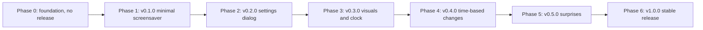
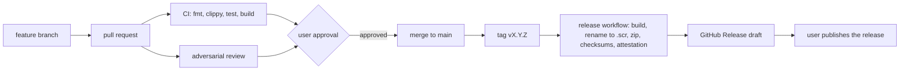

# 0001: 空飛ぶ電子レンジ スクリーンセーバー 初期実装計画(SOW)

- 作成日: 2026-10-31
- ステータス: 提案(ユーザーの合意待ち)。合意した内容はADRに記録し、本計画のステータスを更新する。
- 対象: AGENTS.mdの「プロジェクト概要」に記載されたWindowsスクリーンセーバー

## 1. 目的

昔のMacintoshにあったFlying Toastersに着想を得た、電子レンジが空を飛ぶWindowsスクリーンセーバーを作る。基本機能から段階的に実装し、実行できる段階ごとにセマンティックバージョニングでGitHub Releaseを公開する。将来のLinux版・macOS版を妨げない設計にする。

本計画は次のドキュメントを根拠・詳細として参照する。

| ドキュメント | 内容 |
| --- | --- |
| [Windowsスクリーンセーバーの仕様調査](../research/windows-screensaver.md) | 一次情報に基づく`.scr`の仕様と要件W-1〜W-8、技術スパイクS1〜S6 |
| [言語・エコシステムの比較検討](../research/tech-stack.md) | 候補の比較と推奨(Rust)、依存crateの候補 |
| [先行作品と知的財産上の配慮](../research/prior-art-and-ip.md) | 着想元との関係と方針IP-1〜IP-5 |
| [アーキテクチャ](../design/architecture.md) | 構成要素、起動モード、シミュレーション、描画、終了判定 |
| [設定項目仕様](../design/settings.md) | 設定項目・既定値・検証規則 |
| [ビジュアルデザイン方針](../design/visual-design.md) | 飛行表現の案、素材の作り方、表現上のガイドラインG-1〜G-6 |
| [将来のオプションのアイデア](../ideas/future-options.md) | 時間的に変化する項目・隠し要素などのアイデア |
| [敵対的レビュー記録](../reviews/0001-plan-adversarial-review.md) | 本計画に対するレビューの指摘と対応 |

## 2. リポジトリの現状(2026-10-31時点の確認結果)

- エージェント設定テンプレートから作成した直後の状態で、製品コードはまだない。
- 存在するもの: AGENTS.md(共通インストラクション)、`.claude/`(コマンド・フック・設定)、`.agents/skills/`(ADR・grill-me)、`docs/adr/`(運用ルールとテンプレートのみ)、`.github/`(Dependabotはgithub-actionsのみ、Copilot用設定)、`personal/`(個人のグローバル設定)。
- 未設定のもの: AGENTS.mdの検証コマンド表、README本文、CIワークフロー(`.github/workflows/`がない)、ライセンスファイル。

確認された不整合(本計画では変更せず、[12. ユーザー確認事項](#12-ユーザー確認事項)で判断を仰ぐ):

| ID | 内容 |
| --- | --- |
| I-1 | AGENTS.mdのプロジェクト概要は「GitHub Copilotは利用しない」とする一方、同じファイルの「PR・レビュー・マージ」節、`.claude/commands/babysit-pr.md`、`.github/copilot-instructions.md`、`.github/copilot-code-review.yml`はCopilotによるレビューを前提にしている |
| I-2 | `.github/dependabot.yml`の`assignees`が`ej-uchiyama`で、本リポジトリの所有者と異なる(テンプレート由来と推測) |
| I-3 | `personal/README.md`に「テンプレートから作成した実運用リポジトリでは、このフォルダは削除する」とあるが、残っている |
| I-4 | AGENTS.mdはブランチ名を`docs/xxx`などと定めるが、本計画の作業はClaude Code on the Webのセッションで指定されたブランチ(`claude/admiring-planck-yin4k5`)で行った |
| I-5 | ライセンスファイルがない。AGENTS.mdは利用する技術にオープンソースであることを求めているが、本プロジェクト自身のライセンスは未定 |

## 3. スコープ

対象(v1.0.0まで):

- Windows 11向けスクリーンセーバー本体(`/s`全画面、`/p`プレビュー、`/c`設定画面)
- 電子レンジと食べ物が飛ぶアニメーション、LED表示の時計
- 設定画面からのパラメーター設定と保存
- 時間的に変化する演出と隠し要素(アイデアから採用したもの)
- GitHub Releaseでの配布(zip、チェックサム、インストール手順)

対象外:

- Linux版・macOS版の実装(設計上の考慮のみ。v1.0.0以降に別の計画を立てる)
- ネットワーク通信を伴う機能(天気、テレメトリ、自動アップデート)
- Windows 95向けのパスワード機能(`/a`)
- インストーラとwinget対応(v1.0.0の前に要否を判断する)

## 4. 要件

### 4.1 機能要件

| ID | 要件 | 根拠 | フェーズ |
| --- | --- | --- | --- |
| F-01 | `/s`で全モニタを覆う全画面表示を行い、カーソルを隠す | W-4 | 1 |
| F-02 | `/s`ではキー・マウスボタン・閾値以上のマウス移動・フォーカス喪失で終了する | W-4 | 1 |
| F-03 | `/p <HWND>`で設定画面のプレビュー枠に描画し、親ウィンドウがなくなったら終了する | W-3 | 1 |
| F-04 | 引数なし・`/c`・認識できない引数で設定画面を表示する | W-2、W-8 | 1(仮画面)、2 |
| F-05 | 電子レンジが画面を斜めに横切って飛び続ける | プロジェクト概要 | 1(仮素材)、3 |
| F-06 | 設定項目を設定画面から変更・保存し、`/s`・`/p`に反映する | プロジェクト概要 | 2 |
| F-07 | 電子レンジ固有の要素で飛行を表現し、食べ物も飛ぶ | IP-2、IP-5 | 3 |
| F-08 | LED表示に現在時刻を出す | アイデアT-01 | 3 |
| F-09 | 時間的に変化する演出を行う | プロジェクト概要 | 4 |
| F-10 | 隠し要素を実装する | プロジェクト概要 | 5 |

### 4.2 非機能要件

数値は暫定の目標値で、Phase 1で計測して見直す。

| ID | 要件 | 目標・基準 |
| --- | --- | --- |
| N-01 | 起動の速さ | 起動から最初のフレーム表示まで1秒以内 |
| N-02 | 終了の速さ | 入力から画面が消えるまで0.2秒以内 |
| N-03 | CPU負荷 | 4Kモニタ1台・60fpsで論理1コアの10%以下 |
| N-04 | メモリ使用量 | 200MB以下 |
| N-05 | 配布サイズ | zip 1つあたり20MB以下 |
| N-06 | 通信 | ネットワーク通信を一切行わない |
| N-07 | 副作用 | `/s`・`/p`の実行中はファイルに書き込まない(ログを有効にした場合を除く) |
| N-08 | 堅牢性 | 不正な引数・設定ファイルでクラッシュせず、既定値で動作する |
| N-09 | 対応環境 | Windows 11(x64・arm64)。Windows 10は動作保証外(2025-10-14にサポート終了 [MS-5]) |
| N-10 | 表示品質 | モニタごとのDPIに対応し、どのモニタでも同じ見た目になる |
| N-11 | 表現 | ガイドラインG-1〜G-6を満たす(閃光なし、静止要素なし等) |
| N-12 | ライセンス | 依存はすべてOSSライセンス。配布物に依存crateのライセンス表記を同梱する |

## 5. 技術選定(提案)

詳細と根拠は[言語・エコシステムの比較検討](../research/tech-stack.md)を参照。合意後にADRとして記録する。

| 項目 | 推奨 | 主な理由 |
| --- | --- | --- |
| 言語 | Rust(stable、`rust-toolchain.toml`で固定) | ランタイム不要の単一exe。メモリ安全。将来の移植性 |
| ウィンドウ・入力 | winit 0.30系 | Windowsの子ウィンドウ(`WS_CHILD`)作成に対応し、`/p`を満たせる見込み |
| 描画 | wgpu 30系 | 4K・複数モニタでもCPU負荷と消費電力を抑えられる |
| 設定画面 | eframe/egui 0.37系 | クロスプラットフォーム。本体とwinit・wgpuを共有できる |
| 設定の保存 | ユーザーごとの設定ディレクトリにTOMLファイル | 人が読める、OSをまたいで同じ形式、テストしやすい |
| 素材 | SVG(resvgでラスタライズ) | 解像度非依存、差分を確認できる |

## 6. アーキテクチャ概要

詳細は[アーキテクチャ](../design/architecture.md)を参照。

- Cargoワークスペースで、OSに依存しない`flying-microwave-core`(シミュレーション、設定モデル、テーマ選択、終了判定)と、実行ファイルの`flying-microwave`(起動モード、描画、設定画面、プラットフォーム固有処理)に分ける。
- `core`は決定的に作り(固定タイムステップ、シード指定可能な乱数、時刻の注入)、Linux上でも単体テストできるようにする。
- プラットフォーム固有コードは`platform`モジュールに閉じ込めるが、2つ目のOSに着手するまで抽象化は作らない。

## 7. 段階的実装計画

各フェーズは1つ以上のPRで進め、フェーズの完了時にリリースする。リリース後の不具合修正はパッチバージョン(例: v0.1.1)で出す。各フェーズの着手時に、そのフェーズで追加する依存crateについてユーザーの承認を得る。

### Phase 0: 基盤整備(リリースなし)

目的: 合意した技術で実装を始められる状態にし、Windows実機でしか確かめられない技術的な不確実性を先に潰す。

作業:

1. 本計画の合意事項([12. ユーザー確認事項](#12-ユーザー確認事項))をADRに記録する(言語・描画・設定画面・ライセンス・レビュー体制など)。
2. ライセンスファイルを追加する。
3. Cargoワークスペースの雛形(`crates/core`・`crates/app`)、`rust-toolchain.toml`、lint設定を作る。
4. AGENTS.mdの検証コマンド表を確定する(下表の案)。
5. CIワークフローを追加する(`.github/workflows/`の変更はセキュリティ設定のため要承認)。Windowsランナーでfmt・clippy・テスト・x64/arm64ビルド、Linuxランナーで`core`のテスト(`core`がOSに依存しないことの確認)を行う。
6. Dependabotにcargoを追加する(`.github/dependabot.yml`の変更は要承認。`cooldown`は維持する)。
7. `CHANGELOG.md`を追加する。
8. 技術スパイクS1〜S6を行う。スパイク用の最小プログラムをCIでビルドし、ユーザーがWindows 11実機で実行して結果を`docs/research/spike-results.md`に記録する。スパイクのコードは製品コードに混ぜない。

検証コマンド表の案:

| 用途 | コマンド |
| --- | --- |
| セットアップ | `rustup show`(`rust-toolchain.toml`のツールチェーンを導入) |
| テスト | `cargo test --workspace` |
| リント・フォーマット | `cargo fmt --all --check`、`cargo clippy --workspace --all-targets -- -D warnings` |
| 型チェック | `cargo check --workspace --all-targets` |
| ビルド | `cargo build --release` |

完了条件:

- 雛形の状態でCIの全ジョブがグリーン
- スパイクS1〜S6の結果が記録され、結果に応じて本計画とアーキテクチャを更新済み(例: S1が不成立ならプレビューの代替案を決める)
- 主要な判断のADRがユーザーに承認されている

### Phase 1: v0.1.0 最小のスクリーンセーバー

目的: Windowsのスクリーンセーバーとして選択・プレビュー・実行・終了ができる最小のものを出す。

作業(テストを先に書く順):

1. 引数解析(`cli`): [アーキテクチャの引数解析の規則](../design/architecture.md#起動モードの判定)の各行をテストにしてから実装する。
2. 終了判定(`core::exit_policy`): 閾値未満の移動では終了しない、キーで終了する、プレビューでは入力を無視する、などをテストにする。
3. シミュレーション(`core::sim`): 指定数の出現、左下方向への移動、画面外での再出現、同じシードで同じ結果になること、経過時間の上限処理をテストにする。
4. 描画(`render`): wgpuによるスプライト描画。仮素材(単純な図形)を使う。
5. `/s`: 全モニタの全画面ウィンドウ、カーソル非表示、入力での終了。
6. `/p`: プレビュー枠の子ウィンドウへの描画、親ウィンドウの消失での終了。
7. 引数なし・`/c`: 「設定は今後のバージョンで追加する」旨を表示する簡易画面(UIラベルは英語)。
8. Windowsリソースの埋め込み(アイコン、バージョン情報、String Tableの序数1)と`.scr`へのリネーム。
9. 依存crateのライセンス表記ファイルの生成(生成ツールの選定は要承認)。
10. リリースワークフロー(要承認): タグのプッシュでビルドし、zip・チェックサム・アーティファクト証明を作り、GitHub Releaseの下書きを作る。
11. READMEにインストール・アンインストール手順と既知の注意(SmartScreenの警告など)を書く。

完了条件:

- 自動テストとCIがグリーン
- Windows 11実機で[手動テストのチェックリスト](#82-手動テストwindows実機)に合格
- 非機能要件N-01〜N-05の計測値をドキュメントに記録(目標未達なら対応方針をユーザーと決める)
- 敵対的レビュー完了とユーザー承認

リリース: v0.1.0(x64・arm64)

### Phase 2: v0.2.0 設定画面

目的: 設定画面から主要なパラメーターを変えられるようにする。

作業:

1. 設定の保存形式・場所をADRで決定する。
2. `core::config`: [設定項目仕様](../design/settings.md)のv0.2.0の項目と検証規則をテストにしてから実装する。
3. `storage`: 設定ファイルの読み書き(サイズ上限、壊れたファイルの扱い)。
4. 設定画面(eframe): Flight / Display タブ、OK・Cancel・Defaults。
5. `/s`・`/p`で設定を読み込んで反映する。

完了条件: 設定の保存と反映を実機で確認、壊れた設定ファイルでもクラッシュしないことをテストと実機で確認。

リリース: v0.2.0

### Phase 3: v0.3.0 見た目と時計

目的: 仮素材を本番の見た目に置き換え、電子レンジらしい表現にする。

作業:

1. 飛行表現を[ビジュアルデザイン方針](../design/visual-design.md)の案A〜Cから決める。
2. SVG素材の作成と取り込み(resvg)、素材のライセンス記録。
3. ドアの開閉、ターンテーブルの回転、LED表示の時計(T-01)、飛ぶ食べ物、奥行きによる大きさと速度の違い。
4. 設定項目の追加(食べ物の割合、時計の表示形式など)。

完了条件: ガイドラインG-1〜G-6のセルフチェック、非機能要件の再計測。

リリース: v0.3.0

### Phase 4: v0.4.0 時間的に変化する演出

目的: 時刻や日付によって変化する楽しさを加える。

作業: フェーズの着手時に[将来のオプションのアイデア](../ideas/future-options.md)から採用する項目を選ぶ。推奨の候補は、背景の時間帯変化(T-02)、季節・行事のテーマ(T-04)、タイマーのカウントダウン(T-06)。日付・時刻を注入したテストで境界条件(日付の切り替わり、年末年始など)を確かめる。

リリース: v0.4.0

### Phase 5: v0.5.0 隠し要素

目的: まれに起こる驚きを加える。

作業: フェーズの着手時にアイデアから採用する項目を選ぶ。推奨の候補は、金色の電子レンジ(E-01)、開発者表示(E-07)、デモ用の起動オプション(E-12)。確率で起こる要素は、乱数のシードを固定したテストで発生条件を確かめる。

リリース: v0.5.0

### Phase 6: v1.0.0 安定版

目的: 機能を固め、安心して配布できる状態にする。

作業:

1. 機能の凍結と不具合修正、長時間動作の確認(メモリ使用量が増え続けないこと)。
2. 配布の改善の判断: コード署名(SignPath Foundationの無償署名など[S-1])、インストーラ、wingetへの登録の要否。
3. ドキュメントの整備(README、ユーザー向けの設定説明)。

リリース: v1.0.0

## 8. テスト戦略

### 8.1 自動テスト

- TDD(Red → Green → Refactor)で、`core`のロジックと引数解析を単体テストする。`core`のテストはWindowsとLinuxの両方のCIで実行する。
- シミュレーションは固定シード・固定タイムステップで、位置や個数などの結果を決定的に比較する。
- 描画結果の自動テストは当面行わない。GPUを使う描画をCIで安定して比較するには環境の準備が必要で、初期の費用対効果が低いため。必要になったらwgpuのオフスクリーン描画で導入を検討する。

### 8.2 手動テスト(Windows実機)

各リリースの前に、ユーザーのWindows 11実機で次を確認する(エージェントの開発環境はLinuxで、Windowsの画面を伴う動作は確認できないため)。

1. 設定の「スクリーンセーバー」一覧に表示される。
2. プレビュー枠にアニメーションが表示される。
3. 別のスクリーンセーバーに切り替えると、プレビューのプロセスが終了する(タスクマネージャーで確認)。
4. 「プレビュー」ボタンで全画面になり、マウス移動・キー・クリックのそれぞれで終了する。わずかなマウスの揺れでは終了しない。
5. 待ち時間の経過で自動的に起動する。
6. 複数モニタのすべてが覆われる(環境がある場合)。
7. 「再開時にログオン画面に戻る」を有効にしたとき、終了後にロック画面が表示される。
8. CPU使用率・GPU使用率・メモリ使用量を記録する。
9. 終了後にプロセスが残らない。

## 9. CI/CD・リリース

- 配布物(案): `FlyingMicrowave-<version>-windows-x64.zip`、`FlyingMicrowave-<version>-windows-arm64.zip`、`SHA256SUMS.txt`。zipには`FlyingMicrowave.scr`、インストール手順、ライセンス、依存crateのライセンス表記を入れる。
- `.scr`単体はメールやブラウザで危険なファイルとして扱われやすいため、zipで配布する。
- ビルドの出所を検証できるよう、GitHubのアーティファクト証明(artifact attestations)を付ける。利用するActionは実装時に公式ドキュメントで確認する[G-1]。
- 署名していない実行ファイルにはSmartScreenの警告が出る可能性が高い。v0.x系ではREADMEで説明し、コード署名はPhase 6で判断する。SignPath Foundationの無償署名は、OSIが承認したライセンス、独自(非OSS)コンポーネントを含まないこと、検証可能なCIビルド、全メンバーの多要素認証、リリースごとの手動承認、コード署名ポリシーの公開などを条件とし、証明書の発行先(発行者表示)はSignPath Foundationになる[S-1]。
- リリースノートは`CHANGELOG.md`から作る。

## 10. レビュー体制(敵対的レビュー)

AGENTS.mdのプロジェクト概要は「敵対的レビューを行い、GitHub Copilotは利用しない」と定めている。これに沿った体制の案:

1. PRごとに、作成者とは別のコンテキストを持つレビュー用エージェント(Claude Codeの`/code-review`、またはレビュー専用のサブエージェント)に、差分と要件だけを渡して欠陥を探させる。作成者の結論を渡さない(結論に引きずられないようにするため)。
2. 重要な変更(アーキテクチャ、セキュリティ、リリース関連)では、別系統のモデル(OpenAI Codexなど)による2回目のレビューを任意で行う。
3. 指摘と対応はPR上に残す。計画・設計のレビューは`docs/reviews/`に記録する。
4. 最終判断とマージの承認はユーザーが行う。

本計画自体も、別コンテキストのエージェントによる敵対的レビューを行い、[敵対的レビュー記録](../reviews/0001-plan-adversarial-review.md)に記録した。

この体制を採用する場合、AGENTS.mdの「PR・レビュー・マージ」節、`.claude/commands/babysit-pr.md`、Copilot用の設定ファイルの扱いを合わせて見直す必要がある(不整合I-1)。

## 11. リスクと対策

| ID | リスク | 影響 | 対策 |
| --- | --- | --- | --- |
| R-01 | Microsoftがスクリーンセーバーよりロック画面を推奨しており[MS-4]、将来のWindowsで機能が縮小される | 配布の価値が下がる | `core`を分離し、他の形態(他OS、壁紙アプリ等)へ転用できるようにしておく。Windowsのリリース情報を確認する |
| R-02 | `/p`のプレビュー枠(子ウィンドウ)でwinit・wgpuが期待どおり動かない | プレビューが表示されない | Phase 0のスパイクS1で確認する。不成立なら、プレビューのみCPU描画にする、静止画を表示するなどの代替案を決める |
| R-03 | `.scr`の配布がブラウザ・メール・SmartScreen・ウイルス対策ソフトで警告またはブロックされる | 利用者が導入できない、不安を与える | zipで配布、チェックサムとアーティファクト証明を付ける、READMEで説明する。Phase 6でコード署名を判断する |
| R-04 | GPUが使えない環境(仮想マシン、古いドライバ) | 黒い画面のまま、または起動しない | スパイクS6で挙動を確認し、フォールバック(静かに終了、黒画面のみ表示など)を決める |
| R-05 | winit 0.31への移行(破壊的変更)と、eframeとのバージョン整合 | 依存更新の手間 | 0.30系に固定し、eframeの対応に合わせて移行する。Dependabotの更新PRで確認する |
| R-06 | 着想元との類似による知的財産上の問題 | 公開停止など | 方針IP-1〜IP-5とガイドラインG-1に従い、独自の表現・素材にする |
| R-07 | エージェントの開発環境がLinuxで、Windowsの画面を伴う動作をエージェントが確認できない | 不具合の発見が遅れる | ロジックを`core`に寄せて自動テストする。CIのWindowsランナーでビルドとテストを行う。手動テストのチェックリストをユーザーが実施する |
| R-08 | 依存crateを経由したサプライチェーン攻撃 | 悪意あるコードの混入 | `Cargo.lock`をコミットする。Dependabotの`cooldown`を維持する。依存追加は事前承認。脆弱性・ライセンスの自動チェック(cargo-deny等)の導入を検討する(要承認) |
| R-09 | 光過敏・焼き付きへの配慮不足 | 利用者の健康・機器への悪影響 | ガイドラインG-3〜G-5をレビューの確認項目にする |
| R-10 | MSVCツールチェーン(非OSS)への依存 | ビルド環境の制約 | CIのWindowsランナーで利用できることをPhase 0で確認する。必要なら`*-windows-gnullvm`ターゲットを検討する |
| R-11 | 依存crateのライセンス表記の同梱漏れ | ライセンス違反 | Phase 1でライセンス表記の生成をリリースワークフローに組み込む |

## 12. ユーザー確認事項

AGENTS.mdにより、アーキテクチャ・依存関係・データ形式に関わる判断はユーザーの確認が必要である。次の事項について判断をお願いしたい。

| ID | 決めること | 選択肢 | 推奨 | 期限 |
| --- | --- | --- | --- | --- |
| D-1 | 言語・エコシステム | Rust / C#・.NET / C++・SDL3 / Go・Ebitengine | Rust | Phase 0の開始前 |
| D-2 | 描画方式 | GPU(wgpu) / CPU(softbuffer + tiny-skia) | GPU | Phase 0の開始前 |
| D-3 | 設定画面の方式 | eframe/egui / Win32ネイティブ / Slint / iced | eframe/egui | Phase 0の開始前(スパイクS2の対象のため) |
| D-4 | 設定の保存形式・場所 | ユーザー設定ディレクトリのTOMLファイル / レジストリ | TOMLファイル | Phase 2の開始前 |
| D-5 | 製品名とファイル名 | 例: 「Flying Microwave」と`FlyingMicrowave.scr` | 左記 | Phase 1の開始前 |
| D-6 | 本プロジェクトのライセンス | MIT OR Apache-2.0 / MIT / Apache-2.0 / GPL-3.0など | MIT OR Apache-2.0(Rustエコシステムの慣例で、主要な依存と同じ) | Phase 0 |
| D-7 | 対象のWindowsとCPUアーキテクチャ | Windows 11のx64とarm64 / x64のみ / Windows 10も含める | Windows 11のx64とarm64 | Phase 0 |
| D-8 | 敵対的レビューの方法と、Copilot関連の記述・設定の扱い(I-1) | [10. レビュー体制](#10-レビュー体制敵対的レビュー)の案 / その他 | 10.の案。Copilot関連の記述・設定は削除または置き換え | Phase 0 |
| D-9 | 飛行表現 | ビジュアルデザイン方針の案A / B / C | 案A(ドアの羽ばたき) | Phase 3の開始前 |
| D-10 | リポジトリの整理(I-2、I-3) | `personal/`の削除、Dependabotの`assignees`の修正 | ユーザーの判断に従う | Phase 0 |
| D-11 | ブランチ運用(I-4) | AGENTS.mdの命名規則に従う / Claude Code on the Webのセッションブランチを例外として認める | 例外として認め、AGENTS.mdに明記する | Phase 0 |
| D-12 | Windows実機での検証体制 | スパイク・手動テストを誰がいつ行うか | ユーザーが各フェーズの終わりに、CIでビルドした成果物で行う | Phase 0 |

## 13. 次のアクション

1. ユーザーが本計画と関連ドキュメントを確認し、D-1〜D-12を判断する。
2. 判断に基づいてADRを作成し、本計画を更新する(ステータスを「合意済み」にする)。
3. Phase 0に着手する。

## 参考資料

- [MS-4] Microsoft Learn「ScreenSaver」(Windows無人セットアップのリファレンス、2026-10-31取得)
- [MS-5] Microsoft Support「Windows 10 support has ended on October 14, 2025」(検索結果で確認)
- [S-1] SignPath Foundation「Terms」(2026-10-31取得)
- [G-1] GitHub Docs「Using artifact attestations to establish provenance for builds」(検索結果で確認)
- そのほかの出典は各調査・設計ドキュメントの参考資料を参照。

[MS-4]: https://learn.microsoft.com/en-us/windows-hardware/customize/desktop/unattend/microsoft-windows-shell-setup-themes-screensaver
[MS-5]: https://support.microsoft.com/en-us/windows/deployment/updates-lifecycle/windows-10-support-has-ended-on-october-14-2025
[S-1]: https://signpath.org/terms
[G-1]: https://docs.github.com/actions/security-for-github-actions/using-artifact-attestations/using-artifact-attestations-to-establish-provenance-for-builds
