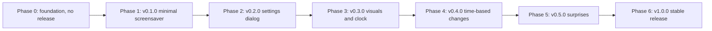
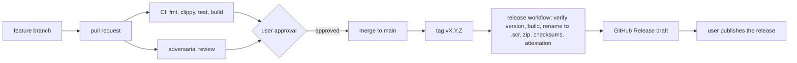

# 0001: 空飛ぶ電子レンジ スクリーンセーバー 初期実装計画(SOW)

- 作成日: 2026-10-31
- ステータス: 提案(ユーザーの合意待ち)。合意した内容はADRに記録し、本計画のステータスを更新する。
- 対象: AGENTS.mdの「プロジェクト概要」に記載されたWindowsスクリーンセーバー
- 改訂: 2026-10-31 敵対的レビューの指摘を反映([レビュー記録](../reviews/0001-plan-adversarial-review.md))

## 1. 目的

昔のMacintoshにあったFlying Toastersに着想を得た、電子レンジが空を飛ぶWindowsスクリーンセーバーを作る。基本機能から段階的に実装し、実行できる段階ごとにセマンティックバージョニングでGitHub Releaseを公開する。将来のLinux版・macOS版を妨げない設計にする。

本計画は次のドキュメントを根拠・詳細として参照する。

| ドキュメント | 内容 |
| --- | --- |
| [Windowsスクリーンセーバーの仕様調査](../research/windows-screensaver.md) | 一次情報に基づく`.scr`の仕様と要件W-1〜W-11、技術スパイクS1〜S6 |
| [言語・エコシステムの比較検討](../research/tech-stack.md) | 候補の比較と推奨(Rust)、ビルド上の注意、依存crateの候補 |
| [先行作品と知的財産上の配慮](../research/prior-art-and-ip.md) | 着想元との関係と方針IP-1〜IP-5、名称の確認 |
| [アーキテクチャ](../design/architecture.md) | 構成要素、起動モード、シミュレーション、描画、終了判定、セキュリティSEC-1〜SEC-5 |
| [設定項目仕様](../design/settings.md) | 設定項目・既定値・検証規則 |
| [ビジュアルデザイン方針](../design/visual-design.md) | 飛行表現の案、素材の作り方、表現上のガイドラインG-1〜G-6 |
| [将来のオプションのアイデア](../ideas/future-options.md) | 時間的に変化する項目・隠し要素などのアイデア |
| [敵対的レビュー記録](../reviews/0001-plan-adversarial-review.md) | 本計画に対するレビューの指摘と対応 |

## 2. リポジトリの現状(2026-10-31時点の確認結果)

- エージェント設定テンプレートから作成した直後の状態で、製品コードはまだない。
- 存在するもの: AGENTS.md(共通インストラクション)、`.claude/`(コマンド・フック・設定)、`.agents/skills/`(ADR・grill-me)、`docs/adr/`(運用ルールとテンプレートのみ)、`.github/`(Dependabotはgithub-actionsのみ、Copilot用設定)、`personal/`(個人のグローバル設定)。
- 未設定のもの: AGENTS.mdの検証コマンド表、CIワークフロー(`.github/workflows/`がない)、ライセンスファイル。

確認された不整合・制約(本計画では変更せず、[12. ユーザー確認事項](#12-ユーザー確認事項)で判断を仰ぐ):

| ID | 内容 |
| --- | --- |
| I-1 | AGENTS.mdのプロジェクト概要は「GitHub Copilotは利用しない」とする一方、同じファイルの「PR・レビュー・マージ」節、`.claude/commands/babysit-pr.md`、`.github/copilot-instructions.md`、`.github/copilot-code-review.yml`はCopilotによるレビューを前提にしている |
| I-2 | `.github/dependabot.yml`の`assignees`が`ej-uchiyama`で、本リポジトリの所有者と異なる(テンプレート由来と推測) |
| I-3 | `personal/README.md`に「テンプレートから作成した実運用リポジトリでは、このフォルダは削除する」とあるが、残っている |
| I-4 | AGENTS.mdはブランチ名を`docs/xxx`などと定めるが、本計画の作業はClaude Code on the Webのセッションで指定されたブランチ(`claude/admiring-planck-yin4k5`)で行った |
| I-5 | ライセンスファイルがない。AGENTS.mdは利用する技術にオープンソースであることを求めているが、本プロジェクト自身のライセンスは未定 |
| I-6 | リポジトリは非公開である(GitHub APIで`"private": true`を確認)。非公開リポジトリのGitHub Releaseはアクセス権のある人しか取得できない。SignPath Foundationの無償署名、アーティファクト証明、ブランチ保護、Actionsの無料枠などにも制約がありうる(詳細は[9. CI/CD・リリース](#9-cicdリリース)) |

## 3. スコープ

対象(v1.0.0まで):

- Windows 11向けスクリーンセーバー本体(`/s`全画面、`/p`プレビュー、`/c`設定画面)
- 電子レンジと食べ物が飛ぶアニメーション、LED表示の時計
- 設定画面からのパラメーター設定と保存
- 時間的に変化する演出と隠し要素(アイデアから採用したもの)
- GitHub Releaseでの配布(zip、チェックサム、インストール手順)

対象外:

- Linux版・macOS版の実装(設計上の考慮のみ。v1.0.0以降に別の計画を立てる)
- ネットワーク通信を伴う機能(天気、テレメトリ、自動アップデート)
- Windows 95向けのパスワード機能(`/a`)
- インストーラとwinget対応(v1.0.0の前に要否を判断する)

## 4. 要件

### 4.1 機能要件

| ID | 要件 | 根拠 | フェーズ |
| --- | --- | --- | --- |
| F-01 | `/s`で起動直後から全モニタを不透明な黒で覆い、カーソルを隠す。その後アニメーションを表示する | W-4、W-9 | 1 |
| F-02 | `/s`ではキーの押下・マウスボタン・タッチ・閾値以上のマウス移動・アプリ全体の非アクティブ化で終了する。複数ウィンドウ間のフォーカス移動や合成イベントでは終了しない | W-4、アーキテクチャ | 1 |
| F-03 | `/p <HWND>`で設定画面のプレビュー枠に描画し、親ウィンドウがなくなったら終了する | W-3 | 1 |
| F-04 | 引数なし・`/c`・認識できない引数で設定画面を表示する。`/c`では前面のウィンドウをオーナーにする | W-2、W-8 | 1(メッセージボックス)、2 |
| F-05 | 電子レンジが画面を斜めに横切って飛び続ける | プロジェクト概要 | 1(仮素材)、3 |
| F-06 | 設定項目を設定画面から変更・保存し、`/s`・`/p`に反映する | プロジェクト概要 | 2 |
| F-07 | `/s`の実行中にモニタが追加・変更されても、すべてのモニタを覆う | W-10 | 2 |
| F-08 | 電子レンジ固有の要素で飛行を表現し、食べ物も飛ぶ | IP-2、IP-5 | 3 |
| F-09 | LED表示に現在時刻を出す | アイデアT-01 | 3 |
| F-10 | 時間的に変化する演出を行う | プロジェクト概要 | 4 |
| F-11 | 隠し要素を実装する | プロジェクト概要 | 5 |

### 4.2 非機能要件

数値は暫定の目標値で、Phase 1で計測して見直す。

| ID | 要件 | 目標・基準 |
| --- | --- | --- |
| N-01 | 起動の速さ | 起動から全モニタが黒で覆われるまで0.5秒以内、最初のアニメーションのフレームまで1秒以内 |
| N-02 | 終了の速さ | 入力から画面が消えるまで0.2秒以内 |
| N-03 | CPU負荷 | 4Kモニタ1台・60fpsで論理1コアの10%以下 |
| N-04 | メモリ使用量 | 200MB以下。長時間動かしても増え続けない |
| N-05 | 配布サイズ | zip 1つあたり20MB以下 |
| N-06 | 通信 | ネットワーク通信を一切行わない |
| N-07 | 副作用 | `/s`・`/p`の実行中はファイルに書き込まない(ログを有効にした場合を除く) |
| N-08 | 堅牢性 | 不正な引数・設定ファイルでクラッシュせず、既定値で動作する |
| N-09 | 対応環境 | Windows 11(x64・arm64)。追加のランタイムを必要としない(VC++ランタイムを静的リンクする)。Windows 10は動作保証外(2025-10-14にサポート終了 [MS-5]) |
| N-10 | 表示品質 | モニタごとのDPIに対応し、どのモニタでも同じ見た目になる。高リフレッシュレートのモニタでもカクつかない(描画時の補間) |
| N-11 | 表現 | ガイドラインG-1〜G-6を満たす(閃光なし、静止要素なし等) |
| N-12 | ライセンス | 依存はすべてOSSライセンス。配布物に依存crateのライセンス表記(フォントなどcrateのメタデータ外のものを含む)を同梱する |
| N-13 | セキュリティ | アーキテクチャのSEC-1〜SEC-5を満たす(DLL検索パスの制限など) |
| N-14 | 省電力 | 省電力のGPUを優先して使う。ディスプレイの電源が切れている間は描画を止める(Phase 3まで) |
| N-15 | 多重起動 | `/s`は単一起動にする |

## 5. 技術選定(提案)

詳細と根拠は[言語・エコシステムの比較検討](../research/tech-stack.md)を参照。合意後にADRとして記録する。

| 項目 | 推奨 | 主な理由 |
| --- | --- | --- |
| 言語 | Rust(stable。2026-10-31時点の最新は1.99.1。`rust-toolchain.toml`で固定) | VC++ランタイムを静的リンクした単一exe。メモリ安全。将来の移植性 |
| ウィンドウ・入力 | winit 0.30系 | Windowsの子ウィンドウ(`WS_CHILD`)作成に対応し、`/p`を満たせる見込み |
| 描画 | wgpu 30系 | 4K・複数モニタでもCPU負荷と消費電力を抑えられる |
| 設定画面 | eframe/egui 0.37系(既定機能を無効にし、フォントを差し替える) | クロスプラットフォーム。本体とwinit・wgpuを共有できる |
| 設定の保存 | ユーザーごとの設定ディレクトリにTOMLファイル | 人が読める、OSをまたいで同じ形式、テストしやすい |
| 素材 | SVG(Phase 3からresvgでラスタライズ) | 解像度非依存、差分を確認できる |

## 6. アーキテクチャ概要

詳細は[アーキテクチャ](../design/architecture.md)を参照。

- Cargoワークスペースで、OSに依存しない`flying-microwave-core`(シミュレーション、設定モデル、テーマ選択、終了判定、乱数生成器)と、実行ファイルの`flying-microwave`(起動モード、描画、設定画面、プラットフォーム固有処理)に分ける。どちらもLinuxでビルドできる状態を保つ。
- `core`は決定的に作り(固定タイムステップ、自前の乱数生成器、時刻の注入)、Linux上でも単体テストできるようにする。
- 起動モードの判定はイベントループの生成前に行う(winitは1プロセスにつきイベントループを1つしか作れないため)。
- プラットフォーム固有コードは`platform`モジュールに閉じ込めるが、2つ目のOSに着手するまで抽象化は作らない。

## 7. 段階的実装計画

各フェーズは1つ以上のPRで進め、フェーズの完了時にリリースする。リリース後の不具合修正はパッチバージョン(例: v0.1.1)で出す。依存crateは、最初に使う時点(スパイクを含む)の前にユーザーの承認を得る。

### 7.1 全フェーズ共通のリリース条件

各フェーズのリリースは、次をすべて満たしてから行う。

1. 自動テストとCIの全ジョブがグリーン。
2. 敵対的レビューが完了している(各指摘に対応したか、対応しない理由を記録した)。
3. Windows 11実機で[手動テストのチェックリスト](#82-手動テストwindows実機)に合格している。確認できなかった項目はリリースノートに明記する。
4. 非機能要件の計測値を記録している。目標に届かない場合は、対応方針をユーザーと決めている。
5. README・CHANGELOG・設定項目仕様などのドキュメントが実態と一致している。
6. ユーザーが承認している。

### 7.2 リリース手順

1. バージョンを上げるPRを作る(`Cargo.toml`のバージョンとCHANGELOG。実行ファイルのバージョン情報は`build.rs`で`Cargo.toml`から生成し、二重管理しない)。
2. 共通のリリース条件を満たし、ユーザーの承認を得てからマージする。
3. `main`に`vX.Y.Z`のタグを付ける。リリースワークフローは、タグと`Cargo.toml`のバージョンが一致することを確認してからビルドする。
4. ワークフローがGitHub Releaseの下書きを作り、ユーザーが内容を確認して公開する。

### Phase 0: 基盤整備(リリースなし)

目的: 合意した技術で実装を始められる状態にし、Windows実機でしか確かめられない技術的な不確実性を先に潰す。

作業:

1. 本計画の合意事項([12. ユーザー確認事項](#12-ユーザー確認事項))をADRに記録する。
2. ライセンスファイルを追加する。
3. リポジトリを公開する場合(D-13)は、公開前に確認する: `personal/`の扱い、コミット履歴に含まれるメールアドレス、秘密情報が含まれていないこと。
4. Cargoワークスペースの雛形(`crates/core`・`crates/app`)、`rust-toolchain.toml`、`.cargo/config.toml`(Windowsターゲットの`+crt-static`)、lint設定を作る。crate名は製品名(D-5)に合わせる。
5. AGENTS.mdの検証コマンド表を確定する(下表の案)。
6. CIワークフローを追加する(`.github/workflows/`の変更はセキュリティ設定のため要承認)。Windowsランナーでfmt・clippy・テスト・x64/arm64ビルド・依存DLLの確認(システムDLLだけか)・依存crateの重複検出(`cargo tree -d`)を行う。Linuxランナーでワークスペース全体のビルド・clippy・テストを行う(アーキテクチャのA-7)。ActionsはコミットSHAで固定し、ジョブごとの権限を最小にする。
7. Dependabotにcargoを追加する(`.github/dependabot.yml`の変更は要承認。`cooldown`は維持する)。0.x系のcrateはマイナー更新でも破壊的変更になりうるため、egui系・winit・wgpuは一緒に更新されるようにグループを分ける。
8. `CHANGELOG.md`を追加する。
9. 技術スパイクS1〜S6を行う。スパイク用の依存(winit・wgpu・pollster・windows-sys・eframe)について事前に承認を得る。スパイクは`spikes/`に置き、ワークスペースに含めず製品コードから参照しない。CIまたはユーザーのWindows環境でビルドし、ユーザーがWindows 11実機で実行して結果を`docs/research/spike-results.md`に記録する。
10. GitHubのWindowsランナーでGUIを伴うスモークテスト([8.1 自動テスト](#81-自動テスト))が実行できるかを確認する。

検証コマンド表の案:

| 用途 | コマンド |
| --- | --- |
| セットアップ | `rustup toolchain install`(`rust-toolchain.toml`のツールチェーンを導入) |
| テスト | `cargo test --workspace --locked` |
| リント・フォーマット | `cargo fmt --all --check`、`cargo clippy --workspace --all-targets --locked -- -D warnings` |
| 型チェック | `cargo check --workspace --all-targets --locked` |
| ビルド | `cargo build --release --locked`(Windows向けの成果物はCIのWindowsランナーで作る) |

エージェントのLinux環境でもこれらを実行できるよう、`app`クレートはLinuxでビルドできる状態を保つ(Windows固有のコードはLinuxではコンパイルされないため、その部分の確認はWindowsのCIで行う)。

完了条件:

- 雛形の状態でCIの全ジョブがグリーン
- スパイクS1〜S6の結果が記録され、結果に応じて本計画とアーキテクチャを更新済み(例: S1が不成立ならプレビューの代替案を決める)
- 主要な判断のADRがユーザーに承認されている

### Phase 1: v0.1.0 最小のスクリーンセーバー

目的: Windowsのスクリーンセーバーとして選択・プレビュー・実行・終了ができる最小のものを出す。

作業(テストを先に書く順):

1. 引数解析(`cli`): [アーキテクチャの引数解析の規則](../design/architecture.md#起動モードの判定)の各行(`/c`のオーナー、余分な引数を含む)をテストにしてから実装する。
2. 終了判定(`core::exit_policy`): [アーキテクチャの入力と終了判定](../design/architecture.md#入力と終了判定)の各項目(閾値、キーの押下と解放、合成イベント、自アプリのウィンドウ間のフォーカス移動、起動直後の猶予時間、タッチ、閉じる要求、プレビューでの入力無視)をテストにする。
3. 乱数生成器(`core::rng`): 既知の出力列と一致することをテストにする。
4. シミュレーション(`core::sim`): 指定数の出現、左下方向への移動、画面外での再出現、同じシードで同じ結果になること、経過時間の上限処理、描画用の補間をテストにする。
5. 描画(`render`): wgpuによるスプライト描画。仮素材(単純な図形)を使う。省電力のGPUを優先し、DX12のシェーダーコンパイラを`Fxc`に明示する(SEC-2)。
6. `/s`: 単一起動、全モニタを黒で覆ってからの描画開始、カーソル非表示、入力での終了。描画の初期化に失敗したら黒い画面のまま入力を待つ。
7. `/p`: プレビュー枠の子ウィンドウへの描画、親ウィンドウの消失での終了。
8. 引数なし・`/c`: 「設定は今後のバージョンで追加する」旨のメッセージボックス(UIラベルは英語)。
9. セキュリティ: SEC-1(DLL検索パスの制限とリンカ設定)、SEC-3(HWNDの検証)。
10. Windowsリソースの埋め込み(アイコン、バージョン情報、String Tableの序数1)、`.scr`へのリネーム、VC++ランタイムを静的リンクしていることのCIでの確認。
11. 依存crateのライセンス表記ファイルの生成(D-17)。フォントなどcrateのメタデータ外のライセンスも確認する。
12. リリースワークフロー(要承認): タグのプッシュでビルドし、zip・チェックサム・(利用できれば)アーティファクト証明を作り、GitHub Releaseの下書きを作る。
13. READMEに、インストール・アンインストール手順と既知の制限(SmartScreenの警告、Smart App Controlによるブロック、グループポリシーで固定された環境)を書く。
14. Phase 0で実行可能と分かった場合は、Windowsランナーでのスモークテストを追加する。

完了条件: [全フェーズ共通のリリース条件](#71-全フェーズ共通のリリース条件)。

リリース: v0.1.0(x64・arm64)

### Phase 2: v0.2.0 設定画面

目的: 設定画面から主要なパラメーターを変えられるようにする。

作業:

1. 設定の保存形式・場所をADRで決定する。
2. `core::config`: [設定項目仕様](../design/settings.md)のv0.2.0の項目と検証規則をテストにしてから実装する。
3. `storage`: 設定ファイルの読み書き(サイズ上限、壊れたファイルの扱い、一時ファイルを使った置き換え)。
4. 設定画面(eframe): Flight / Display / About タブ、OK・Cancel・Defaults。eframeは既定機能を無効にして必要な機能だけを使い、フォントはライセンスを確認したものにする。`/c`のオーナーに対するモーダル化はスパイクS2の結果に従う。
5. `/s`・`/p`で設定を読み込んで反映する。
6. `/s`の実行中のモニタの追加・変更への対応(F-07)。

完了条件: 共通のリリース条件に加え、設定の保存と反映、壊れた設定ファイルでもクラッシュしないことをテストと実機で確認する。

リリース: v0.2.0

### Phase 3: v0.3.0 見た目と時計

目的: 仮素材を本番の見た目に置き換え、電子レンジらしい表現にする。

作業:

1. 飛行表現を[ビジュアルデザイン方針](../design/visual-design.md)の案A〜Cから決める(D-9)。
2. SVG素材の作成と取り込み(resvg)、素材のライセンス記録。
3. ドアの開閉、ターンテーブルの回転、LED表示の時計(T-01)、飛ぶ食べ物、奥行きによる大きさと速度の違い。
4. 設定項目の追加(食べ物の数、時計の表示形式など)。
5. ディスプレイの電源が切れている間の描画停止(N-14)。

完了条件: 共通のリリース条件に加え、ガイドラインG-1〜G-6のセルフチェックを記録する。

リリース: v0.3.0

### Phase 4: v0.4.0 時間的に変化する演出

目的: 時刻や日付によって変化する楽しさを加える。

作業: フェーズの着手時に[将来のオプションのアイデア](../ideas/future-options.md)から採用する項目を選ぶ。推奨の候補は、背景の時間帯変化(T-02)、季節・行事のテーマ(T-04)、タイマーのカウントダウン(T-06)。日付・時刻を注入したテストで境界条件(日付の切り替わり、年末年始など)を確かめる。設定画面にExtrasタブを追加する。

完了条件: 共通のリリース条件に加え、採用した各演出の発動条件をテストで確認する。

リリース: v0.4.0

### Phase 5: v0.5.0 隠し要素

目的: まれに起こる驚きを加える。

作業: フェーズの着手時にアイデアから採用する項目を選ぶ。推奨の候補は、金色の電子レンジ(E-01)、開発者表示(E-07)、デモ用の起動オプション(E-12)。確率で起こる要素は、乱数のシードを固定したテストで発生条件を確かめる。

完了条件: 共通のリリース条件に加え、隠し要素をすべて設定でオフにできることを確認する。

リリース: v0.5.0

### Phase 6: v1.0.0 安定版

目的: 機能を固め、安心して配布できる状態にする。

作業:

1. 機能の凍結と不具合修正、長時間動作の確認(メモリ使用量が増え続けないこと)。
2. 配布の改善の判断: コード署名(D-14の再判断)、インストーラ、wingetへの登録の要否。
3. ドキュメントの整備(README、ユーザー向けの設定説明)。

完了条件: 共通のリリース条件に加え、8時間以上の連続動作で異常がないことを確認する。

リリース: v1.0.0

## 8. テスト戦略

### 8.1 自動テスト

- TDD(Red → Green → Refactor)で、`core`のロジックと引数解析を単体テストする。WindowsとLinuxの両方のCIで実行する。
- シミュレーションは自前の乱数生成器・固定シード・固定タイムステップで、位置や個数などの結果を決定的に比較する。
- スモークテスト(Phase 0で実行可能性を確認し、可能ならPhase 1で導入): Windowsランナーで、GPUの代わりにWARP(ソフトウェア描画)を使い、次を確かめる。`/s`が送信したキー入力で0.2秒以内に終了すること、`/p`がテスト用の親ウィンドウの破棄で終了すること、不正な引数で全画面にならないこと、終了後にプロセスが残らないこと。
- 描画結果の画像比較は当面行わない。GPUを使う描画をCIで安定して比較するには環境の準備が必要で、初期の費用対効果が低いため。必要になったらwgpuのオフスクリーン描画で導入を検討する。

### 8.2 手動テスト(Windows実機)

各リリースの前に、ユーザーのWindows 11実機で次を確認する(エージェントの開発環境はLinuxで、Windowsの画面を伴う動作は確認できないため)。

1. 設定の「スクリーンセーバー」一覧に、想定した名前で表示される。
2. プレビュー枠にアニメーションが表示される。別のスクリーンセーバーに切り替えると、プレビューのプロセスが終了する(タスクマネージャーで確認)。
3. 「設定」ボタンで設定画面(Phase 1はメッセージボックス)が前面に表示される。
4. 「プレビュー」ボタン(マウスでの押下とEnterキーでの押下の両方)で全画面になり、直後に勝手に終了しない。マウス移動・キー・クリック・タッチ(環境がある場合)のそれぞれで終了し、わずかなマウスの揺れでは終了しない。
5. 待ち時間の経過で自動的に起動する。
6. 複数モニタ(DPIが異なる組み合わせを含む)のすべてが覆われ、起動直後に終了しない(環境がある場合)。
7. 「再開時にログオン画面に戻る」を有効にしたとき、終了後にロック画面が表示される。
8. `.scr`のダブルクリック、右クリックメニューの「テスト」「構成」「インストール」が期待どおり動く。
9. ダウンロードしたzip(インターネットから取得した印が付いたもの)から展開した`.scr`で動く。
10. VC++ランタイムが入っていないクリーンな環境(Windows Sandboxなど)で動く。
11. 空白や日本語を含むパス・ユーザー名の環境で動く。
12. スリープやディスプレイの消灯から復帰したときに正しく動く・終了する。
13. Smart App Controlが有効な環境での挙動を記録する(環境がある場合)。
14. arm64の実機で動く(実機がない場合はリリースノートに未検証と明記する)。
15. CPU使用率・GPU使用率・メモリ使用量を記録する。
16. 終了後にプロセスが残らない。

## 9. CI/CD・リリース

- 配布物(案): `FlyingMicrowave-<version>-windows-x64.zip`、`FlyingMicrowave-<version>-windows-arm64.zip`、`SHA256SUMS.txt`。zipには`FlyingMicrowave.scr`、インストール手順、ライセンス、依存crateのライセンス表記を入れる。
- `.scr`単体はメールやブラウザで危険なファイルとして扱われやすいため、zipで配布する。
- ワークフローの安全対策: ActionsはコミットSHAで固定する、ジョブごとの`permissions`を最小にする、`--locked`でビルドする、リリース用のタグを保護する。
- ビルドの出所を検証できるよう、GitHubのアーティファクト証明(artifact attestations)を付ける。非公開リポジトリで利用できるプランは限られるとレビューで指摘されており(GitHubのドキュメントは本セッションで確認できていない)、公開の判断(D-13)と合わせて確認する。利用するActionは実装時に公式ドキュメントで確認する[GH-1]。
- 署名していない実行ファイルにはSmartScreenの警告が出る可能性が高い。さらにSmart App Controlが強制モードの環境では、署名のない不明なコードは既定でブロックされる[MS-6]。v0.x系の扱いはD-14で判断する。
- SignPath Foundationの無償署名の条件(原文で確認)[SP-1]: すべての構成要素がOSIの承認したライセンスであること(商用のデュアルライセンス不可)、独自(非OSS)コンポーネントを含まないこと、署名する形で既にリリースされていること、アンインストールの手順または仕組みを提供すること、検証可能な方法でソースからビルドすること、全メンバーの多要素認証、リリースごとの手動承認、コード署名ポリシーの公開など。加えて「a certain verifiable reputation」が求められるため、新しいプロジェクトは申請が通らない可能性がある。証明書の発行先(発行者表示)はSignPath Foundationになる。
- 非公開リポジトリの場合の制約: Releaseはアクセス権のある人しか取得できない。SignPath Foundationは公開リポジトリを前提とする。WindowsランナーはActionsの無料枠を消費する(倍率などの詳細は要確認)。
- リリースノートは`CHANGELOG.md`から作る。

## 10. レビュー体制(敵対的レビュー)

AGENTS.mdのプロジェクト概要は「敵対的レビューを行い、GitHub Copilotは利用しない」と定めている。これに沿った体制の案:

1. PRごとに、作成者とは別のコンテキストを持つレビュー用エージェント(Claude Codeの`/code-review`、またはレビュー専用のサブエージェント)に、差分と要件だけを渡して欠陥を探させる。作成者の結論を渡さない(結論に引きずられないようにするため)。
2. 重要な変更(アーキテクチャ、セキュリティ、リリース関連)では、別系統のモデル(OpenAI Codexなど)による2回目のレビューを任意で行う。
3. レビューの指摘は検証すべき主張として扱い、一次情報やソースで確かめてから対応する。指摘と対応はPR上に残す。計画・設計のレビューは`docs/reviews/`に記録する。
4. 最終判断とマージの承認はユーザーが行う。

本計画自体も、別コンテキストのエージェントによる敵対的レビューを行い、[敵対的レビュー記録](../reviews/0001-plan-adversarial-review.md)に記録した。

この体制を採用する場合、AGENTS.mdの「PR・レビュー・マージ」節、`.claude/commands/babysit-pr.md`、Copilot用の設定ファイルの扱いを合わせて見直す必要がある(不整合I-1)。

## 11. リスクと対策

| ID | リスク | 影響 | 対策 |
| --- | --- | --- | --- |
| R-01 | Microsoftがスクリーンセーバーよりロック画面を推奨しており[MS-4]、将来のWindowsで機能が縮小される | 配布の価値が下がる | `core`を分離し、他の形態(他OS、壁紙アプリ等)へ転用できるようにしておく。Windowsのリリース情報を確認する |
| R-02 | `/p`のプレビュー枠(子ウィンドウ)でwinit・wgpuが期待どおり動かない | プレビューが表示されない | Phase 0のスパイクS1で確認する。不成立なら、プレビューのみCPU描画にする、静止画を表示するなどの代替案を決める |
| R-03 | `.scr`の配布がブラウザ・メール・SmartScreen・ウイルス対策ソフトで警告またはブロックされる。Smart App Controlが強制モードの環境では、署名なしの`.scr`は動かない[MS-6] | 利用者が導入できない、不安を与える | zipで配布、チェックサムとアーティファクト証明を付ける、READMEに既知の制限として書く。署名の方針をD-14で決める |
| R-04 | GPUが使えない環境(仮想マシン、古いドライバ) | アニメーションが表示されない | スパイクS6で挙動を確認し、WARPへのフォールバックなどを決める。描画できなくても黒い画面で覆い続ける(W-9) |
| R-05 | winit 0.31への移行(破壊的変更)、wgpu・egui系のバージョン整合 | 依存更新の手間、同じcrateの複数バージョンの混入 | winit・wgpuはeframeが依存する系列に固定し、eframeの対応に合わせて一緒に上げる。Dependabotのグループを分け、CIで重複を検出する |
| R-06 | 着想元との類似による知的財産上の問題 | 公開停止など | 方針IP-1〜IP-5とガイドラインG-1に従い、独自の表現・素材にする。製品名の決定前に商標を確認する |
| R-07 | エージェントの開発環境がLinuxで、Windowsの画面を伴う動作をエージェントが確認できない | 不具合の発見が遅れる | ロジックを`core`に寄せて自動テストする。CIのWindowsランナーでビルド・テスト・(可能なら)スモークテストを行う。手動テストのチェックリストをユーザーが実施する |
| R-08 | 依存crateやActionsを経由したサプライチェーン攻撃 | 悪意あるコードの混入 | `Cargo.lock`をコミットし`--locked`でビルドする。Dependabotの`cooldown`を維持する。依存追加は事前承認。ActionsのコミットSHAでの固定、最小権限、タグの保護。脆弱性・ライセンスの自動チェック(cargo-deny等)の導入を検討する(要承認) |
| R-09 | 光過敏・焼き付きへの配慮不足 | 利用者の健康・機器への悪影響 | ガイドラインG-3〜G-5をレビューの確認項目にする |
| R-10 | MSVCツールチェーン(非OSS)への依存 | ビルド環境の制約 | CIのWindowsランナーで利用できることをPhase 0で確認する。必要なら`*-windows-gnullvm`ターゲットを検討する |
| R-11 | 依存crateのライセンス表記の同梱漏れ | ライセンス違反 | Phase 1でライセンス表記の生成をリリースワークフローに組み込む。crateのメタデータ外のライセンス(フォントなど)も確認する |
| R-12 | リポジトリが非公開のまま(I-6) | Releaseを一般に配布できない。署名・証明などが使えない | 公開の時期をD-13で決める。公開前に履歴と内容を確認する |
| R-13 | DLL検索順序の乗っ取り(`.scr`と同じフォルダの悪意あるDLLの読み込み) | 任意コードの実行 | SEC-1・SEC-2をPhase 1で実装し、PR本文でセキュリティ変更として明示する |
| R-14 | eframeの既定フォントのライセンス(Ubuntu Font Licence)がOSIの承認ライセンスでない | 署名サービスの条件に抵触、表記漏れ | eframeの既定機能を無効にし、フォントを差し替える |
| R-15 | 複数モニタで終了判定が誤作動する(起動直後の終了など) | スクリーンセーバーとして使えない | アーキテクチャの終了判定の設計に従い、テストとスパイクS4で確認する |
| R-16 | VC++ランタイムへの依存の見落とし | クリーンな環境で起動しない | `+crt-static`で静的リンクし、CIで依存DLLを確認する。クリーンな環境での手動テストを行う |

## 12. ユーザー確認事項

AGENTS.mdにより、アーキテクチャ・依存関係・データ形式に関わる判断はユーザーの確認が必要である。次の事項について判断をお願いしたい。詳細な比較は各ドキュメントを参照。

| ID | 決めること | 選択肢と主な長所・短所 | 推奨 | 期限 |
| --- | --- | --- | --- | --- |
| D-1 | 言語・エコシステム | Rust: 単一exe・メモリ安全・`/p`に対応できる見込み/ビルドが遅い。C#・.NET: Windowsでの実績が豊富/ランタイム依存、クロスプラットフォームはAvalonia次第。C++・SDL3: 実績が豊富/メモリ安全でない、ビルド構成が複雑。Go・Ebitengine: 単一バイナリ/`/p`に対応する手段が見当たらない([比較](../research/tech-stack.md#比較)) | Rust | Phase 0の開始前 |
| D-2 | 描画方式 | GPU(wgpu): 低負荷・演出の余地/実装量、GPUがない環境やDLLへの対策が必要。CPU(softbuffer + tiny-skia): 単純・テストしやすい/4Kで負荷が高い | GPU | Phase 0の開始前 |
| D-3 | 設定画面の方式 | eframe/egui: 実装が少ない・クロスプラットフォーム/見た目が非ネイティブ、モーダル化に追加処理、フォントの差し替えが必要。Win32ネイティブ: 標準の見た目・モーダル化が容易/Windows専用でコード量が多い。Slint・iced: [比較](../research/tech-stack.md#設定画面の比較)を参照 | eframe/egui | Phase 0の開始前(スパイクS2の対象のため) |
| D-4 | 設定の保存形式・場所 | TOMLファイル: 人が読める・OS共通・テストしやすい/保存場所の解決が必要。レジストリ: Windowsの慣例/Windows専用でテストしにくい | TOMLファイル | Phase 2の開始前 |
| D-5 | 製品名とファイル名 | 「Flying Microwave」と`FlyingMicrowave.scr`: 着想元が伝わりやすい/着想元と同じ形の名前で商標の確認が必要。独自の名前: 独自性が高い/着想元が伝わりにくい。一覧の表示名に空白を入れるには空白を含むファイル名が必要(スパイクS5で確認) | 商標を確認したうえで左記 | Phase 0の開始前(crate名に使うため) |
| D-6 | 本プロジェクトのライセンス | MIT OR Apache-2.0: Rustの慣例でwgpu・eframeと同じ、winit(Apache-2.0)とも両立/2つのライセンス文を同梱する。MIT: 簡潔/特許条項がない。Apache-2.0: 特許条項がある/やや長い。GPL-3.0: 派生物もOSSにできる/利用の制約が強い | MIT OR Apache-2.0 | Phase 0 |
| D-7 | 対象のWindowsとCPUアーキテクチャ | Windows 11のx64とarm64: 主要な環境を網羅/arm64の実機がないと未検証になる。x64のみ: 検証が容易/arm64機ではエミュレーション頼み(動作は要確認)。Windows 10も含める: 利用者が増える/サポートが終了したOS | Windows 11のx64とarm64 | Phase 0 |
| D-8 | 敵対的レビューの方法と、Copilot関連の記述・設定の扱い(I-1) | [10. レビュー体制](#10-レビュー体制敵対的レビュー)の案: AGENTS.mdの方針に沿う/同系統のモデルは盲点を共有しうる。別系統のモデルを常に併用: 視点が増える/手間と費用が増える | 10.の案。Copilot関連の記述・設定は削除または置き換え | Phase 0 |
| D-9 | 飛行表現 | [ビジュアルデザイン方針](../design/visual-design.md#飛行表現の案)の案A / B / C | 案A(ドアの羽ばたき) | Phase 3の開始前 |
| D-10 | リポジトリの整理(I-2、I-3) | `personal/`の削除: テンプレートの指示どおりで、公開前に個人設定を除ける/履歴には残る。Dependabotの`assignees`の修正: 通知が正しい人に届く | ユーザーの判断に従う | Phase 0 |
| D-11 | ブランチ運用(I-4) | セッションブランチを例外として認める: Claude Code on the Webの仕組みと両立する/命名の一貫性が下がる。AGENTS.mdの命名規則に従う: 一貫性が保てる/セッションごとの指定が必要(可能かは要確認) | 例外として認め、AGENTS.mdに明記する | Phase 0 |
| D-12 | Windows実機での検証体制 | ユーザーが各フェーズの終わりに、CIでビルドした成果物で行う/ほかに検証できる環境がない | 左記 | Phase 0 |
| D-13 | リポジトリの公開の時期(I-6) | 早期に公開: Releaseを誰でも取得でき、署名・証明などの条件を満たしやすい/履歴(`personal/`、コミットのメールアドレス)が公開される。非公開のまま進める: 準備が整うまで見せずに済む/Releaseを一般に配布できず、一部の機能に制約がある | 公開前の確認をしたうえで、Phase 0のCI追加前に公開する(遅くともv0.1.0の前) | Phase 0 |
| D-14 | v0.x系のコード署名の方針 | 署名せず、既知の制限として明記: 費用と手間がない/Smart App Controlの強制モードでは動かず、SmartScreenの警告が出る。早期に署名: 多くの環境で動く/SignPath Foundationは実績が必要で新規は通らない可能性があり、有料の署名サービスは費用がかかる(個人での利用資格は要確認) | v0.x系は署名せず明記し、公開と初回リリースの後にSignPath Foundationへの申請を検討する。Phase 6で再判断する | Phase 1の開始前 |
| D-15 | 素材のデータ形式 | SVG + resvg: 解像度非依存・差分を確認できる/依存が増え、SVGの対応範囲に制約がある。PNG: 単純/解像度ごとに用意が必要 | SVG + resvg | Phase 3の開始前 |
| D-16 | ワークスペースの構成 | `core`と`app`の2crate: 移植性とテストのしやすさ/構成が少し複雑。1crate: 単純/OS依存の分離が崩れやすい | 2crate | Phase 0 |
| D-17 | 依存crateのライセンス表記の生成方法 | cargo-about(0.9.3、MIT OR Apache-2.0): テンプレートから自動生成/crateのメタデータ外のライセンス(フォントなど)は別途確認が必要。手作業: ツールが不要/漏れやすい | cargo-about | Phase 1 |

## 13. 次のアクション

1. ユーザーが本計画と関連ドキュメントを確認し、D-1〜D-17を判断する。
2. 判断に基づいてADRを作成し、本計画を更新する(ステータスを「合意済み」にする)。
3. Phase 0に着手する。

## 参考資料

- [MS-4] Microsoft Learn「ScreenSaver」(Windows無人セットアップのリファレンス、2026-10-31取得)
- [MS-5] Microsoft Learn「Windows 10 Home and Pro - Microsoft Lifecycle」(「Windows 10 will reach end of support on October 14, 2025」、2026-10-31取得)
- [MS-6] Microsoft Learn「Smart App Control」(2026-10-06更新版を2026-10-31取得)
- [SP-1] SignPath Foundation「Terms」(2026-10-31取得)
- [GH-1] GitHub Docs「Using artifact attestations to establish provenance for builds」(検索結果で確認)
- そのほかの出典は各調査・設計ドキュメントの参考資料を参照。

[MS-4]: https://learn.microsoft.com/en-us/windows-hardware/customize/desktop/unattend/microsoft-windows-shell-setup-themes-screensaver
[MS-5]: https://learn.microsoft.com/en-us/lifecycle/products/windows-10-home-and-pro
[MS-6]: https://learn.microsoft.com/en-us/windows/apps/develop/smart-app-control/overview
[SP-1]: https://signpath.org/terms
[GH-1]: https://docs.github.com/actions/security-for-github-actions/using-artifact-attestations/using-artifact-attestations-to-establish-provenance-for-builds
