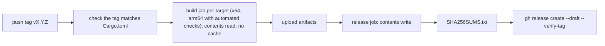

# Phase 1のビルド・配布用ツールの提案

- 作成日: 2026-11-01
- ステータス: 合意済み(2026-11-01。確認事項Q-1〜Q-4は、いずれも推奨のとおりに決定した)。承認された項目は、ADRに記録してから実装する
- 関連: [実装計画](0001-initial-implementation-plan.md)のPhase 1の作業9〜12と9章、[調査結果](../research/phase1-tooling.md)

## 目的

Phase 1の残りの作業のうち、次の4つで使う依存crateと道具を決める。いずれも依存の追加か、セキュリティ設定(ワークフロー)の変更にあたるため、メンテナーの承認が必要である(AGENTS.md)。

- 作業9: DLLの検索パスの制限。Windows APIを呼ぶcrateが必要になる。
- 作業10: Windowsリソースの埋め込み。
- 作業11: 依存crateのライセンス表記の生成。
- 作業12: リリースのワークフロー。

## 提案

| ID | 項目 | 提案 | 主な理由 |
| --- | --- | --- | --- |
| T-1 | Windowsリソースの埋め込み(作業10) | embed-resource 3.0.12を、ビルド時だけの依存として使う。自分で書いた`.rc`から、アイコン・バージョン情報・文字列表の序数1を埋め込む | 文字列表の序数1を素直に書ける。Linuxでの型チェックを壊さず、Windowsでは失敗を見逃さない。リソースを実行ファイルにだけ結び付ける |
| T-2 | ライセンス表記の生成(作業11) | cargo-about 0.9.3を、リリースのワークフローで`cargo install --locked --features cli --version 0.9.3 cargo-about`によりソースから入れる(2026-11-01に変更: 0.9.3は選んだ時点で公開から7日たっていなかったため、0.9.2にした。版はワークフローの`CARGO_ABOUT_VERSION`で決める。[incidents 0007](../incidents/0007-dependencies-inside-cooldown.md))。テキスト形式のテンプレートで`THIRD-PARTY-LICENSES.txt`を作る | 配布されているバイナリには署名がない。ソースからなら、crates.ioのチェックサムをCargoが確かめる |
| T-3 | リリースのワークフロー(作業12) | 下の「T-3の構成」のとおり | 書き込みの権限を、依存crateをビルドしないジョブだけに与える。第三者のActionを増やさない |
| T-4 | Windows APIを呼ぶcrate(作業6〜9) | `windows-sys` 0.61.2を、製品の依存に加える | [技術スタックの比較](../research/tech-stack.md)で採用済みで、スパイクでも使った。Microsoftの公式のcrate |
| T-5 | リリース用のタグの保護 | メンテナーが、`v*`のタグを作れる人を管理者に限るルールセットを設定する | ワークフローは、タグが付いたコミットの内容で動く。タグを作れる人を絞らないと、書き込み権限のある人が、リリースの権限で任意のワークフローを動かせる。非公開リポジトリでは、Pro以上の契約で設定できる |

### T-1の補足

- バージョン情報は、ビルドスクリプトが`CARGO_PKG_VERSION`からマクロで`.rc`に渡す。Cargo.tomlとの二重管理にしない。
- ビルドスクリプトは`cargo:rerun-if-changed`を、`.rc`・アイコン・マニフェストについて出す。
- WindowsのCIに、埋め込んだバージョン情報が実行ファイルにあることを確かめる検査を加える。
- 2026-11-02の実装: 版は、マクロ(`-D`)ではなく、ビルドスクリプトが`OUT_DIR`に作るヘッダー(`fm_version.h`)で`.rc`に渡した。二重管理にしない点は同じである。文字列の版を引用符ごとマクロで渡すと、`rc.exe`への引数と、`llvm-rc`の経路の前処理(cc)への引数とで、引用符の扱いを両方とも正しくする必要があるため。決定は[ADR-0020](../adr/0020-windows-resources-with-embed-resource.md)に記録した。
- 採用しなかった案: winresource(文字列表の扱い、Linuxでの場合分け、テスト用の実行ファイルにもリソースが入ること、リリースのタグがないこと)、コンパイル済みの`.res`をリポジトリに置く方法(バージョン情報の二重管理)。

### T-2の補足

- `about.toml`で、対象をWindowsの2つのターゲットに絞り、公開しないワークスペースのcrateを外す。
- `windows-sys`・`windows-link`のように、ライセンスのファイルが読み込まれないcrateには、`clarify`でファイルとSHA-256を明示する。
- 生成した結果に、SPDXの定型文の空欄(`<copyright holders>`など)が残っていたら失敗にする検査を加える。定型文への置き換えは、終了コードでは検出できないため。
- テンプレートは、本文を`{{{text}}}`で出力する。出力は`-o`でファイルに書く。

### T-3の構成

- 起動: `v[0-9]+.[0-9]+.[0-9]+`のタグのプッシュ。タグの名前は環境変数で渡し、厳密な正規表現で検査してから、`cargo metadata --no-deps --locked --offline`で得たバージョンと照合する。タグが付いたコミットが`origin/main`の祖先であることも確かめる(計画の7.2で、タグは`main`に付けるため。T-5はタグを作れる人を絞るだけで、付ける先のコミットは制限しない)。
- ビルドのジョブ: x64とarm64を、キャッシュを使わずに最初からビルドする([ADR-0017](../adr/0017-ci-build-cache-and-x64-spike-builds.md))。CIと同じ依存DLLの確認を行う。arm64は動作を保証しない対象で、CIではビルドしないため、GitHubがホストするarm64のランナー(`windows-11-arm`)でビルドし、同じジョブで自動の確認(依存DLLの確認と、動く場合はスモークテスト)を行う。arm64のビルドか自動の確認が失敗したら、ワークフローを失敗にする([ADR-0016](../adr/0016-arm64-without-guarantee.md)。2026-11-01に加えた)。arm64のホストでビルドするため、実装のときに、`windows-11-arm`のイメージで`rc.exe`(T-1)と`dumpbin.exe`(依存DLLの確認)が使えるかと、そのパスを確かめる。CIの依存DLLの確認は`bin\Hostx64\x64\dumpbin.exe`を探しており、そのままではarm64のホストで見つからないおそれがある(未確認)。[調査結果](../research/phase1-tooling.md)の「x64のホストの`rc.exe`を使う」という推測は、x64のホストでクロスビルドする前提のものである。`FlyingMicrowave.scr`に改名し、利用者向けの`README.txt`、`LICENSE.txt`、`THIRD-PARTY-LICENSES.txt`と一緒にzipにする。権限は読み取りだけ。
- リリースのジョブ: 成果物を受け取り、`SHA256SUMS.txt`を作る。同じタグのリリースや下書きがないことを`gh release view`で確かめてから、`gh release create --draft --verify-tag`で下書きを作る。リリースノートは`CHANGELOG.md`の該当する版の節から作る。書き込みの権限(`contents: write`)は、このジョブだけに与える。
- 公開: メンテナーが下書きを確かめて公開する(計画の7.2)。
- アーティファクト証明: 非公開のあいだは使えないため、入れない。公開したときに、リリースのジョブに加える。
- `cache-mode: none`: キャッシュのActionを使わないことで代える。ワークフローの検査ツールがまだ対応していないため。
- 公開したときの追加の検討: リリースの変更を禁止する設定(immutable releases)。
- 2026-11-01の実装(計画0001のD-21): 上の構成のうち、次の点を変えた。
  - 対象: まずx64のプレリリース(`vX.Y.Z-alpha.N`)だけを扱う。正式なリリースのタグは、arm64のビルドを加えるまで、検査のジョブで失敗にする。
  - バージョンの照合: `cargo metadata`ではなく、`scripts/prepare_release.py`がCargo.tomlのワークスペースのバージョンを読む。検査のジョブにはRustのツールチェーンを入れず、同じ値をより少ない手順で得られるため。
  - 成果物の受け渡し: `actions/download-artifact`ではなく、ランナーにある`gh run download`を使う(リリースのジョブに`actions: read`を加えた)。第三者のActionを増やさないためで、download-artifactのv8.0.2は、公開から7日たったことを確かめられなかった(タグに日付がなく、GitHubのAPIにも、この環境から接続できなかった)。
  - zipの中身: 利用者向けの`README.txt`は、正式なリリース(作業13)まで入れない。
  - 起動: タグのプッシュに加えて、既存のタグを指定した手動実行もできる(最初の下書きと、失敗したときのやり直しのため)。手動実行は`main`から起動したときだけ受け付ける。
  - 検査のスクリプト: タグのコミットではなく、ワークフローのコミットから実行する。タグのコミットは別の場所に取り出し、Cargo.toml・CHANGELOG.md・Cargo.lockをデータとして読む。スクリプトより前に付けたタグ(`v0.1.0-alpha.2`)も、手動実行で下書きを作れるようにするため。
  - コミットの固定: 検査したコミットのSHAをビルドのジョブに渡し、そのSHAからビルドする。下書きを作る前に、タグがまだ同じコミットを指すことを確かめる。
- 2026-11-02の実装(計画0001のD-23): arm64を加えた。
  - ビルドのジョブを、x64(`windows-2025`)とarm64(`windows-11-arm`)のマトリクスにした。各ランナーが、自分のアーキテクチャをネイティブにビルドしてテストする。
  - 自動の確認: テスト、依存DLLの確認、バージョン情報の確認。スモークテスト(作業14)はまだない。
  - `dumpbin.exe`は、ホストのアーキテクチャを問わない探し方(`bin\Host*\*\dumpbin.exe`)にした。`windows-11-arm`のイメージの資料(actions/partner-runner-images、イメージの版20260105.41.1)には、Visual Studio 2022とWindows SDKがあると書かれているが、MSVCのどの構成要素が入っているかは書かれていない。`rc.exe`と`dumpbin.exe`が使えるかは、v0.1.0のタグで初めて確かめる。
  - 正式なリリースのタグを受け付ける。プレリリースでもarm64をビルドする。
  - 下書きを作るジョブは、2つのzipがそろっていることを確かめてから`SHA256SUMS.txt`を作る。
  - リリースノートの最後に、arm64版は動作を保証しないことと、行った確認を書いた節を付ける(ADR-0016)。

## 確認事項(メンテナーの判断を待っているもの)

| ID | 内容 | 推奨 |
| --- | --- | --- |
| Q-1 | T-1〜T-4を承認するか | 承認する |
| Q-2 | T-5のタグの保護を設定できる契約か | 設定できるなら設定する。手順はエージェントが用意する |
| Q-3 | 設定画面の「Surprises」(隠し要素をまとめてオフにするスイッチ。[設定項目仕様](../design/settings.md)の`extras.surprises`)を残すか。残すと、隠し要素の中身は分からないが、存在は利用者に伝わる | 残す。利用者向けの文書には、このスイッチの説明も書かない |
| Q-4 | 英語の返答を自動で検出して書き直させるフック(`.claude/hooks/`。セキュリティ設定)を加えるか | まずAGENTS.mdの言語ルールで様子を見て、再発したら加える |

## 決定(2026-11-01)

確認事項Q-1〜Q-4は、いずれも推奨のとおりに決めた。

- Q-1: T-1〜T-4を承認した。
- Q-2: T-5のタグの保護は、契約で設定できるなら設定する。契約の確認と設定はメンテナーが行い、手順はエージェントが用意する。2026-11-01に、メンテナーがルールセット`release-tags`として設定した([オンボーディングの9.1](../development/onboarding.md#91-リポジトリのルールセット))。
- Q-3: 設定画面の「Surprises」のスイッチは残す。利用者が読む文書では、このスイッチも説明しない(AGENTS.mdの「ドキュメント」の規則に反映した)。
- Q-4: 英語の返答を検出するフックは、いまは加えない。AGENTS.mdの言語ルールで様子を見て、英語の返答が再発したら改めて検討する。その後、英語の表示が再発したため([incidents 0001](../incidents/0001-english-text-shown-to-maintainer.md))、2026-11-01にメンテナーの承認を得てフックを加えた([オンボーディングの6.3](../development/onboarding.md#63-フック))。

## 進め方

承認された項目から、作業10・11・12の順に、それぞれ別のPRで実装する。T-4は、作業6〜9のうち最初に実装する作業のPRで加える(計画の順では作業6の`/s`。Windows APIを呼ぶのはそこが最初になるため)。各PRには対応するADRを含め、本格的なレビュー(ADR-0014)を行う。
