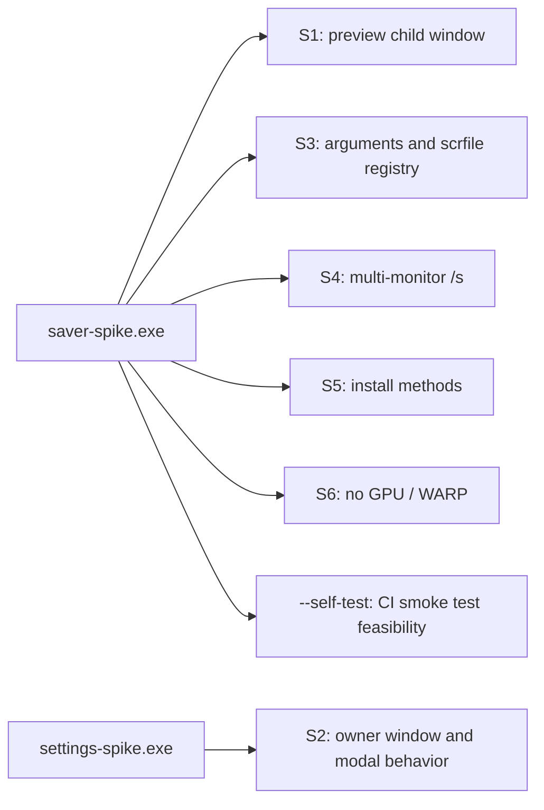

# 技術スパイク

- ステータス: 確認を終えた。4回の実機での確認の結果は[スパイクの結果](../docs/research/spike-results.md)に記録した。Phase 2の終わりに削除する([計画](../docs/plans/0001-initial-implementation-plan.md)のD-28)
- 関連: [Windowsスクリーンセーバーの仕様調査](../docs/research/windows-screensaver.md)(未確認事項とスパイクS1〜S6)、[アーキテクチャ](../docs/design/architecture.md)、[実装計画](../docs/plans/0001-initial-implementation-plan.md)のPhase 0

## このディレクトリについて

- 位置づけ: Phase 0の技術スパイクで、Windows実機でしか確かめられない不確実性を先に潰すための使い捨てプログラムである。製品コードではない。
- ワークスペースとの関係: ルートの`Cargo.toml`は`spikes/`を`exclude`している。各スパイクは空の`[workspace]`表を持つ独立したワークスペースで、`Cargo.lock`も個別に持つ。製品コード(`crates/`)からスパイクを参照しない。
- 依存crate: `winit =0.30.13`、`wgpu =30.0.1`、`pollster =1.0.1`、`windows-sys =0.61.2`、`eframe =0.37.0`、saver-spikeの`log =0.4.34`(2026-11-01に追加。wgpuが`log`クレートだけに出すエラーの理由をログファイルに書くため。名前の衝突を避けて`log_crate`という名前で取り込む)。すべてバージョンを完全に固定している。これ以外の直接依存は追加していない。
- 扱い: 設定画面のスパイクはPhase 2の設定画面の参考になるため、Phase 2の終わりまで残し、そのときに削除する(計画のD-28)。
- 結果の記録先: 確認した結果は[`docs/research/spike-results.md`](../docs/research/spike-results.md)に記録する。結果の表のテンプレートと、CIのランナーで得た観察が既にある。

| ディレクトリ | 実行ファイル | 確認する項目 |
| --- | --- | --- |
| `spikes/saver-spike/` | `saver-spike.exe` | S1(プレビューの子ウィンドウ)、S3(実際の引数)、S4(複数モニタ)、S5(インストール方法。確認用の実行ファイルとして使う)、S6(GPUのない環境)、CIでのスモークテストの可否(`--self-test`) |
| `spikes/settings-spike/` | `settings-spike.exe` | S2(eframeの設定ウィンドウをオーナーに対してモーダル相当にできるか) |



## ビルド方法

前提: Windows 11、Rustのツールチェーン管理ツール(rustup)、Visual Studio Build Tools(MSVCのリンカ)。リポジトリのルートにある`rust-toolchain.toml`が各スパイクのディレクトリでも適用される。ツールチェーンが未導入なら、リポジトリのルートで`rustup toolchain install`を実行する。

x64の場合:

```text
cd spikes\saver-spike
cargo build --release --locked
cd ..\settings-spike
cargo build --release --locked
```

- 成果物: `spikes\saver-spike\target\release\saver-spike.exe`、`spikes\settings-spike\target\release\settings-spike.exe`
- arm64のWindowsで確認する場合: `cargo build --release --locked --target aarch64-pc-windows-msvc`(成果物は`target\aarch64-pc-windows-msvc\release\`の下)
- CI: Windowsランナーでのビルドと成果物(artifact)の公開は、下の「CIのビルドと成果物」を参照。
- Linuxで行えること: ビルドはWindowsでのみ行う(Linuxでは`Windows only`と表示するだけの実行ファイルになる)。引数の解析などWindowsに依存しない部分の単体テストは、各スパイクのディレクトリで`cargo test`により実行できる。

## CIのビルドと成果物

- ワークフロー: `.github/workflows/spikes.yml`(ADR-0017)。
  - PR: `spikes/`を変更するPR(このワークフロー自身の変更を含む)では、ビルドが通るかを確かめるため、両スパイクをWindowsランナー(`windows-2025`)でx64向けにビルドする。ビルドのキャッシュを使い、成果物は公開しない。
  - 手動実行(`workflow_dispatch`): x64向けに、キャッシュを使わずに最初からビルドし、成果物を公開する。arm64向けにはビルドしない(ADR-0016・0017)。arm64の端末で確かめる場合は、上の「ビルド方法」のとおり、その端末でビルドする。GitHubのActionsタブで「Spikes」を選び、「Run workflow」で対象のブランチを指定して実行する。
- 成果物: 手動実行のときだけ作られる、`spikes-x86_64-pc-windows-msvc`の1つ。`saver-spike.exe`・`saver-spike.scr`・`settings-spike.exe`・`settings-spike.scr`・`README.md`が入る。`.scr`は`.exe`と同じファイルを拡張子だけ変えて同梱しているため、後述の「.scrの作成とインストール」の手順1の名前の変更は不要である(任意のフォルダへの展開は必要)。保持期間は14日で、過ぎると取得できなくなる。同梱の`README.md`はこのファイルのコピーなので、リポジトリ内への相対リンクはたどれない。
- 取得: 手動実行が終わったら、その実行の画面のArtifactsから`spikes-x86_64-pc-windows-msvc`をダウンロードして展開する。
- 自己テスト: x64のビルドのあとに、ランナー上で`--self-test`を実行する。確かめるのはウィンドウの作成とWARPでの描画だけで、失敗してもビルドは止めない(後述の「自己テスト」)。
- スモークテストの可否確認: CIの自己テストで確かめるのは、ウィンドウの作成とWARPでの描画だけである。`/s`への入力の注入、テスト用の親ウィンドウを使った`/p`、不正な引数、プロセスの残留は、Phase 1でスモークテストを作るときに確かめる(計画のPhase 1の作業14)。

成果物を実行する前の確認:

- コミット: ワークフローの実行画面に表示されるコミットが、レビュー済みのコミットと一致することを確認する。ブランチに後からコミットが追加されると、成果物は別のビルドになる。
- 署名: 成果物は署名されていない実行ファイルである。SmartScreenなどの扱いは、後述の「共通の準備」の「署名がない実行ファイルの扱い」を参照。
- 入手先: 成果物は手動実行でしか作られない(実行には書き込み権限が必要)。リポジトリを公開したあとも、本リポジトリの手動実行以外から入手した実行ファイルは実行しない。

## 共通の準備

- 署名がない実行ファイルの扱い: ビルドした実行ファイルは署名されていない。SmartScreenの警告が出る場合がある。Smart App Controlが強制モードの環境では実行自体がブロックされうる([仕様調査](../docs/research/windows-screensaver.md#配布に関わるwindowsの保護機能))。ブロックされた場合は、その事実と環境(Smart App Controlの状態)を結果に記録し、評価モードまたはオフの環境で続ける。
- ログ: 両方のスパイクが`%TEMP%\flying-microwave-spike.log`に追記する。1行の形式は`<UNIXミリ秒> +<起動からのミリ秒>ms pid=<PID> <プログラム名>: <内容>`である。各試験の前にファイルを削除し、試験中は`Get-Content $env:TEMP\flying-microwave-spike.log -Wait`で追いかけると分かりやすい。
- ログを記録に貼るときの注意: ログにはユーザー名を含むパスが出る。リポジトリは将来公開するため、`docs/research/spike-results.md`にはユーザー名などの個人を特定できる情報を載せず、`C:\Users\<user>\`のように置き換える。
- 両方のスパイクが起動時に必ず記録するもの: 引数(`std::env::args`)、実行ファイルのパス、`SetDefaultDllDirectories(LOAD_LIBRARY_SEARCH_SYSTEM32)`の結果(SEC-1)、採用した起動モード。
- saver-spikeだけが記録・参照するもの: `reg query "HKCR\scrfile\shell" /s`の出力(S3)と、フラグファイルの有無(後述)。settings-spikeは`reg query`を実行せず、フラグファイルも読まない。
- `reg query`の実行方法: saver-spikeは、`GetSystemDirectoryW`で得たシステムディレクトリの`reg.exe`を、シェルを介さず、コンソールウィンドウを出さずに実行する(環境変数`SystemRoot`は使わない)。`GetSystemDirectoryW`が失敗した場合は、エラーをログに書いて実行を省略する。
- `reg query`の出力の文字化け: `reg.exe`はパイプへOEMコードページで出力するため、日本語Windowsの`(既定)`のような非ASCIIの文字は、ログでは文字化けすることがある。スパイクは変換しない。確認したい動詞とコマンドはASCIIなので、通常は読める。必要なら、S3の手順1のようにコマンドプロンプトで同じコマンドを実行して控える。
- `/s`・`/p`ではエラーダイアログを表示しない。失敗はログにだけ書く。

saver-spikeの起動モード:

| 引数 | 動作 |
| --- | --- |
| `/s` | 全モニタに全画面ウィンドウを作り、暗い色がゆっくり変わる背景の上に、ゆっくり動く小さな四角を描く(描画できたことを目で確かめるための目印)。入力で終了する。GPUの初期化が15秒以内に終わらなければ、ログに`GPU init watchdog fired after 15 s; exiting`と書いて終了コード5で終了する |
| `/p <HWND>` | 指定ウィンドウの子ウィンドウとして描く。HWNDが無効なら終了コード2で終了する |
| `/c` | メッセージボックス`Settings are tested by settings-spike.`を表示して終了する |
| `--self-test` | 320x240のウィンドウでWARPを使って30フレームを描き、終了する。終了コード0=成功、1=失敗、3=20秒のタイムアウト |
| (なし)、そのほか | メッセージボックス`saver-spike: unrecognized arguments (see log).`を表示して終了する |

引数は最初の1つだけがモードを決める。大文字小文字を区別せず、`/`と`-`のどちらの接頭辞も受け付ける。HWNDは符号なし10進数で、`:`の後ろか次の引数で渡す。

実行ファイルと同じフォルダに置くフラグファイル(中身は空でよい。`.scr`としてWindowsが起動した場合にも効く):

| ファイル | 効果 |
| --- | --- |
| `force-fallback.flag` | wgpuにフォールバックアダプタ(DX12ではWARP)を要求する(S6) |
| `backend-vulkan.flag` | DX12の代わりにVulkanを使う(S6の追加確認) |

どちらも置かない場合は、省電力(LowPower)優先のDX12で、DX12のシェーダーコンパイラは`Fxc`に固定される(SEC-2)。

`/s`の終了条件(スパイク用の簡易版。[アーキテクチャ](../docs/design/architecture.md#入力と終了判定)の規則に従う):

- 猶予時間: ウィンドウとGPUの初期化が終わってから500ミリ秒。この間に無視するのは、カーソルの移動とフォーカスの変化だけである。
- 猶予時間内のカーソルの移動: 終了せず、基準位置(`GetCursorPos`で得るスクリーン座標)を、そのときの位置に取り直す。猶予時間が終わった時点でも基準位置を取り直す。
- 猶予時間内でも終了するもの: 合成でないキーの押下、マウスボタンの押下、ホイール、タッチ、ウィンドウを閉じる要求は、猶予時間の内外を問わずすぐに終了する。キーの解放と合成されたキーイベントは終了の原因にならない。
- 猶予時間のあとのカーソルの移動: 基準位置から物理16ピクセル以上動くと終了する。
- フォーカスの変化: 記録するだけで、終了の原因にはしない(S4でフォーカスの挙動を測るため。アーキテクチャの「アプリ全体の非アクティブ化」による終了は、スパイクでは行わない)。

## 画面が覆われたままになったときの対処

`/s`は全モニタを覆う。試験中に画面が覆われたまま戻らなくなったときは、次の順で試す。

1. 通常の終了: キーを押す、マウスを16ピクセル以上動かす。マウスボタンの押下、ホイール、タッチでも終了する。
2. 反応しない場合: Ctrl+Alt+Delを押してタスクマネージャーを開き、`saver-spike.exe`を終了する。`.scr`として起動した場合のプロセス名は`saver-spike.scr`である。
3. 操作できない場合: 別のセッション(リモートデスクトップや、別のPCからのリモート接続など)から、`taskkill /im saver-spike.exe /f`を実行する。`.scr`として起動した場合は`taskkill /im saver-spike.scr /f`。
4. GPUの初期化が止まった場合: saver-spikeの`/s`は、GPUの初期化を始めてから15秒たっても終わらなければ、ログに`GPU init watchdog fired after 15 s; exiting`と書いて、終了コード5で自動的に終了する。初期化が失敗として返った場合は、黒い全画面のまま入力を待ち、入力で終了する(W-9)。初期化が終わったあとの描画の停止は、このウォッチドッグの対象外である。

## .scrの作成とインストール(S1・S3・S5・S2で共通)

Windowsはスクリーンセーバーとして`.scr`拡張子のファイルだけを扱う。ビルドした`.exe`をコピーして拡張子を変えて使う。エクスプローラーの「表示」で、ファイル名の拡張子を表示しておく。

1. 作成: `saver-spike.exe`を`C:\spike\`などの任意のフォルダにコピーし、`saver-spike.scr`に名前を変更する。S2では`settings-spike.exe`も同様に`settings-spike.scr`にする。
2. 右クリックのインストール: `.scr`を右クリックして「インストール」を選ぶ。Windows 11では「その他のオプションを確認」で従来のメニューを出す必要がある場合がある。
3. `System32`への配置: 管理者権限で`.scr`を`C:\Windows\System32`にコピーする。右クリックのインストールとの比較用で、試験が終わったら管理者権限で削除する。
4. コマンドからのインストール: `rundll32.exe desk.cpl,InstallScreenSaver C:\spike\saver-spike.scr`

スクリーンセーバーの設定画面は、設定アプリの「個人用設定」の「ロック画面」にある「スクリーン セーバー」から開くか、`control desk.cpl,,1`を実行して開く。現在の選択は次のコマンドで確認できる。

```text
reg query "HKCU\Control Panel\Desktop" /v SCRNSAVE.EXE
```

S1・S3・S2は、上のいずれかの方法でインストールした状態で行う。方法ごとの違いの確認はS5で行う。

## S1: プレビューの子ウィンドウ

目的: winitの子ウィンドウ(`with_parent_window`)とwgpuのサーフェスが、設定画面の小さなプレビュー枠の中で描画できるか、親が閉じたときに終了できるかを確認する。上の「.scrの作成とインストール」の方法2か3で`saver-spike.scr`をインストールした状態で行う。

手順と観察:

1. ログを削除し、スクリーンセーバーの設定画面を開いて`saver-spike`を選ぶ。
2. プレビュー枠の中に、茶色がかった小さな四角(枠の短い辺の約8分の1)が見え、ゆっくり動くか。背景は暗い色で、目ではほぼ黒に見える(約12秒周期でわずかに変わる)。四角が見えれば、描画できている。四角が見えない場合は、ログの`marker not drawn`の行で理由を確かめる。描画が枠全体を覆っているか、枠からはみ出したり、デスクトップや別のウィンドウに描かれたりしていないか。白や黒の点滅、ちらつきがないか。
3. ログの`parent client rectangle`と`child window created`の行を比べる。親のクライアント領域と子ウィンドウの`inner_size`・`scale_factor`が一致しているか。表示スケール(100%・125%・150%など)を変えて繰り返し、枠の中に収まっているかを確認する。
4. ログの`adapter chosen`の行(アダプタ情報)、`surface configured`の行(フォーマット・表示モード)、`frame N presented`の行を確認する。エラーや`setup FAILED`が出ていないか。
5. プレビューの表示中に、一覧で別のスクリーンセーバー(「なし」でもよい)に切り替える。`exiting with code 0`で終わることを確認する。終了の経路は2つ以上ありうるため、ログに次のどれが出たかを控える。
   - 親が無効になった: `preview: parent HWND ... is no longer a window`と`EXIT requested: parent window is gone`(親の確認は500ミリ秒ごと)。
   - `CloseRequested`: `preview: WindowEvent::CloseRequested`と`EXIT requested: close requested`。ダイアログがプレビューのウィンドウに`WM_CLOSE`を送る場合に出ると想定している。
   - 自ウィンドウの破棄: `preview: WindowEvent::Destroyed`と`EXIT requested: own window destroyed`。
6. タスクマネージャー、またはPowerShellの`Get-Process saver-spike`で、`saver-spike`のプロセスが残っていないことを確認する。
7. プレビューの表示中に設定画面を閉じる(×ボタン、キャンセル、OK)場合も、同様に終了するか、プロセスが残らないかを確認する。終了の経路(手順5の3種類のどれか)も控える。
8. 無効なHWNDの動作: コマンドプロンプトで`saver-spike.exe /p 1`を実行する。ログに`not a valid window`が出て、終了コードが2になることを確認する(`start /wait saver-spike.exe /p 1`のあとに`echo %ERRORLEVEL%`)。
9. 設定画面でプレビューを表示したまま、キーやマウスの操作をして、スクリーンセーバー側が入力を無視する(ログに`input ignored`が出るだけで終了しない)ことを確認する。

記録するもの: 描画できたか、枠を覆う大きさになっているか(スケールごと)、親が閉じたときに終了した時間(ログのタイムスタンプ)と終了の経路(親が無効になった、`CloseRequested`、自ウィンドウの破棄のどれか)、プロセスが残るか、表示の不具合。

## S2: eframeの設定ウィンドウをオーナーに対してモーダル相当にする

目的: eframe 0.37.0にはネイティブのオーナーウィンドウを指定する手段がないため、ウィンドウの生成後にHWNDを取得し、Win32 APIでオーナーの設定とオーナーの無効化ができるかを確認する(ADR-0003)。

settings-spikeの動作:

- 引数なし: オーナーなしの通常のウィンドウとして開く。
- `/c`(HWNDなし): 前面のウィンドウ(`GetForegroundWindow()`)が有効なウィンドウならオーナーにする。
- `/c:<HWND>`または`/c <HWND>`: そのウィンドウが有効ならオーナーにする(HWNDは符号なし10進数)。
- `/s`・`/p`: 何も表示せず静かに終了する(選択しても邪魔にならないようにするため)。
- 画面: スライダー`Number of microwaves`(1〜50)、チェックボックス`Show clock on display`、ボタン`OK`・`Cancel`。どちらのボタンも閉じるだけで、何も保存しない。
- オーナーがあるときの処理: ウィンドウの生成直後に`SetWindowLongPtrW(GWLP_HWNDPARENT)`でオーナーを設定し、`EnableWindow(owner, FALSE)`でオーナーを無効にする。ウィンドウが消える前(OK・Cancel・×ボタン)に`EnableWindow(owner, TRUE)`と`SetForegroundWindow(owner)`を呼ぶ。各手順の戻り値はログに出る。
- フォント: `C:\Windows\Fonts\segoeui.ttf`(なければ`arial.ttf`)を実行時に読み込む。egui標準の同梱フォントはライセンスの理由で使わない。読み込めなければ文字が四角で表示される。

手順A: 実際の流れ(設定画面の「設定」ボタンから)。Windowsは選択中の`.scr`を`/c`付き(HWNDがどう付くかはS3で確認する)で起動するため、この流れを試すには、選択中の`.scr`がsettings-spikeである必要がある。

1. 「.scrの作成とインストール」の方法で`settings-spike.scr`をインストールする(必要なら`System32`への配置でも試す)。
2. スクリーンセーバーの設定画面で`settings-spike`を選ぶ。プレビュー枠は何も描かれない(`/p`では静かに終了するため)。
3. 「設定」ボタンを押す。settings-spikeの設定ウィンドウが開くことを確認し、次を観察する。
   - 設定画面(オーナー)をクリックしたりキー入力したりしても反応せず、設定ウィンドウが前面に出る(モーダル相当)か。
   - 設定ウィンドウがオーナーより手前に出続けるか。タスクバーにボタンが出るか。Alt+Tabの動作はどうか。
   - 設定ウィンドウに文字が正しく表示されるか(フォントの読み込み)。スライダーとチェックボックスを操作できるか。
   - 表示スケール(125%・150%など)での見た目と大きさ。
4. 次のそれぞれの終了方法で、設定画面が再び操作できるようになり、前面に戻るかを確認する: OKボタン、Cancelボタン、×ボタン、Alt+F4。
5. ログの`owner:`と`release_owner`の行で、`SetWindowLongPtrW`・`GetWindow(GW_OWNER)`・`EnableWindow`・`IsWindowEnabled`・`SetForegroundWindow`の結果を記録する。`/c`に渡された引数の形式(HWNDが付くか)は、ログの`std::env::args`の行で分かる。

手順B: 手動での起動(コマンドプロンプトまたはPowerShellから)。

1. 引数なし: `settings-spike.exe`を実行し、オーナーなしで開くことを確認する。
2. 前面のウィンドウをオーナーにする: `settings-spike.exe /c`を実行する。コマンドプロンプト自身が前面のウィンドウになるため、設定ウィンドウを閉じるまでコマンドプロンプトは操作できなくなるはずである(ログの`GetForegroundWindow()`の値を確認する)。
3. HWNDを指定する: メモ帳を起動し(`start notepad`)、PowerShellで`(Get-Process notepad).MainWindowHandle`を実行して得た値(10進数)を使い、`settings-spike.exe /c:<値>`を実行する。メモ帳に入力できなくなり、閉じると戻ることを確認する。
4. 無効なHWNDを指定する: `settings-spike.exe /c:1`を実行する。ログに`not a valid window`が出て、オーナーなしで開くことを確認する。
5. 開いている最中に設定ウィンドウのプロセスを強制終了した場合、オーナーが無効のまま残る(タスクマネージャーで終了するか、ウィンドウを閉じて回復する)。これは強制終了に限った問題で、パニック時はフックが有効に戻す。

記録するもの: オーナーの設定が成功したか(`GetWindow(GW_OWNER)`の値)、オーナーの無効化と再有効化が効いたか、終了方法ごとにフォーカスが戻ったか、設定ウィンドウが他のウィンドウの背後に回る不具合の有無、フォントの表示、`/c`で渡された引数の形式。不成立の場合は、どの手順でどう失敗したかを記録する(ADR-0003の見直し条件になる)。

## S3: Windowsが実際に渡す引数

目的: Windowsが`.scr`に渡す引数の形式(`/c:HWND`、大文字小文字、ハイフンなど)と、右クリックメニュー(テスト・構成・インストール)の動作定義を記録する。

準備: 上の「.scrの作成とインストール」の方法で`saver-spike.scr`をインストールし、ログを削除する。

手順と観察:

1. コマンドプロンプトで`reg query "HKCR\scrfile\shell" /s`を実行し、結果を控える(スパイクもログに同じ内容を書くが、非ASCIIの文字は文字化けすることがある)。
2. `saver-spike.scr`をダブルクリックする。ログの`std::env::args`の行で、引数なしか、何か渡されたかを確認する(引数なしなら`unrecognized arguments`のメッセージボックスが出る)。
3. エクスプローラーで`saver-spike.scr`を右クリックし、Windows 11では「その他のオプションを確認」を選んで従来のメニューを出す。表示される項目(テスト、構成、インストールなど)を控え、それぞれを実行して、ログの`std::env::args`の行に出る引数を記録する。
4. スクリーンセーバーの設定画面で`saver-spike`を選び、「プレビュー」ボタン(全画面の`/s`が想定される)と「設定」ボタン(`/c`またはHWND付きの形式が想定される)を押す。ログの引数を記録する。「設定」ではメッセージボックスが出るので閉じる。
5. 設定画面を開いたままにして、小さなプレビュー枠用に`/p <HWND>`が渡されることを確認する(ログに`/p`の起動が繰り返し出る)。
6. 待ち時間を1分に設定して放置し、Windowsによる自動起動の引数(想定は`/s`)を記録する。

記録するもの: 起動の契機ごとの`argv`(大文字小文字、`/`か`-`か、`:`で連結されているか、HWNDが別引数か)、`HKCR\scrfile\shell`の内容、スパイクのモード判定(`decision: mode = ...`)が期待どおりだったか。

## S4: 複数モニタでの全画面表示

目的: 複数モニタ(DPIが混在する構成を含む)での全画面表示、最前面化、カーソルの非表示、複数ウィンドウを作ったときのフォーカスイベントの順序、起動直後に意図せず終了しないかを確認する。2台以上のモニタがある環境で行う。可能なら、表示スケールが異なる組み合わせ(例: 100%と150%)と、モニタの位置関係を変えた構成(左右・上下)でも行う。

手順と観察:

1. ログを削除し、`saver-spike.scr`をインストールしたうえで、コマンドプロンプトから`saver-spike.exe /s`を実行する。または設定画面の「プレビュー」ボタンを使う。
2. すべてのモニタが、タスクバーを含めて覆われているか。他のウィンドウより手前に出ているか(最前面化)。マウスカーソルが見えないか。モニタごとに、茶色がかった小さな四角(画面の短い辺の約8分の1)が見え、ゆっくり動くか。四角が見えれば、そのモニタで描画できている。背景は暗い色で、点滅しないか。
3. 何も操作しない状態で、500ミリ秒以降に勝手に終了しないか。ログの`grace period ended; cursor reference re-taken`の行(猶予時間の終了と基準位置の取り直し)と、`Focused`の行(ウィンドウ番号・どのウィンドウにフォーカスがあるか)の順序を記録する。起動直後にフォーカスが次々に移り、アプリのどのウィンドウにもフォーカスがない瞬間があるかも確認する(この状態は終了の原因にしていない)。
4. ログの`KeyboardInput`の行で、`is_synthetic=true`のイベントが起動時に出ているかを確認する(フォーカスの移動に伴う合成イベントの想定)。あわせて、`is_synthetic=false`の`AltRight`の押下が起動直後に出ていないことを確認する。2回目の実機での確認では、winitの全画面の指定(`with_fullscreen`)が入力を合成して、この押下で毎回終了した。いまは全画面の指定を使わず、モニタを覆う枠のないウィンドウを作り、`SetForegroundWindow`で最初のウィンドウを前面に出す(ログに`SetForegroundWindow(window[0]) = true`)。`false`が出た場合は、キーボードの入力がスパイクのウィンドウに届かないことがあるため、キーによる終了の確認は無効として記録する(マウスによる終了は、前面かどうかによらず確かめられる)。
5. 終了条件を1つずつ試す(試験のたびに起動し直す): キーを押す、マウスボタンを押す、ホイールを回す、タッチ操作(対応する環境のみ)、マウスを16ピクセル以上動かす。どれでも終了し、ログの`EXIT requested`の行に理由が出ることを確認する。マウスを少し(数ピクセル)だけ動かしても終了しないことを確認する。起動後500ミリ秒以内については、カーソルの移動だけが無視され(ログに`cursor move ignored (grace period); reference re-based`。最初の20回のCursorMovedについてだけ記録される)、キーの押下、マウスボタンの押下、ホイール、タッチは猶予時間内でもすぐ終了する(ログに`ends the screensaver (grace period running, ...)`)ことを確認する。起動直後にキーを押して、すぐに終了できるかも試す。
6. ログの`monitor[N]`の行(名前・位置・サイズ・拡大率)と、`window[N] created`の行(`inner_size`・`outer_position`・`scale_factor`)を比べ、各ウィンドウがモニタ全体を覆う位置と大きさになっているかを確認する。wgpuやwinitの警告・エラーは、`[WARN ...]`・`[ERROR ...]`で始まる行に出る。DPIが混在する構成で、`ScaleFactorChanged`や`Resized`が出たかも記録する。
7. `CursorMoved`の行の`window_position`と`screen_position`(`GetCursorPos`の値)を見比べる。モニタをまたいだ移動でも、スクリーン座標の物理ピクセルで判定できているかを確認する。
8. `window[N]: ... fps`の行(10秒ごと)で、モニタごとのフレームレートを記録する。複数モニタで描画が詰まらないか。
9. Windowsの待ち時間による自動起動でも同様に確認する(S3の手順6)。

記録するもの: モニタ構成(台数・解像度・拡大率・配置)、`Focused`イベントの順序、合成キーイベントの有無、起動直後に意図せず終了したか、終了条件ごとの結果、最前面化・カーソル非表示・タスクバーの被覆の可否。

## S5: インストール方法と一覧への表示

目的: インストールの方法ごとに、一覧への表示、選択状態(`SCRNSAVE.EXE`)、名前の扱いがどうなるかを確認する。

準備: ログを削除する。上の「.scrの作成とインストール」の方法と、設定画面の開き方、`SCRNSAVE.EXE`の確認コマンドを使う。

手順と観察(それぞれの方法のあと、一覧に出るか、選ぶとプレビュー枠が描かれるか、`SCRNSAVE.EXE`の値がどうなるかを記録する):

1. 右クリックのインストール: 方法2で`saver-spike.scr`をインストールする。メニューのどこに「インストール」が出るかも記録する。
2. `System32`への配置: 方法3で配置し、設定画面を開き直して一覧を確認する。右クリックのインストールの結果と、一覧への出方を比べる。
3. 任意のフォルダ: `C:\spike`のような任意のフォルダに置いただけの状態で、設定画面の一覧に出るかを確認する。
4. コマンドからのインストール: 方法4を実行し、結果を確認する。
5. 名前の扱い: 空白を含む名前(`Flying Microwave.scr`)と日本語を含む名前(`空飛ぶ電子レンジ.scr`)にコピーして、それぞれ右クリックのインストールを試す。一覧の表示名(ファイル名がそのまま使われるか)、`SCRNSAVE.EXE`の値、プレビューが動くか、`/s`が動くかを確認する。ログの`std::env::current_exe`の行で、パスが正しく渡されているか(空白・日本語・引用符)を確認する。
6. 別のものを選んだあと: `System32`以外に置いた`.scr`を選んだあとで別のスクリーンセーバー(「なし」でもよい)を選び、先に選んだ項目が一覧に残るかを確認する。設定画面を閉じて開き直しても残るか、サインアウトまたは再起動後も残るかも記録する。

記録するもの: 方法ごとの結果の表(一覧に出たか、`SCRNSAVE.EXE`の値、表示名、プレビュー・`/s`・`/c`が動いたか)、Windows 11の右クリックメニューでの「インストール」の位置、`System32`以外での一覧への残り方。

## S6: GPUのない環境

目的: GPUが使えない環境(仮想マシンなど)で、wgpuがどう動くか、DX12のWARP(ソフトウェア描画)へのフォールバックが使えるかを確認する。

手順と観察:

1. 通常の環境で、`saver-spike.exe`と同じフォルダに空の`force-fallback.flag`を作る(`type nul > force-fallback.flag`)。ログを削除して`saver-spike.exe /s`を実行する。ログの`adapter chosen`の行を確認する。WARPなら、名前が`Microsoft Basic Render Driver`、デバイスの種類が`Cpu`、バックエンドが`Dx12`のはずである。描画が動くか、フレームレートはどうか(`fps`の行)を記録する。
2. GPUのない仮想マシン(GPU仮想化やパススルーを使わない設定)にWindows 11を用意し、`saver-spike.exe`をコピーして、フラグファイルなしで`/s`を実行する。次を確認する。
   - アダプタが選ばれたか(`adapter chosen`の行)。選ばれたなら何か(WARPか仮想ディスプレイアダプタか)。
   - 選ばれなかった場合のログの内容(`GPU initialization FAILED`の行)。そのとき、黒い全画面のまま入力を待ち、キー入力で終了するか(W-9)。初期化が15秒以内に終わらない場合は、ウォッチドッグのログ(`GPU init watchdog fired after 15 s; exiting`)が出て、終了コード5で終了するか。
3. 同じ仮想マシンで`force-fallback.flag`を置いて、1と同じことを確認する。
4. 追加の確認: `backend-vulkan.flag`だけを置いて実行し、Vulkanが使えない環境でどう失敗するか(黒い画面のまま入力待ちになるか)を確認する。確認が終わったらフラグファイルを削除する。
5. `/p`でも、同じ環境でプレビューの動作とログを確認する(初期化に失敗したときは静かに終了する想定)。

記録するもの: 環境(物理か仮想か、仮想化ソフト、GPUの有無)、選ばれたアダプタの情報(`AdapterInfo`)、DX12のWARPで描画できたか、描画できないときの失敗の仕方(`/s`で黒い画面のまま入力待ちになったか)。

## 自己テスト(`--self-test`): CIでのスモークテストの可否

目的: GitHubのWindowsランナーのようにGPUのない非対話に近い環境で、ウィンドウを作り、WARPで描画し、終了コードで結果を返せるかを確認する(実装計画のPhase 0の作業8)。

手動での実行(ローカルのWindowsで):

```text
start /wait saver-spike.exe --self-test
echo %ERRORLEVEL%
```

PowerShellでは、`$p = Start-Process .\saver-spike.exe -ArgumentList '--self-test' -Wait -PassThru; $p.ExitCode`で終了コードを取得できる。

- 成功: 終了コード0、ログに`SELF-TEST OK`が出る。
- 失敗: 終了コード1、ログに`SELF-TEST FAILED: ...`が出る。
- タイムアウト: 30フレームを20秒以内に描けなかった場合は終了コード3で、ログに`SELF-TEST FAILED: timeout ...`が出る。

このモードは常にWARP(DX12)を要求し、フラグファイルは見ない。

CIでの実行: `.github/workflows/spikes.yml`が、x64のビルドのあとにホストランナー上でこの自己テストを実行し、ログをワークフローの出力に表示する。確かめるのはウィンドウの作成とWARPでの描画だけで、入力の注入や`/p`の親ウィンドウなどは確かめない。それらは、Phase 1でスモークテストを作るときに確かめる。CIで得た結果は`docs/research/spike-results.md`の「CIでの観察」に記録する。ローカルのWindowsで成功したかも、同じファイルに記録する。

## 後片付け

- インストールしたスクリーンセーバーを解除する: 設定画面で別のスクリーンセーバー(または「なし」)を選ぶ。
- ファイルを削除する: `System32`に置いた`.scr`(管理者権限が必要)、`C:\spike`などに置いた`.scr`、`.flag`ファイル。
- `reg query "HKCU\Control Panel\Desktop" /v SCRNSAVE.EXE`で、試験前の値に戻っていることを確認する。
